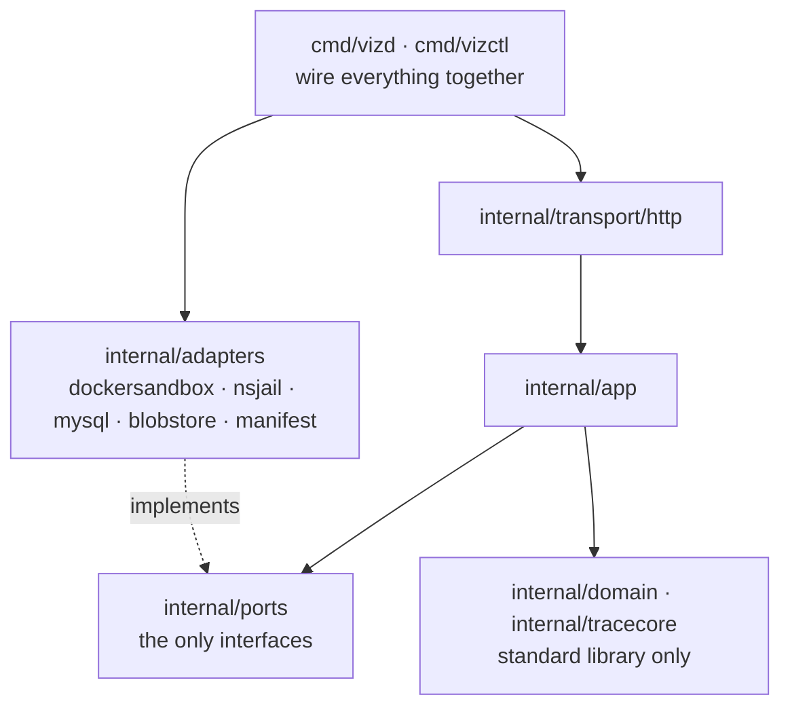
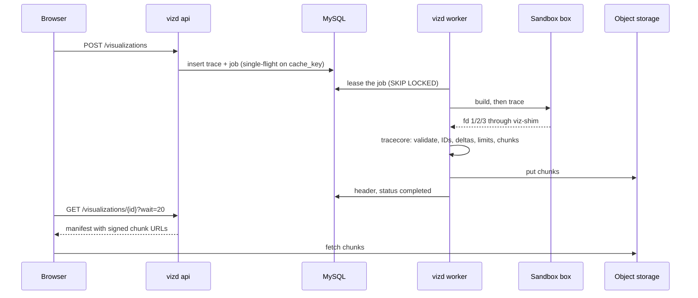

# Backend overview

The backend is one Go module, `backend/`. It holds two binaries and a shim, the tracers that run inside the sandbox, and the contracts both halves of the product are generated from. Spec §7 is the architecture; this page maps it onto the code as it stands on Sat 24 Oct 2026 and says what is built. The rules for changing it are in [AGENTS.md](../../../AGENTS.md).

## Binaries

| Binary | Where | Job | Built so far |
|---|---|---|---|
| `vizd` | `cmd/vizd` | The service, with roles `api`, `worker` or `all` (D3) | Config, the sandbox choice check, the MySQL pool, `vizd migrate`, `/healthz` and `/readyz`, the visualization API under `api` and `all`, and the job worker under `worker` and `all` |
| `vizctl` | `cmd/vizctl` | The developer CLI (§7.10) | `trace` runs one program end to end in the Docker dev sandbox; `validate` checks a trace file. `diff` isn't built |
| `viz-shim` | `cmd/viz-shim` | Runs inside every runner image and carries fd 1, 2 and 3 out of the sandbox as one framed stream | Done |

## Packages

Dependencies point one way: `transport → app → domain`. `domain` and `tracecore` import only the standard library, plus the generated types. Adapters implement ports, and only the binaries wire them in (§7.4).

| Package | What it holds | Status |
|---|---|---|
| `internal/domain` | Sentinel errors, the language `Manifest`, `ChunkKey` and `TailKey`, request limits and checks, the cache key, `viz_` and `trc_` IDs, trace states, and the API's product rules: quota, retention, which traces rerun | Grows with each task |
| `internal/tracecore` | Wire stream in, trace out: stable IDs, keyframes and deltas, limits, chunks | Done (BE-04 §2). See [tracing](tracing.md) |
| `internal/app` | Use cases: create, get and wait, run a trace job | `Worker` runs trace jobs (BE-05); `Build`, the build step, is shared with `vizctl`. `Visualizations` creates, gets and waits, deletes and cleans up (BE-06), and shares (BE-12). See [the worker](#the-worker) and [the API](#the-api) |
| `internal/ports` | `Sandbox` and its shared test suite `sandboxtest`, `JobQueue`, `MetaStore`, `Events`, `BlobStore` and `Adapters` | All six done. See [sandbox](sandbox.md) |
| `internal/adapters/nsjail` | The production sandbox (D10, G1) | Done |
| `internal/adapters/dockersandbox` | The dev sandbox for laptops; not a security boundary | Done |
| `internal/adapters/mysql` | The connection pool, goose migrations, sqlc query files, the transaction retry helper `InTx`, the `JobQueue` adapter on the `jobs` table, `Store` (`MetaStore`) and `Poller` (`Events`) | Done for BE-05 and BE-06 |
| `internal/adapters/blobstore` | `BlobStore` on any S3 API (aws-sdk-go-v2); SeaweedFS in dev and on the beta server (D4) | Put with 3 retries, sign for `S3_PUBLIC_ENDPOINT`, copy server side, delete in batches of 1,000 |
| `internal/adapters/manifest` | `Adapters`: every `*/manifest.yaml` in a directory, checked once at load | Done; `vizctl`, the worker and `GET /languages` use it |
| `internal/shim` | The `viz-shim` frame codec, shared by both sandboxes | Done |
| `internal/transport/http` | HTTP handlers: the probes, and the §8 API on the generated strict server | Done |
| `internal/gen/{api,trace,wire,sqlc}` | Types generated from the contracts, and query code generated from the SQL, by `make gen`. Never edited | Generated |
| `schema/` | `trace.v1` and `wire.v1` JSON Schemas, and the Go package that validates against them | Done |
| `api/` | `openapi.yaml`, the HTTP contract | Done (BE-01) |
| `adapters/<language>/` | Each language's manifest, runner image and tracer | Python done (BE-03). C++ done: build and runner image (BE-07), GDB tracer (BE-08) |
| `fixtures/<language>/<case>/` | Programs and the traces they must produce | 8 Python and 18 C++ fixtures with goldens |

## One visualization, end to end

All of it is built. The API creates the trace and its job in one transaction; the worker claims jobs from MySQL, runs them through the sandbox and `tracecore`, puts the chunks in object storage and completes the trace; a parked `GET` wakes on the change and returns signed chunk URLs. The lifecycle is spec §7.6, the job states §7.7 and the queue §7.13.2.

## The worker

`app.Worker` runs one job at a time per process (one slot, §7.9), under `vizd --role=worker` or `all`.

- **Loop** (`Run`, owned by `vizd`): rescue expired leases at most every 10 s, sweep sandbox leftovers every minute and old jobs every hour, then claim. An empty queue is polled every 200 ms (±20%), every 1 s after 10 empty claims; after a job it claims again at once.
- **Job:** `queued → building → tracing → completed`, or `failed` when the build fails. `building` is skipped when the manifest has no build. Upload and `Complete` happen last.
- **Watcher** (one goroutine per job, owned by the job): every second it writes `progress_steps` if the step count moved, else checks the lease. A lost lease cancels the job's context, which kills the sandbox, and nothing more is written.
- **Deadlines:** sandbox start, build and trace within 30 s of the claim (§7.7); build and trace also within the 15 s wall time (§11), the build within its manifest timeout; upload and `Complete` within the 45 s lease.
- **Outcomes:** the program's own end, timeouts and limits included, completes the trace and is never retried. `domain.ErrInfra` (sandbox, storage, a status write, a language this worker can't run) requeues, and the queue fails the second attempt with `internal_error`. Malformed tracer output fails with `internal_error` and logs the core's redacted error.
- **Drain:** on SIGTERM `/readyz` fails, the loop stops claiming, and the running job gets 25 s. Then its context is canceled and it is requeued with a context that outlives it. HTTP shuts down after the worker returns.
- **Name:** `leased_by` is the hostname plus a random suffix, so a restarted process never writes under its predecessor's lease.

## The API

`app.Visualizations` serves spec §8 under `/api/v1`, in `vizd --role=api` or `all`. `transport/http` maps requests and domain errors onto the contract; the rules live in `app`, `domain` and `mysql.Store`.

- **Caller:** an anonymous caller is `ip:` plus an HMAC of the client IP (`VIZ_IP_HASH_KEY`), one per IPv4 address or IPv6 /64. `X-Forwarded-For` and `X-Request-ID` count only from a loopback peer: the reverse proxy runs on the same host (BE-13 §5).
- **Create**, in one transaction with the lock order `usage_daily → traces → visualizations → jobs`: take quota, then single-flight on `cache_key`. That attaches to the existing trace, inserts a new one, or resets one that can't serve the request (canceled, failed by infra, or expired). A new or reset trace gets a job unless `VIZ_SLOTS × 10` are queued. A third active visualization detaches the caller's oldest queued one. A repeated `Idempotency-Key` within 24 h returns the first visualization and takes no quota.
- **Get and wait:** with `wait` and `since`, the request parks on `Events` until the trace's version passes `since`, the wait runs out or the pod shuts down, then reads its row again. `mysql.Poller` queries changed traces every 250 ms, only while a request is parked, and refuses a request past 5,000 parked. A completed trace comes with chunk URLs signed for 15 minutes.
- **Delete:** only the creator can. It detaches the visualization and cancels the queued job when no other visualization waits on the trace; anyone else gets `404`.
- **Share:** only the creator can, once the visualization is completed. The link is a new visualization row of the same trace (`shared`), recorded on the owner's row as `share_id`. The chunks and tail are copied from `t7/` to `t90/` before the transaction, which then locks the trace, re-checks it is completed, sets `storage_prefix = 't90'` and extends the trace, the owner's row and the link to 90 days. A second share finds `share_id` under the lock and returns the same link. Revoke deletes the link row and clears `share_id`. `GET` sends `Cache-Control: public, max-age=60` for a link and `no-store` otherwise; the link's URL is `VIZ_WEB_ORIGIN/viz/{id}`.
- **Cleanup:** at start and every 24 h, under `api` and `all` only, because the worker's credentials can't delete. Rows past `expires_at` go in batches of 1,000, then their chunks, under both `t7/` and `t90/` for a shared trace; chunks it can't delete are logged by trace ID.
- **Errors:** domain errors map to the §8.7 envelope with a request ID, and `429` and `503` carry `Retry-After`. Unreachable MySQL is `503 capacity`. Only 5xx responses are logged.
- **Browsers:** origins in `CORS_ORIGINS` get CORS headers. `POST` bodies must be `application/json`, because a `text/plain` form post skips the preflight, and at most 1 MiB.
- **Drain:** under `all`, parked requests stay parked while the worker drains. When HTTP shuts down, the poller stops and wakes them with their current state.

## Shape of the code

- **Languages are data.** A language is a manifest and a runner image (§7.2 #5). `vizctl`, `tracecore` and the fixture test never branch on a language name.
- **Contracts are generated.** `api/openapi.yaml` and `schema/*.json` are the source of truth for the Go and TypeScript types, and CI fails on drift (D14).
- **Everything out of the sandbox is hostile.** The core validates every wire message and enforces every §11 limit outside the sandbox (§12).
- **Two stateful systems only:** MySQL and S3-compatible object storage (D4). No Redis, no message broker.

## Read next

| Doc | For |
|---|---|
| [Sandbox](sandbox.md) | The `Sandbox` port, `viz-shim`, nsjail and the Docker dev sandbox |
| [Tracing](tracing.md) | Manifest to trace: the Python tracer, the wire contract, `tracecore`, `vizctl` |
| [Guides](../guides/) | Tasks: adding a language, running the tests, writing migrations |
| [Conventions](../conventions/) | How to write comments and tests here |
