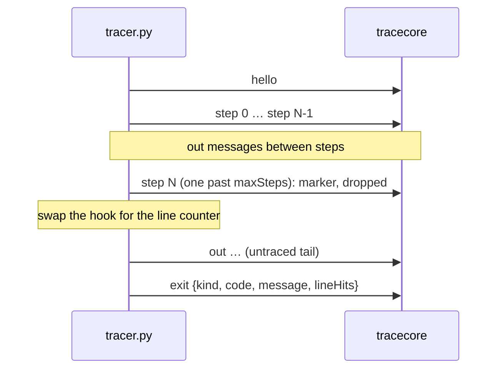

# Tracing

How a program becomes a trace: the Python tracer, the wire protocol, the trace core and `vizctl`. The spec sections are §7.11.1 (Python tracer), §9 (trace format), §10 (adapters and wire protocol), §11 (limits) and §19.9 (v1.1 additions). The sandbox the tracer runs in has [its own guide](sandbox.md).

Read this before you wire the worker to the core (BE-05), add a language (BE-07, BE-08, BE-14), change the wire protocol, or move the Python tracer to `sys.monitoring` (G2). The steps for those changes are in [adding or changing a language adapter](../guides/language-adapter.md). The tests and golden fixtures are in [testing](../guides/testing.md).

## The pipeline


A run has two halves with a hostile channel between them. Inside the sandbox, the tracer shares a process with the user's program and writes full snapshots. Outside, the core validates every message, enforces every limit and does the clever work: stable IDs, deltas, chunks. Adapters stay small, and every language gets the same limits and the same output (§10.1).

| Piece | Where | What it does |
|---|---|---|
| Manifest | `backend/adapters/python/manifest.yaml` | Image, build and trace commands, env, capabilities, `modules.allow`. Languages are data: Go code never branches on a language name |
| Tracer | `backend/adapters/python/tracer.py` | Runs the program under `sys.settrace` and writes the wire protocol to fd 3. Standard library only |
| Runner image | `backend/adapters/python/Dockerfile` | CPython 3.12.15 (slim, pinned by digest), `tracer.py` and `viz-shim` in `/opt/viz/`. pip removed, setuid bits stripped |
| Schemas | `backend/schema/` | `wire.v1.schema.json` (fd 3), `trace.v1.schema.json` (output). The `schema` package compiles both and returns redacted errors |
| Trace core | `backend/internal/tracecore` | Wire stream in, trace out. Standard library only, plus the generated types in `internal/gen` |
| CLI | `backend/cmd/vizctl` | `trace` runs one program end to end in the Docker dev sandbox; `validate` checks a trace file |
| Fixtures | `backend/fixtures/python/<case>/` | `main.py`, optional `stdin`, and `expected.trace.json` recorded from a real run |

**Why validation is passed in.** §7.4 keeps `tracecore` free of anything outside the standard library. The JSON Schema library lives in the `schema` package, and the caller hands `Validator.Wire` to the recorder as a plain function.

## One run

This is what `vizctl trace` does today (`cmd/vizctl/trace.go`). The worker (BE-05) follows the same steps, with its own deadlines and storage.

```go
val, err := schema.New()
box, err := sb.Start(ctx, ports.SandboxSpec{
	JobID:  id,
	Image:  m.Image,
	Files:  map[string][]byte{m.SourceFile: src, "stdin": stdin},
	Memory: 256 << 20,
})

// build, when m.Build != nil: for Python, the syntax and import check
build, err := box.Run(buildCtx, ports.Command{
	Args: m.Build.Cmd,
	Env:  []string{"VIZ_MODULES_ALLOW=" + strings.Join(m.AllowedModules, ",")},
	Stdout: diag, Stderr: diag, Wire: io.Discard,
})

// trace
rec := tracecore.NewRecorder(tracecore.Config{
	ID:       id,
	Source:   trace.Source{File: m.SourceFile, LineCount: lineCount(src)},
	Options:  trace.Options{MaxSteps: 1000, StartAtLines: []int{}},
	Limits:   tracecore.DefaultLimits,
	Validate: val.Wire,
})
exit, err := box.Run(traceCtx, ports.Command{
	Args:   m.TraceCmd,
	Env:    append([]string{"VIZ_MAX_STEPS=1000"}, m.TraceEnv...),
	Stdout: rec.Stdout(), Stderr: rec.Stderr(), Wire: rec.Wire(),
})
res, err := rec.Finish(tracecore.Outcome{
	Code: exit.Code, Signal: exit.Signal,
	TimedOut: exit.Limit == ports.LimitTime, OutOfMemory: exit.Limit == ports.LimitMemory,
}, err)
```

1. **Load the manifest** whose `id` matches `--lang`. `manifest.Load("adapters")` (`internal/adapters/manifest`, the `Adapters` port) reads and checks every `adapters/*/manifest.yaml` once and hands out a `domain.Manifest`: the build timeout as a `time.Duration`, `trace.env` as sorted `KEY=value` strings, and `Build` nil for a language with no build step.
2. **Start one box** with the source and `stdin` written into `/work`. Stdin is a file, never fd 0 (sandbox guide, Rules for callers).
3. **Build** under `build.timeoutMs`, if the manifest has a build. A non-zero exit fails the run before anything is traced: `unsupported_module` when the code equals `build.unsupportedModuleExit`, `compile_error` otherwise, with the build output as diagnostics.
4. **Trace** under the wall-time deadline (15 s by default, §11), with the recorder's three writers. When a writer returns an error, the sandbox kills the box. That's how the core enforces its hard limits.
5. **Finish**: pass `Run`'s outcome and error in. A kill caused by one of the core's own limits still gives a trace. Any other error (infra, cancel, malformed output) comes back as an error.
6. **Use the result**: `res.Trace()` is the whole document (what `vizctl` prints), `res.Chunks()` the gzipped chunks to store (chunk `i` goes to `BlobStore.Put` under `domain.ChunkKey("t7", id, i)`, §7.5), `res.Tail` the output after the step limit (`tail.txt.gz`, §19.9.5), and `res.Logs` the adapter's `log` messages, for internal logs only.

### What the caller passes

| Env | Set by | Value |
|---|---|---|
| `VIZ_MODULES_ALLOW` | Caller, on the build | `modules.allow` from the manifest, comma-separated |
| `VIZ_MAX_STEPS` | Caller, on the trace | `options.maxSteps` (1,000 by default, 5,000 at most) |
| `VIZ_PROTOCOL_FD` | Manifest `trace.env` | `3` |
| `PYTHONHASHSEED` | Manifest `trace.env` | `0`, so string hashes and set order are the same on every run (§7.12) |

The trace command is `python3 -s -P`, not `-I`: `-I` implies `-E`, which ignores `PYTHONHASHSEED`. `-s -P` still keeps the user site and the script directory off `sys.path`, and the sandbox controls the rest of the environment (spec v1.6).

## The build step: `tracer.py --check`

Python has no compiler, so its build step is a check that runs before anything is traced (§7.11.1). It compiles the source and walks every `import` and `from … import` in the AST.

| Result | Exit | stderr | Failure kind |
|---|---|---|---|
| Fine | 0 | — | — |
| Syntax error, including compile-time ones such as `return` outside a function | 1 | `main.py:L:C: error: <message>` | `compile_error` |
| An import whose top-level module isn't in `VIZ_MODULES_ALLOW` (relative imports are always blocked) | 3 | `main.py:L:C: error: numpy isn't supported in the visualizer`, one line per import | `unsupported_module` |

`modules.allow` is the pinned image's `sys.stdlib_module_names`, all 301 names, sorted. The diagnostics use GCC's format, so one parser covers the C++ and Python builds. The trace run doesn't check imports again: a dynamic import of a missing module fails at runtime as an ordinary exception.

## The wire contract

The tracer writes NDJSON to fd 3 (§10.1). The program's own fd 1 and 2 stay its own. Every line must pass `wire.v1.schema.json`.



| Rule | Detail |
|---|---|
| Order | `hello` first, `exit` last, `step` and `out` in between. `log` may come anywhere, even after `exit`; any other message after `exit` is malformed |
| Snapshots | Every `step` is a full snapshot: the whole stack (capped, below) and every object reachable from it. The core computes deltas |
| IDs | Frame `id` is the call's `callId` as a string; the module frame is call 0. Heap ids are `str(id(obj))`. The core maps both to `f0…` and `o1…` in order of first appearance |
| Calls | Call steps carry `callId` and `parentCallId` (the next frame out on the stack). Return steps carry `callId` (§19.9.6) |
| Output | The Python tracer captures stdout and stderr itself and sends `out` messages of at most 16,384 characters (64 KiB as UTF-8). Output between step k−1 and step k belongs to step k: it was printed while step k's `prevLine` ran. Output after the last step goes to the last step |
| Step limit | The tracer sends at most `maxSteps + 1` steps. The extra one is a marker that the program went on. The core drops it, records `truncation.step_limit`, and keeps reading `out` and `exit` for the untraced tail. Not a kill (D25) |
| Line hits | `exit.lineHits` counts every line event in `main.py` over the whole run, untraced tail included. It becomes `summary.lineHits` with `lineHitsSource: "counter"` (§19.9.3) |
| Exceptions | One `exception` step where the exception is raised in `main.py` (`line` is the raising line), not one per frame it unwinds through. Uncaught: `exit {kind: "exception", code: 1, message: "IndexError: …"}`. `SystemExit(n)`: `exit {kind: "normal", code: n}` |

## Inside the tracer

`tracer.py` is flat functions over module-level state. It sees the program through three hooks: `sys.settrace` and `threading.settrace` for events, and a short-lived `sys.setprofile` for recovering from the recursion limit.

### Events and steps

- **Only `main.py` produces steps.** The global hook returns `None` for any frame whose `co_filename` isn't `main.py`, so library and tracer frames never get a local hook. `input()`, `print()` and the output writers make no steps (§15 regression case).
- **A call step lands on the first body line.** settrace reports a call at the `def` line, so the frame waits in `pending` and becomes a `call` step at its first `line` event (§7.11.1).
- **Step 0 is the module's call step**, at line 1 with `callId` 0. The program ends with the module's `return` step, so output from the last line has a step to land on.
- **Return steps carry the value**, except while a frame is unwinding from an exception. 3.12 sends no exception event when `finally` or `with` re-raises, so the tracer reads the opcode at `f_lasti`. A return opcode means a real return.
- **Values follow §10.3**: `int`, `float`, `bool`, `str` (1,000 characters, then `len` and `truncated`) and `None` inline. `list` and `deque` become `sequence`, and `tuple` a `fixed` sequence. `set` and `frozenset` become `set`; `dict` and its subclasses, `mapping`. An instance of a class from `main.py` becomes a `record`, from `__dict__` and `__slots__`. Functions, lambdas and methods become `function` with a signature, and classes `class`. Everything else is `opaque`, with `repr()` cut to 200 characters. Containers record at most 1,000 items, with the real `length`.
- **`internal`** marks module-level `__` names, imported modules, imported functions and comprehension iterators (`.0`).
- **`stdinPos`** is exact: `StringIO.tell()` converted to a UTF-8 byte offset, plus the number of whitespace-separated tokens fully consumed (§19.9.4).
- **The stack is capped** at the module frame plus the 100 innermost frames, the same cap the core applies (§11). Without it, a recursion 1,000 deep sent about 127 KB per step.

### After the step limit

When the step past the limit is sent, the tracer swaps both hooks for `count_call` and `count_line`. These only count `line` events in `main.py`, with no snapshots, and the program runs to the end. Output still goes out as `out` messages, and the core files it under the untraced tail.

Spike S2 measured this counter at 3–19× the untraced run time under settrace, and 1–9× under `sys.monitoring` ([S2 report](../../../plans/spikes/s2-python-hook.md)). How much of a long program finishes inside the 10 s CPU limit depends on that number. G2 decides whether to switch.

### The recursion limit

settrace calls the hook as a Python function, so the hook itself fails first when the program reaches the recursion limit. CPython then removes the hook for good, and the rest of the trace and the line counts are lost while the exit still says normal. So the tracer:

- raises `RecursionError` itself, from the hook, at the user's limit;
- installs a `sys.setprofile` hook that puts the trace hook back as that frame unwinds;
- wraps `sys.setrecursionlimit` and `sys.getrecursionlimit` and keeps 50 frames of headroom above the user's limit for its own work.

The user sees one exception step, line counts keep going, and the exit is right. The tracer's own frames still cost about 3 frames of depth in the main thread.

### Threads

`threading.Thread(target=main).start()`, with a bigger `threading.stack_size`, is a common trick on judges for deep recursion. `threading.settrace` installs the hook in new threads. When `main.py` starts a thread, `start()` doesn't return until that thread finishes. The thread keeps its own stack, so the stack size still applies, and its frames are drawn on top of the starter's: one call stack, one call tree, the same trace on every run. The cost: a program whose thread waits on the thread that started it hangs until the time limit (§7.11.1).

### Determinism (§7.12)

`random.seed(0)` before the program runs, `PYTHONHASHSEED=0` from the manifest, and stable IDs assigned by the core rather than the tracer. The eight fixtures give byte-identical traces across runs once the trace ID is masked.

### Failure inside the tracer

An exception in the tracer's own code sends `log` (level `error`, at most 200 characters, no user data) and `exit {kind: "internal_error"}`, then `os._exit(0)`. After a normal run the tracer also leaves with `os._exit`, so that `exit` really is the last message: atexit handlers and finalizers could still print.

## Inside the trace core

`tracecore.Recorder` is one concrete type and not safe for concurrent use. That's fine: the sandbox calls all three writers from one goroutine, in the order it read the data.

### Reading

- **fd 3** is split on newlines. A line, partial or whole, can't exceed `Limits.TraceBytes`: a step bigger than the whole trace budget can't be recorded, so a longer line is the size limit. Each line goes through `Validate`, then is decoded into the generated `internal/gen/wire` types.
- **Order:** no message before `hello`, a single `hello`, and only `log` after `exit`. A stream that ends with bytes after `exit` and no newline is malformed too. `log` messages are kept up to 64 KiB.
- **fd 1 and 2** and `out` messages go through the same function. Output waits in a buffer and is attached to the next recorded step. After the step limit it goes to the tail.

### Transform

| Stage | How |
|---|---|
| Frame IDs | Wire frame id → `f0, f1…` in order of first appearance. Wire ids are unique per call, so a recursion gets a new `fN` per call |
| Object IDs | Native id → `o1, o2…` in order of first appearance, walking the frames in stack order and then the heap breadth first. CPython reuses `id()` after an object is freed, so a reused id continues an `oN` |
| Frame cap | The global frame plus the `Limits.Frames` (100) innermost |
| Internals | `internal` locals are dropped unless `options.showInternals` |
| Heap budget | At most `Limits.HeapObjects` (500) objects per step. A `ref` past the budget becomes `unavailable` with reason `object_limit`; a `ptr` loses its `target` (§11) |
| Strings and containers | Strings are cut at `Limits.StringChars` runes, with `len` and `truncated`. Items and entries are cut at `Limits.Items`, with `truncated` |
| Keyframes | Every step where `i % 50 == 0` carries every frame and every object (D2) |
| Deltas | The other steps carry each frame and object whose JSON differs from the previous step, whole, plus `removedObjects`: ids reachable in the previous step and not in this one. `stack` is always complete |

Malformed input fails the run with `ErrMalformed`. That covers a schema failure, a message out of order, and a ref to an id missing from the step's heap. The error message names the line number and the schema rule that failed, never the line's content, so the job runner can log it (§7.8).

### Limits and how they end a trace

| Limit (§11) | Default | Enforced by | Kill? | Trace |
|---|---|---|---|---|
| Steps | `options.maxSteps`, 1,000 | The first step past the limit | No | `truncation {step_limit, atLine: last recorded step's line}`, `summary.exit.kind = step_limit`, the program's own exit in `untracedTail` |
| Trace size | 20 MB uncompressed | Sum of the marshaled steps, and the fd-3 line length | Yes | `truncation size_limit`, `exit.kind = step_limit` (there is no size exit kind) |
| Output | 64 KB, stdout and stderr together, tail included | The writers | Yes | `exit.kind = output_limit`, no truncation |
| Wall time | 15 s | The caller's context deadline; the sandbox kills | Yes | `truncation time_limit` unless the step limit came first, `exit.kind = timeout` |
| Memory | 256 MB | The sandbox | Yes | `exit.kind = memory_limit` |
| Heap objects, frames, strings, items | 500 / 100 / 1,000 / 1,000 | Per step, in the transform | No | Cut in place (above) |

### Finishing

`Finish(outcome, runErr)` decides `summary.exit` in this order: an output-limit kill, a size-limit kill, the tracer's own `exit` message, a time limit, a memory limit, a signal (Linux names, because the sandbox is Linux even when `vizctl` runs on macOS), and otherwise `internal_error` with the box's exit code. A tracer that dies without `exit` and without hitting a limit is therefore an internal error, not the user's fault.

After the step limit, `untracedTail.completed` is true when the tail ended by itself (normal, exception or signal), and false when a limit cut it. `stdoutBytes` counts stdout only. `Result.Tail` keeps stdout and stderr in arrival order.

`Chunks()` cuts the steps into chunks of 250. 250 is a multiple of the keyframe interval, so every chunk starts on a keyframe and the player can open any chunk alone. Each chunk is a gzipped JSON array of steps with its SHA-256. The version is `1.1`: v1 plus the §19.9 fields.

## Trust boundary

The user's program runs in the tracer's process, so it can write anything to fd 3, replace `sys.settrace`, or kill the tracer. That is accepted: a user can only spoil their own trace (§12, and AGENTS.md "Intentional, do not flag"). The defenses are all on the core's side:

- every fd-3 line is checked against the schema before it's used;
- every limit is counted outside the sandbox, in the writers;
- reads are bounded: no `io.ReadAll`, no default `bufio.Scanner`;
- errors and logs never quote tracer output.

One leftover: `encoding/json` matches keys case-insensitively, so a forged `"ID": null` can change a field after the line passed validation. The core checks the required pointers again before using them, so the most this does is bend the user's own trace.

## Not built yet

| What | Where |
|---|---|
| G2: keep `settrace` or move to `sys.monitoring` | Gate on Fri 13 Nov; S2 recommends `sys.monitoring` |
| The worker running this flow and storing chunks, header and tail | BE-05 |
| Running the goldens on amd64 and arm64 in CI | BE-04 §2 |
| Signing the runner image | BE-03 §3, needs the registry (BE-13) |
| A traceback on the program's stderr for an uncaught exception (today only `exit.message` has it) | BE-10 |
| `startAtLines` and `captureRanges` in the tracer (both `false` in the manifest) | BE-11 |
| A test that fake fd-3 messages from user code end as `internal_error` | BE-02 §5 |
| `sys.stdin.buffer`, `open(0)` and `sys.stdout.buffer` (fd 0 is `/dev/null`; the writers are text only) | Not planned |
