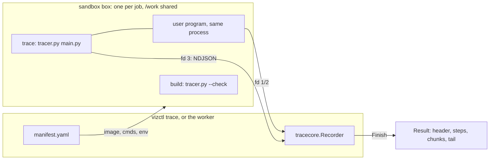
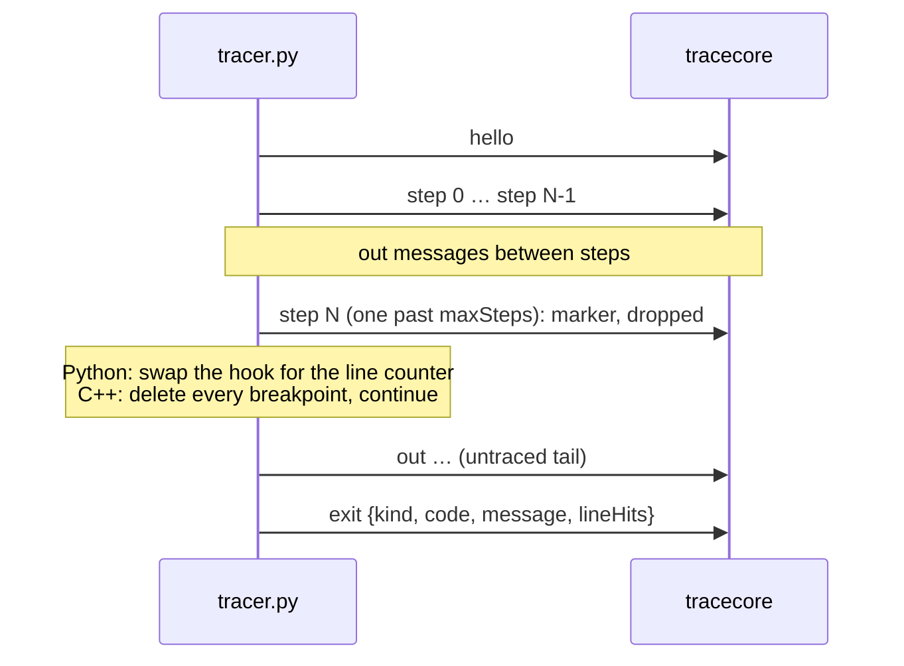

# Tracing

How a program becomes a trace: the Python and C++ tracers, the wire protocol, the trace core and `vizctl`. The spec sections are §7.11.1 (Python tracer), §7.11.2 (C++ build and tracer), §9 (trace format), §10 (adapters and wire protocol), §11 (limits) and §19.9 (v1.1 additions). The sandbox the tracer runs in has [its own guide](sandbox.md).

Read this before you change how the worker drives the core, add a language (BE-07, BE-08, BE-14), change the wire protocol, or move the Python tracer to `sys.monitoring` (G2). The steps for those changes are in [adding or changing a language adapter](../guides/language-adapter.md). The tests and golden fixtures are in [testing](../guides/testing.md).

## The pipeline



A run has two halves with a hostile channel between them. Inside the sandbox, the tracer shares a process with the user's program (Python) or drives it from GDB (C++), and writes full snapshots. Outside, the core validates every message, enforces every limit and does the clever work: stable IDs, deltas, chunks. Adapters stay small, and every language gets the same limits and the same output (§10.1).

| Piece | Where | What it does |
|---|---|---|
| Manifest | `backend/adapters/<language>/manifest.yaml` | Image, build and trace commands, env, capabilities, `modules.allow`. Languages are data: Go code never branches on a language name |
| Tracer | `backend/adapters/python/tracer.py`, `backend/adapters/cpp/trace.py` | Python's runs the program under `sys.settrace`; C++'s drives GDB through its Python API. Both write the wire protocol to fd 3. Standard library only, plus GDB's `gdb` module for C++ |
| Runner image | `backend/adapters/python/Dockerfile`, `backend/adapters/cpp/Dockerfile` | Python: CPython 3.12.15 (slim, pinned by digest), `tracer.py` and `viz-shim` in `/opt/viz/`, pip removed, setuid bits stripped. C++: GCC 13.5 and GDB 14.2 ([the C++ runner image](../guides/language-adapter.md#the-c-runner-image)) |
| Schemas | `backend/schema/` | `wire.v1.schema.json` (fd 3), `trace.v1.schema.json` (output). The `schema` package compiles both and returns redacted errors |
| Trace core | `backend/internal/tracecore` | Wire stream in, trace out. Standard library only, plus the generated types in `internal/gen` |
| CLI | `backend/cmd/vizctl` | `trace` runs one program end to end in the Docker dev sandbox; `validate` checks a trace file |
| Fixtures | `backend/fixtures/<language>/<case>/` | `main.py` or `main.cpp`, optional `stdin`, and `expected.trace.json` recorded from a real run |

**Why validation is passed in.** §7.4 keeps `tracecore` free of anything outside the standard library. The JSON Schema library lives in the `schema` package, and the caller hands `Validator.Wire` to the recorder as a plain function.

## One run

This is what `vizctl trace` does (`cmd/vizctl/trace.go`). The worker (`internal/app/worker.go`) follows the same steps, with the job's options, its own deadlines, progress and storage; both run the build through `app.Build`.

```go
val, err := schema.New()
box, err := sb.Start(ctx, ports.SandboxSpec{
	JobID:  id,
	Image:  m.Image,
	Files:  map[string][]byte{m.SourceFile: src, "stdin": stdin},
	Memory: 256 << 20,
})

opts := trace.Options{MaxSteps: 1000, StartAtLines: []int{}}

// build, when m.Build != nil: Python's syntax and import check, or g++
b, kind, err := app.Build(ctx, box, m, opts)

// trace
rec := tracecore.NewRecorder(tracecore.Config{
	ID:       id,
	Source:   trace.Source{File: m.SourceFile, LineCount: lineCount(src)},
	Options:  opts,
	Limits:   tracecore.DefaultLimits,
	Validate: val.Wire,
})
exit, err := box.Run(traceCtx, ports.Command{
	Args:   m.TraceCmd,
	Env:    append([]string{"VIZ_MAX_STEPS=1000"}, m.TraceEnv...),
	Stdout: rec.Stdout(), Stderr: rec.Stderr(), Wire: rec.Wire(),
})
res, err := rec.Finish(tracecore.Outcome{
	Code: exit.Code, Signal: exit.Signal,
	TimedOut: exit.Limit == ports.LimitTime, OutOfMemory: exit.Limit == ports.LimitMemory,
}, err)
```

1. **Load the manifest** whose `id` matches `--lang`. `manifest.Load("adapters")` (`internal/adapters/manifest`, the `Adapters` port) reads and checks every `adapters/*/manifest.yaml` once and hands out a `domain.Manifest`: the build timeout as a `time.Duration`, `trace.env` and `build.env` as sorted `KEY=value` strings, and `Build` nil for a language with no build step.
2. **Start one box** with the source and `stdin` written into `/work`. Stdin is a file, never fd 0 (sandbox guide, Rules for callers).
3. **Build** under `build.timeoutMs`, if the manifest has a build: `build.cmd`, then `build.safetyFlags` unless `opts.SafetyChecks` is false. A non-zero exit fails the run before anything is traced: `unsupported_module` when the code equals `build.unsupportedModuleExit`, `compile_error` otherwise, with the build output as diagnostics.
4. **Trace** under the wall-time deadline (15 s by default, §11), with the recorder's three writers. When a writer returns an error, the sandbox kills the box. That's how the core enforces its hard limits.
5. **Finish**: pass `Run`'s outcome and error in. A kill caused by one of the core's own limits still gives a trace. Any other error (infra, cancel, malformed output) comes back as an error.
6. **Use the result**: `res.Trace()` is the whole document (what `vizctl` prints), `res.Chunks()` the gzipped chunks to store (chunk `i` goes to `BlobStore.Put` under `domain.ChunkKey("t7", id, i)`, §7.5), `res.Tail` the output after the step limit (`tail.txt.gz`, §19.9.5), and `res.Logs` the adapter's `log` messages, for internal logs only.

### What the caller passes

| Env | Set by | Value |
|---|---|---|
| `VIZ_MODULES_ALLOW` | Caller, on the build | `modules.allow` from the manifest, comma-separated |
| `TMPDIR` | Manifest `build.env` (C++) | `/work`: g++ writes temp files, and `/tmp` is read-only |
| `VIZ_MAX_STEPS` | Caller, on the trace | `options.maxSteps` (1,000 by default, 5,000 at most) |
| `VIZ_PROTOCOL_FD` | Manifest `trace.env` | `3` |
| `PYTHONHASHSEED` | Manifest `trace.env` | `0`, so string hashes and set order are the same on every run (§7.12) |

The trace command is `python3 -s -P`, not `-I`: `-I` implies `-E`, which ignores `PYTHONHASHSEED`. `-s -P` still keeps the user site and the script directory off `sys.path`, and the sandbox controls the rest of the environment (spec v1.6).

## The build step: `tracer.py --check`

Python has no compiler, so its build step is a check that runs before anything is traced (§7.11.1). It compiles the source and walks every `import` and `from … import` in the AST.

| Result | Exit | stderr | Failure kind |
|---|---|---|---|
| Fine | 0 | — | — |
| Syntax error, including compile-time ones such as `return` outside a function | 1 | `main.py:L:C: error: <message>` | `compile_error` |
| An import whose top-level module isn't in `VIZ_MODULES_ALLOW` (relative imports are always blocked) | 3 | `main.py:L:C: error: numpy isn't supported in the visualizer`, one line per import | `unsupported_module` |

`modules.allow` is the pinned image's `sys.stdlib_module_names`, all 301 names, sorted. The diagnostics use GCC's format, so one parser covers the C++ and Python builds. The trace run doesn't check imports again: a dynamic import of a missing module fails at runtime as an ordinary exception.

## The C++ build

`build.cmd` in `adapters/cpp/manifest.yaml` is `g++ -std=gnu++17 … main.cpp /opt/viz/flush_init.cpp -o main` with the flags below. They stay on when safety checks are off.

| Flag or file | Why |
|---|---|
| `-O0 -g3 -fno-omit-frame-pointer` | GDB sees every line and every local |
| `--coverage` | Line hits for BE-11. The `.gcno` files land in `/work` |
| `-Wall -Wextra -Wshadow` | The warnings panel (§19.6). Warnings come back from a build that succeeds |
| `-fdiagnostics-plain-output` | No colors, carets, fix-its or URLs: `raw` is plain text with one diagnostic per line |
| `--param ggc-min-heapsize=32768 --param ggc-min-expand=30` | GCC sizes its garbage-collected heap from the host's RAM, not the box's 256 MiB. Collecting early keeps a build that can't use the PCH inside the box, for 5–10% more build time and the same code ([S7](../../../plans/spikes/s7-safety-checks.md)) |
| `/opt/viz/flush_init.cpp` | Unbuffered stdout and `std::unitbuf` before `main` (§7.11.2) |

- **Safety checks (D21, §19.6).** `build.safetyFlags` (`-D_GLIBCXX_DEBUG -fsanitize=undefined -fno-sanitize-recover=all`) go after `build.cmd` unless the request sets `options.safetyChecks: false`. Unset and `true` mean on (`domain.SafetyChecks`). `NormalizeOptions` keeps the field only when it's `false`, so unset and `true` share a cache key and `false` gets its own. `CheckRequest` rejects `false` for a language with no `build.safetyFlags`, such as Python. With checks on, the containers are libstdc++'s debug ones, so a trace shows `std::__debug::vector<int, …>`.
- **Precompiled headers.** The image has one per value of `_GLIBCXX_DEBUG` in `bits/stdc++.h.gch/`, and GCC picks the one that fits the build. Their flags must match the manifest's ([language adapter guide](../guides/language-adapter.md#the-c-runner-image)).
- **Env.** `build.env` sets `TMPDIR=/work`. The sandbox sets no `LANG`, so GCC quotes with ASCII `'`, not curly quotes.
- **Timeout.** 10 s (`build.timeoutMs`). A build killed by it is `compile_error` with `raw` set to `Build timed out`.

### Diagnostics

`app.Build` keeps the whole build output, stdout and stderr together and cut at 64 KiB, as `build.raw`, and parses it into `build.diagnostics` (§8.3). `raw` is set whenever the build printed something. A diagnostic always points into `main.cpp`, because that's the only file the user can open:

| GCC prints | Diagnostic |
|---|---|
| `main.cpp:6:14: error: expected ';' before 'return'` | Line 6, column 14, severity `error`, the message after it. `warning` the same way |
| `main.cpp:2:10: fatal error: testlib.h: No such file or directory` | Severity `error` |
| `…: note: …` | None; notes stay in `raw` |
| An error or warning in a system header, such as `…/stl_algo.h:4859:7: error: no match for 'operator<' …` | At the last `main.cpp` location GCC printed before it: `main.cpp:10:9:   required from here`, or `In file included from main.cpp:2:` (column 1). GCC prints that context only when it changes, so it carries over to the errors after it. None when no `main.cpp` location came first |
| ``/work/main.cpp:7: undefined reference to `solve(int)'``, from the linker | Line 7, column 1, severity `error` |
| `main.cpp: In function 'int main()':`, `collect2: error: ld returned 1 exit status` | None |

The §8.3 program fails with one error at 6:14, and `raw` is `main.cpp: In function 'int main()':` then `main.cpp:6:14: error: expected ';' before 'return'`, the same with checks on or off. `TestTraceNamesBuildFailure` (`cmd/vizctl`) runs it end to end; `TestBuildReadsGCCDiagnostics` (`internal/app`) covers each row above from captured GCC 13 output.

## The wire contract

The tracer writes NDJSON to fd 3 (§10.1). The program's own fd 1 and 2 stay its own. Every line must pass `wire.v1.schema.json`.



| Rule | Detail |
|---|---|
| Order | `hello` first, `exit` last, `step` and `out` in between. `log` may come anywhere, even after `exit`; any other message after `exit` is malformed |
| Snapshots | Every `step` is a full snapshot: the whole stack (capped, below) and every object reachable from it. The one exception is a sparse sequence that was in the previous step: it may come as `{kind, type, length, patch}` with only its changed cells (§19.9.1). The core computes deltas |
| IDs | Frame `id` is the call's `callId` as a string. Call 0 is Python's module frame and C++'s `main`; the C++ globals frame is `globals`. Heap ids are `str(id(obj))` in Python and `<addr>:<type>` in C++ (`tmpN:<type>` for a value with no address). The core maps both to `f0…` and `o1…` in order of first appearance |
| Calls | Call steps carry `callId` and `parentCallId` (the next frame out on the stack). Return steps carry `callId` (§19.9.6) |
| Output | The Python tracer captures stdout and stderr itself and sends `out` messages of at most 16,384 characters (64 KiB as UTF-8). The C++ program writes its own fd 1 and 2. `viz-shim` forwards what it wrote before a wire line ahead of that line, and the tracer doesn't resume the program until `viz-shim` has read the line, so nothing written later overtakes it (§10.1). Output between step k−1 and step k belongs to step k: it was printed while step k's `prevLine` ran. Output after the last step goes to the last step |
| Step limit | The tracer sends at most `maxSteps + 1` steps. The extra one is a marker that the program went on. The core drops it, records `truncation.step_limit`, and keeps reading `out` and `exit` for the untraced tail. Not a kill (D25) |
| Line hits | `exit.lineHits` counts every line event in `main.py` over the whole run, untraced tail included. It becomes `summary.lineHits` with `lineHitsSource: "counter"` (§19.9.3). The C++ tracer sends none; C++ counts come from gcov (BE-11) |
| Exceptions | Python: one `exception` step where the exception is raised in `main.py` (`line` is the raising line), not one per frame it unwinds through. Uncaught: `exit {kind: "exception", code: 1, message: "IndexError: …"}`. `SystemExit(n)`: `exit {kind: "normal", code: n}`. C++: a signal or a failed safety check gives one `exception` step with `error {type: "SIGSEGV", message, line}`, then the program's real exit. A caught C++ exception makes no step; an uncaught one ends in `abort()` and shows as `SIGABRT`. An error may carry `kind` and `values` ([Friendly errors](#friendly-errors-196)) |

## Friendly errors (§19.6)

From trace format v1.2 an error step's `error` may carry `kind`, the §19.6 message it matches, and `values`, what the error involves. Without `kind`, the UI shows `message`, the runtime's own words. Program values are decimal strings, as in `value.v`; counts are integers. A value the tracer couldn't read is left out.

| `kind` | C++ | Python | `values` |
|---|---|---|---|
| `index_out_of_range` | `vector` and `deque` through `_GLIBCXX_DEBUG`'s subscript check; `string` and `std::array` through their assertions; a C array through UBSan | `IndexError` raised by a subscript (not by `pop()`) | `index`, `size`, `type`, and `name` except for a C array |
| `signed_overflow` | UBSan: `+`, `-`, `*`, negation, `INT_MIN / -1` | — | `op`, `operands`, `type`, `max` |
| `division_by_zero` | UBSan, integer `/` and `%` | `ZeroDivisionError` | Python: `expr` and `divisor`, the source text |
| `empty_container` | `front`, `back`, `top`, `pop_back` … on an empty container; `*s.begin()` on an empty set | — | `call`, `type`, `name` |
| `recursion_too_deep` | `SIGSEGV` with the fault within 64 KiB of the stack pointer | `RecursionError` | `depth`, the calls on the stack; Python adds `limit` |

- **`name`** is how the program names the container. In C++ it's the local, parameter (a reference is followed) or global whose address and type match the container's, so `s.v[2]` gets none: a struct and its first member share an address. In Python it's the subscripted expression's text, from `ast.unparse`, so `grid[r][c]` gives `grid[r]`.
- **No source text in C++.** `a[i]` isn't known: UBSan reports a column that points at the operator or the `]`, and libstdc++ reports none.

## Inside the Python tracer

`tracer.py` is flat functions over module-level state. It sees the program through three hooks: `sys.settrace` and `threading.settrace` for events, and a short-lived `sys.setprofile` for recovering from the recursion limit.

It is typed and passes pyright in strict mode (`make typecheck`). Every message it sends is one of the TypedDicts that `make gen` writes to `adapters/wire.py` from `wire.v1.schema.json`, so a misspelled field, a number where the schema wants a string, or a missing required field fails the check before any run. The types catch the shape only; the core still validates every line (§12). `adapters/wire.py` isn't in the runner image: the tracer imports it under `TYPE_CHECKING` and leaves its annotations unevaluated. That `from __future__ import annotations` would leak into the user's program through `compile()`, so both `compile()` calls pass `dont_inherit=True`.

### Events and steps

- **Only `main.py` produces steps.** The global hook returns `None` for any frame whose `co_filename` isn't `main.py`, so library and tracer frames never get a local hook. `input()`, `print()` and the output writers make no steps (§15 regression case).
- **A call step lands on the first body line.** settrace reports a call at the `def` line, so the frame waits in `pending` and becomes a `call` step at its first `line` event (§7.11.1).
- **Step 0 is the module's call step**, at line 1 with `callId` 0. The program ends with the module's `return` step, so output from the last line has a step to land on.
- **Return steps carry the value**, except while a frame is unwinding from an exception. 3.12 sends no exception event when `finally` or `with` re-raises, so the tracer reads the opcode at `f_lasti`. A return opcode means a real return.
- **Values follow §10.3**: `int`, `float`, `bool`, `str` (1,000 characters, then `len` and `truncated`) and `None` inline. `list` and `deque` become `sequence`, and `tuple` a `fixed` sequence. `set` and `frozenset` become `set`; `dict` and its subclasses, `mapping`. An instance of a class from `main.py` becomes a `record`, from `__dict__` and `__slots__`. Functions, lambdas and methods become `function` with a signature, and classes `class`. Everything else is `opaque`, with `repr()` cut to 200 characters. Containers record at most 1,000 items, with the real `length`.
- **`internal`** marks module-level `__` names, imported modules, imported functions and comprehension iterators (`.0`).
- **`stdinPos`** is exact: `StringIO.tell()` converted to a UTF-8 byte offset, plus the number of whitespace-separated tokens fully consumed (§19.9.4).
- **The stack is capped** at the module frame plus the 100 innermost frames, the same cap the core applies (§11). Without it, a recursion 1,000 deep sent about 127 KB per step.

### After the step limit

When the step past the limit is sent, the tracer swaps both hooks for `count_call` and `count_line`. These only count `line` events in `main.py`, with no snapshots, and the program runs to the end. Output still goes out as `out` messages, and the core files it under the untraced tail.

Spike S2 measured this counter at 3–19× the untraced run time under settrace, and 1–9× under `sys.monitoring` ([S2 report](../../../plans/spikes/s2-python-hook.md)). How much of a long program finishes inside the 10 s CPU limit depends on that number. G2 decides whether to switch.

### The recursion limit

settrace calls the hook as a Python function, so the hook itself fails first when the program reaches the recursion limit. CPython then removes the hook for good, and the rest of the trace and the line counts are lost while the exit still says normal. So the tracer:

- raises `RecursionError` itself, from the hook, at the user's limit;
- installs a `sys.setprofile` hook that puts the trace hook back as that frame unwinds;
- wraps `sys.setrecursionlimit` and `sys.getrecursionlimit` and keeps 50 frames of headroom above the user's limit for its own work.

The user sees one exception step, line counts keep going, and the exit is right. The tracer's own frames still cost about 3 frames of depth in the main thread.

### Error values

The exception step's `kind` comes from the exception's type ([Friendly errors](#friendly-errors-196)). Its values come from the expression that raised it: the position of the instruction at `f_lasti` (`co_positions()`) is the span of a `Subscript`, `BinOp` or `AugAssign` node in the parsed `main.py`. The tracer then evaluates that node's parts again, but only names, constants, subscripts of a `list`, `tuple`, `str`, `range`, `deque` or `dict` by an `int` or `str`, and integer `+`, `-`, `*`, `//`, `%`. Anything else could run the program's code (a property, a `__getitem__`, an `__index__`, a call), so that value is left out: `a[f(x)]` gets `name` and `size` but no `index`. The source is parsed once, at the first exception.

### Threads

`threading.Thread(target=main).start()`, with a bigger `threading.stack_size`, is a common trick on judges for deep recursion. `threading.settrace` installs the hook in new threads. When `main.py` starts a thread, `start()` doesn't return until that thread finishes. The thread keeps its own stack, so the stack size still applies, and its frames are drawn on top of the starter's: one call stack, one call tree, the same trace on every run. The cost: a program whose thread waits on the thread that started it hangs until the time limit (§7.11.1).

### Determinism (§7.12)

`random.seed(0)` before the program runs, `PYTHONHASHSEED=0` from the manifest, and stable IDs assigned by the core rather than the tracer. The eight fixtures give byte-identical traces across runs once the trace ID is masked.

### Failure inside the tracer

An exception in the tracer's own code sends `log` (level `error`, at most 200 characters, no user data) and `exit {kind: "internal_error"}`, then `os._exit(0)`. After a normal run the tracer also leaves with `os._exit`, so that `exit` really is the last message: atexit handlers and finalizers could still print.

## Inside the C++ tracer

`adapters/cpp/trace.py` runs inside GDB 14.2: `gdb -q -nx -batch -x /opt/viz/trace.py --args ./main`. Like `tracer.py`, it is flat functions over module-level state, with the standard library and GDB's `gdb` module. The libstdc++ pretty printers load from GDB's data directory ([the C++ runner image](../guides/language-adapter.md#the-c-runner-image)). The program is GDB's child process. The tracer never single-steps it: breakpoints make every stop, `continue` resumes, and every stop comes in through GDB's `stop` and `exited` events (§7.11.2).

### Stepping

- **A breakpoint on every statement row.** The tracer reads `main.cpp`'s rows from the binary's DWARF 5 line table (`.debug_line`) with its own parser. GDB's table can't be used: it drops a row whose line repeats with a new discriminator, and that row is often a one-line loop's back edge. Every `is_stmt` row of a `main.cpp` function gets an internal breakpoint, except the function's first row, its prologue. Library code has no breakpoints, so it always runs at full speed; a callback from it, such as a `sort` comparator, stops at its own rows.
- **`set breakpoint always-inserted on`.** GDB otherwise removes and reinserts every breakpoint at each stop. With 700 of them, a 1,000-step trace took 1.8 s without it and 0.5 s with it.
- **Breakpoints go in once `main` runs.** Before `run` there is one, on `main`'s first row; the others are added at that stop. Global constructors run untraced at full speed, and tracing starts at the first stop in `main`. When `main` returns, the tracer deletes every breakpoint and lets the program finish untraced, so static destructors and `atexit` handlers make no steps.
- **When a stop is a step.** A stop in the innermost call's frame is a `line` step when its line differs from that call's last step. On the same line it is a step when the code jumped back (its pc isn't after the previous stop's), unless the call already showed this line past the jump's target since its last jump back. A one-line loop (`for (...) cin >> a[i];`) then gives one step per iteration, like Python's line events, and the step limit bounds it. A range-for written over several lines jumps back to its condition after its `++` step, so it still gives one step per iteration on that line.
- **Closing braces.** GCC gives some code the position of the function's closing `}`: a VLA's stack save, and the setup of an aggregate temporary with a `std::string` member (`v.push_back({"b", 2})`). The closing position is that of the row holding the function's `ret`. Rows there before the first statement get no breakpoint, so the call step lands on the first statement. A later stop there takes a snapshot but sends nothing yet. If the frame's next stop is another statement, it was a temporary and the snapshot is dropped. If the frame returns, or calls a destructor, it was the epilogue: the `}` step goes out, and the return step's locals come from it. After the epilogue, a row of the `return` statement's line (its value moved after the destructors ran) makes no step.
- **Compiler-generated functions get no breakpoints.** GDB 14 has no `Symbol.is_artificial`, but `ptype` leaves out every method DWARF marks `DW_AT_artificial`. A method whose name and parameter types aren't in `ptype/r` of its class is compiler-generated: implicit constructors, destructors and assignment operators, and a lambda's closure members besides its `operator()`. So are functions with reserved names: `__tcf_0`, `_GLOBAL__sub_I_main`, a lambda's `_FUN`. User-written ones keep their steps, even when they sit on the struct's own line. If GDB ever printed a parameter type differently in the class and in the definition, a user-written method would lose its steps; a user function with a reserved name does.

### Calls and returns

- **A stack of user calls.** The tracer keeps its own stack of the user calls it has seen; `main` is call 0. A stop in a `main.cpp` frame that isn't the innermost call is a new call: a `call` step with `callId`, `parentCallId` and the caller's line as `prevLine`. Since the prologue has no breakpoint, a call's first stop is its first statement. Library frames between two user calls don't show, so a comparator's frame sits right on top of the frame that called `sort`. The stack is capped like the core's: Globals plus the 100 innermost calls.
- **One `gdb.FinishBreakpoint`, on the innermost call.** GDB unwinds to every finish breakpoint's frame on each stop. At depth 300, one breakpoint per call cost 3.3 s per 1,000 steps and one in all 0.6 s. A new call moves the breakpoint to itself, and a return moves it back to the caller.
- **Inline callers.** A FinishBreakpoint never fires when the frame's caller is an inline frame, for example libstdc++'s inlined allocator code running a destructor. The tracer arms it on the outermost inline frame, which returns to the same address.
- **`main`'s return needs `set backtrace past-main on`.** Without it GDB doesn't show `main`'s caller, where the breakpoint goes.
- **Frames left without a return get no return step.** An exception, `exit()` or `longjmp` leaves frames without returning from them. At each stop the tracer drops every call whose frame GDB can no longer find, innermost first, and arms the call that's left.
- **The return step** is the live stack plus the returning frame on top, with `returnValue`. The frame's locals, and the objects they refer to, come from its epilogue stop: after its last statement, before its destructors. A one-line function's epilogue makes no step but still gives that snapshot, so `void add(int &x, int v) { x += v; }` returns showing `x` after the `+=`. `line` and `prevLine` are the frame's last line. `returnValue` is `null` for `void`, `unavailable` with reason `unknown_return` when GDB can't compute it, and the value otherwise.
- **A smashed return address.** A stack-smashing write can overwrite a frame's return address. When the address can't be read, no finish breakpoint goes there (GDB couldn't insert it), and the return faults: the program ends with a signal and its error step.
- **arm64 results in memory.** A struct or union returned in memory goes to an address the caller passes in `x8`. The callee needn't keep `x8`, but GDB 14 reads it at the return anyway. So the tracer saves `x8` at the call when the function's prologue copies it, which GCC `-O0` does exactly when the result goes through memory, and reads the result from there.
- **Names and kinds.** A frame's `name` is GDB's qualified name with any ABI tag cut off, along with the parameter list GDB 14 leaves after it: `make_str[abi:cxx11](int)` becomes `make_str`. `kind` is `method` for a function with `this`, constructors and destructors included; `lambda` for one with GCC's `__closure` parameter, named `<lambda>`; and `function` otherwise.

### Values

| C++ | Wire value |
|---|---|
| Integers | `int`, `v` in decimal. `__int128` takes GDB's text, because GDB 14's `int()` refuses it |
| `bool` | `bool`, `"true"` or `"false"` |
| `char`, `signed char`, `unsigned char` | `char` with `code` |
| `enum` | `int` whose `v` is the enumerator name |
| `double` | `float`, Python's `repr`: the shortest text that reads back as the same double |
| `float` | `float`, the shortest decimal that reads back as the same 32-bit float: `0.1f` is `0.1`, not `0.10000000149011612` |
| `long double` | `float`, GDB's text. Python's `float()` would round it to a double |
| `T&`, `T&&` | The referenced value; `type` keeps the reference type |
| `std::string`, `std::string_view` | `str`: its first 1,000 bytes, decoded as UTF-8 (a bad byte becomes U+FFFD). A longer one has `len`, its size in bytes, and `truncated: true` |
| `const char*` to readable memory | `str` up to its NUL, at most 1,000 bytes, read in chunks that end on 4 KiB pages; `truncated: true` past that, with no `len`. A null or unreadable one is a `ptr`, and so is every `char*` |
| A library template in `typemap.json` | Its row's kind (below) |
| `T[N]` | `sequence` with `fixed` (below) |
| A `struct`, `class` or `union` declared in `main.cpp`, or one without a name (a lambda's closure) | `record`: the fields of user base classes first, flattened, then its own. A name that repeats becomes `Base::x`. Static members and `_vptr` are left out. A library base class is one field named by its type |
| `T*` | `ptr` (below) |
| Anything else | `opaque` with GDB's text, pretty printer included, cut to 200 characters |
| Optimized out | `unavailable`, reason `optimized_out` |
| Any other read error | `unavailable`, reason `unreadable` |

- **Type names** are GDB's, through libstdc++'s type printers, which `whatis` applies: `std::vector<int>`, not `std::vector<int, std::allocator<int> >`. `std::__debug::` and `std::__cxx11::` are taken out, and `std::string` written short inside template arguments, so a type reads the same with safety checks on or off. Names without `std::` are GDB's plain text: `whatis` reads a VLA's bound outside its frame and gets garbage.
- **Garbage doesn't stop the trace.** The libstdc++ printers raise `gdb.error`, `OverflowError` or `ValueError` on garbage memory, such as a `std::string` in a deleted struct. Those make the value `unavailable` with reason `unreadable`, and a heap object whose printer fails is `opaque` with summary `unreadable`. Any other exception is a bug in the tracer and ends the run (below).
- **Locals come in declaration order.** The function's own block keeps GDB's order. Nested blocks follow, outermost first, each sorted by `(line, name)`, because GDB returns their symbols in hash order. A local declared after the current line is left out. On its declaration line it is `uninit` until that line has run in the current entry of its block (§7.11.2, v1.4); a one-line loop's line has run once the loop jumps back.
- **Globals** are the variables in `main.cpp`'s global and static blocks, sorted by `(line, name)`, in a frame with id `globals`.
- **`internal`** marks names that start with `__`: GCC's `__for_range`, `__for_begin` and `__for_end`, and a lambda's `__closure`. `this` and lambda captures stay visible.
- **Heap keys** are `<addr>:<type>`, the type without typedefs and `const`, so a struct and its first field don't share a key. A value with no address gets `tmpN:<type>`. An array's address is taken from its first element: asked for the address of an array that isn't in the program's memory, GDB 14 calls `malloc` in the program.
- **Budgets.** At most 500 objects per step: past it, a `ref` becomes `unavailable` with reason `object_limit`, and a pointer has no `target`. Pointers are followed at most 32 hops from a local or global (§11).

### Pointers

- `addr` is the address in hex, and `0x0` is `nullptr`.
- A pointer to a `struct`, `class` or `union` declared in `main.cpp` is followed: the pointee is recorded as a `record` and `target` names it. `this` is one of these. A pointer whose pointee can't be read has no `target`.
- Any other pointer gets `target` and `index` when it points at an element boundary of a C array or `std::array` recorded in the same step with the same element type. `index` counts over the whole array, so it can be past a window. The match runs after the whole step is encoded, so the array can come later in the step than the pointer: a global pointer into a local array works.
- Every other pointer has no `target`: one past the end of an array, into `new[]` memory or a `vector`, or a `char*`.

### The type map

`adapters/cpp/typemap.json` sits next to `trace.py` in the image. It is JSON because GDB's Python has no YAML parser and the tracer uses the standard library only. A struct's tag, with `std::__debug::`, `std::__cxx11::` and `std::__cxx1998::` taken out, gives the template name (`std::vector`) that picks a row. A row names the kind and the reader; `length` is the field path a printer-read container keeps its size in.

| Row | Kind | How it's read |
|---|---|---|
| `basic_string`, `basic_string_view` | `str` | The pretty printer's string |
| `array` | `sequence`, `fixed` | Its `_M_elems` as a C array. `array<T, 0>` holds no array |
| `vector` | `sequence`, `meta.capacity` | `[_M_start, _M_finish)` as one memory block. `vector<bool>` reads its bit words |
| `deque` | `sequence` | Length from the iterators, items from the printer |
| `list`, `set`, `multiset`, `unordered_set`, `unordered_multiset` | `sequence` or `set` with `ordered` | Length from the container's size field, items from the printer |
| `map`, `multimap`, `unordered_map`, `unordered_multimap` | `mapping` with `ordered` | The same, entries from the printer |
| `pair`, `tuple` | `record` | `first` and `second`; `0`, `1`… |
| `stack`, `queue`, `priority_queue` | Its container's kind | Its `c` member, with `meta.adapter` |
| `bitset` | `sequence` of `bool`, `fixed` | One read of its words |

A length outside `[0, 2^32)` comes from garbage memory and makes the object `opaque` with summary `unreadable`. Items and entries carry no `type`; the container's `type` already says it, and on a big container that's about a third of the bytes. Every other library type, iterators and smart pointers among them, is `opaque`.

### Arrays and containers

- **Arrays of scalars longer than 64** (`T[N]`, `std::array`, a `vector` of integers, `char`, `bool`, `float` or `double`) are sparse sequences (§19.9.1). Each is read with one `read_memory` per step: whole when it is at most 4 MB and the step's whole reads stay within 16 MB, else only its first 1,000 cells. The bytes are kept until the step is sent.
- **Patches are made when a step is sent, not when it's taken.** A snapshot taken at a closing brace can be dropped, and a return step reuses the returning frame's objects from its last stop, so the previous snapshot isn't always what the core has. `send_step` compares each array with what the previous step message sent and sends a `patch` of the cells that changed, or the whole sparse form when the array is new, or its default, length, capacity or window changed. The bytes are dropped once the step is sent, so a deep recursion's frames don't each keep a copy of a global array. A return step that reuses an array the previous message had sends an empty `patch`.
- **The diff** compares 4 KB blocks, then 64-byte chunks of a dirty block, then cells: 0.02 ms for one changed cell in 200,005 ints. When most blocks changed (a `sort` or `fill`), it unpacks both arrays and compares them whole instead, 6 ms against 22 ms (S6).
- **The default** is the most common value when the array is first seen (0 without counting when every byte is zero). The tracer keeps the count of non-default cells up to date from the dirty cells, and picks the default again, once, when the count passes min(10,000, length/2): after `memset(dist, 0x3f, sizeof dist)` the default is 1061109567 and no cell is non-default. Cells are compared as raw bit patterns, so a `NaN` equals itself.
- **More than 10,000 non-default cells** keep only the first 1,000, with `truncated` and `window`, while the tracer still reads and counts the whole array.
- `vector<bool>`, arrays of enums and arrays of anything but scalars stay dense.
- **Dense containers** record their first 100 items and their real `length`. A cut one has `truncated`, and a cut sequence `window {start: 0, count: 100}`. Why 100, not §11's 1,000: a 1,000-entry `map` at 1,000 items took 13.5 s per 1,000 steps, about 10 µs per tree node inside the printers. A small array of scalars is read with one `read_memory` per step: 0.02 ms for 100 ints, against 0.13 ms one `gdb.Value` at a time.

### Signals and deep recursion

- **A signal ends the trace.** Any signal GDB stops on (`SIGSEGV`, `SIGFPE`, `SIGABRT`, …) gives one `exception` step at the innermost call's current line, with `error {type: "SIGSEGV", message: "Segmentation fault", line}` (`message` is `strsignal`'s text), then `exit {kind: "signal", signal: "SIGSEGV"}`. An uncaught C++ exception ends in `abort()`, so it shows as `SIGABRT`. A signal before `main` gives only the exit. When GDB can't find any call's frame any more, as after a return to a smashed address, the error step repeats the last step's stack and line.
- **A stack overflow is `recursion_too_deep`.** A `SIGSEGV` whose fault address (`$_siginfo`) is within 64 KiB of the stack pointer comes from the stack running out: a wild pointer faults far from it, and below the stack pointer the kernel grows the stack. `depth` is the number of traced calls on the stack.
- **Deep recursion with small frames ends as `memory_limit`, not `SIGSEGV`.** Stack pages count toward the 256 MB memory limit (§11), so the out-of-memory kill comes before the stack overflows. A real `SIGSEGV` needs huge frames: the `stack-overflow` fixture uses 32 MiB ones.
- **SIGKILL from outside.** When the program dies of SIGKILL, as it does in the out-of-memory kill, the tracer kills itself with SIGKILL too. The core then gets no `exit` message, takes the outcome from the sandbox and reports `memory_limit`. An `exit {kind: "signal"}` from the tracer would win over the sandbox's outcome ([Finishing](#finishing)).

### Safety checks

With the safety checks on (D21), a failed check reports and then ends the program: UBSan's handler prints and exits with code 1, and libstdc++ prints and calls `abort()`. The tracer stops at the check itself, so the error lands on the user's line with the values still readable:

- **Breakpoints on the check functions.** When tracing starts, `info functions` finds every `__ubsan_handle_*`, `__gnu_debug::_Error_formatter::_M_error` and `std::__glibcxx_assert_fail`, and the tracer breaks on each one's first instruction. Not on `__ubsan_handle_dynamic_type_cache_miss`: vptr checks call it on every cache miss, and it reports only when the type is really wrong. With the checks off nothing calls them.
- **Arguments by calling convention.** These functions have no debug info, so the tracer reads `x0`–`x3` on aarch64 and `rdi`, `rsi`, `rdx`, `rcx` on x86-64. A UBSan handler gets a pointer to its source location and type descriptors, then the operands, each the value itself when it fits 64 bits and a pointer to it otherwise. `_M_error` gets the `_Error_formatter`, whose layout the program's own debug info describes: the message template and its parameters, such as the index and the size. `__glibcxx_assert_fail` gets the condition's text (`!this->empty()`, `__n < this->size()`), and the values come from the library frame that asserted it.
- **The user's line.** The error step is a snapshot at the innermost traced call's current line, like a signal's. The library function the program called (`operator[]`, `front`) is the frame just inside it, which also gives `call`.
- **Then untraced.** After the error step the tracer deletes its breakpoints and lets the program finish. The report goes to stderr and lands on the error step, the last one, and the exit is what the process did: `SIGABRT` after libstdc++, `exit {kind: "normal", code: 1}` after UBSan.
- **`message`** is UBSan's first line for the checks with a `kind` (`signed integer overflow: 2000000000 + 1000000000 cannot be represented in type 'int'`), the check's name for the others (`shift out of bounds`, while stderr has UBSan's full text), libstdc++'s message with its parameters filled in (`attempt to subscript container with out-of-bounds index 5, but container only holds 5 elements`), or `Assertion '!this->empty()' failed.`. `type` is `UBSan` or `libstdc++`.
- **A `size_t` index reads as signed:** `v[i - 1]` at `i = 0` is index `-1`, as the program wrote it.

### After the step limit

The tracer reads `VIZ_MAX_STEPS` (1,000 if it's unset). Once it has sent the marker step, `maxSteps + 1`, it deletes every breakpoint, rows and finish, and runs `continue`. The program runs at full speed to its real exit with no steps after the marker. Its output goes to the untraced tail, and the `exit` message carries its real outcome. A one-line loop over 1,000 iterations gets there too: each iteration is a step. The wall-time deadline still holds: the sandbox kills the box, and the core records `untracedTail.completed: false` with exit `timeout`. There's no line counter; C++ line hits come from gcov (BE-11).

### Stdin, output and determinism (§7.12)

- **Stdin.** Before `run`, the tracer opens `/work/stdin` and `dup2`s it onto GDB's fd 0, which the program inherits: `startup-with-shell off` starts it with no shell in between. A missing file is empty input.
- **Output.** The program writes its own fd 1 and 2, which go to the core, and `flush_init.cpp` keeps stdout unbuffered (§7.11.2). `send` returns only once fd 3 is empty (`FIONREAD` on its write end), so the program stays stopped until `viz-shim` has read every line. Without the wait, output printed right after a step could reach the core first and land on the step before. It yields while it waits: a 10 µs sleep made 1,000 steps take 1.5 s instead of 0.2 s in a 1-vCPU box. Once the program runs, GDB's own fd 0, 1 and 2 point at `/dev/null`, and before that `suppress-cli-notifications` and the `print … off` settings keep GDB quiet. fd 3 isn't inheritable, so the program doesn't get it.
- **Determinism.** Nothing is seeded. glibc's `rand()` without `srand` gives the same sequence on every run, and ASLR is off (`set disable-randomization on`, and the sandbox). Two runs of a fixture give byte-identical traces.

### Failure inside the tracer

An exception in the tracer's own code sends `log` (level `error`) and `exit {kind: "internal_error"}`. The log names the exception type and the `trace.py` lines in its traceback, innermost first: `KeyError at trace.py:626 < 786 < 807`. It never carries the exception's message, which can hold the user's identifiers or values.

### Known limits

- `longjmp` isn't followed.
- Every signal GDB stops on is treated as fatal, even one the program has a handler for.
- Code before `main` (global constructors) and after `main` returns runs untraced.
- A frame an exception unwinds through can show one step at a cleanup's line before it disappears.
- On aarch64, GCC's debug info for a named return value (an NRVO local) can show garbage.
- The `__for_*` internals show stale values on the `for` line. They're hidden by default.
- Containers read through the pretty printers, and arrays of non-scalars, keep 100 items.
- A `vector` that changes length or capacity is sent whole on that step, all its non-default cells included.
- A step that changes most of a 200,005-int array (a `sort`) costs about 6 ms to diff, against 0.1 ms for a few cells.
- A safety check that fails after the step limit, or before `main`, gives no error step: only the exit and the report on stderr. So does a failed vptr check.
- Deep recursion that ends as `memory_limit` has no error step, so no `recursion_too_deep`.

### Numbers

GDB 14.2 and GCC 13.5 on arm64, in the runner image with one CPU, GDB time per run:

| Run | Before (`step`) | Now (breakpoints) |
|---|---|---|
| A 1,000-step loop (`long`) | 0.49 s | 0.27 s |
| Recursion 300 deep, 1,000 steps | 3.2 s | 3.2 s, most of it reading the 100 capped frames on each step |
| 1,000 steps of `vector`, `map`, `set` and `sort` lines | 2.4 s | 1.7 s |
| 1,000 steps in a program with 700 breakpoints | 0.57 s | 0.55 s |
| `for (int i = 0; i < 100000; i++) s += i;` on one line | 50 s, 2 steps | 0.4 s, 1,000 steps then the untraced tail |
| `for (...) cin >> a[i];` on one line, 5,000 numbers | 16 s, 2 steps of the loop | 0.4 s, 1,000 steps then the untraced tail |

Through `vizctl`, with the build and the container start, 1,000 steps with a global `int[200005]` take 1–2 s. A 1,000-step DFS that writes two global `int[200005]` (BE-09) takes 1.6–2.4 s through `vizctl`, about 0.9–1.5 s of it tracing, with the machine's load average at 14–19. Its trace is 885 KB of steps, 32 KB gzipped, and every array change in a delta is a one-cell `patch`.

## Inside the trace core

`tracecore.Recorder` is one concrete type and not safe for concurrent use. That's fine: the sandbox calls all three writers from one goroutine, in the order it read the data.

### Reading

- **fd 3** is split on newlines. A line, partial or whole, can't exceed `Limits.TraceBytes`: a step bigger than the whole trace budget can't be recorded, so a longer line is the size limit. Each line goes through `Validate`, then is decoded into the generated `internal/gen/wire` types.
- **Order:** no message before `hello`, a single `hello`, and only `log` after `exit`. A stream that ends with bytes after `exit` and no newline is malformed too. `log` messages are kept up to 64 KiB.
- **fd 1 and 2** and `out` messages go through the same function. Output waits in a buffer and is attached to the next recorded step. After the step limit it goes to the tail.

### Transform

| Stage | How |
|---|---|
| Frame IDs | Wire frame id → `f0, f1…` in order of first appearance. Wire ids are unique per call, so a recursion gets a new `fN` per call |
| Object IDs | Native id → `o1, o2…` in order of first appearance, walking the frames in stack order and then the heap breadth first. CPython reuses `id()` after an object is freed, so a reused id continues an `oN` |
| Frame cap | The global frame plus the `Limits.Frames` (100) innermost |
| Internals | `internal` locals are dropped unless `options.showInternals` |
| Heap budget | At most `Limits.HeapObjects` (500) objects per step. A `ref` past the budget becomes `unavailable` with reason `object_limit`; a `ptr` loses its `target` (§11) |
| Strings and containers | Strings are cut at `Limits.StringChars` runes, with `len` and `truncated`. Items and entries are cut at `Limits.Items`, with `truncated` |
| Sparse sequences | The core keeps each sparse sequence's non-default cells as the last step message left them, keyed by native id. A full sparse form replaces them; a `patch` changes them, and must have a sparse form under the same id in the previous step message, the same `type` and `length`, keys under `length` and inside the window, scalar cells and no other field, or the run is malformed. Over `Limits.Cells` (10,000) cells the stored object keeps only the cells of a `Limits.Items` window, with `truncated` |
| Keyframes | Every step where `i % 50 == 0` carries every frame and every object (D2) |
| Deltas | The other steps carry each frame and object whose JSON differs from the previous step, whole, plus `removedObjects`: ids reachable in the previous step and not in this one. `stack` is always complete. A sparse sequence is compared without its cells: when the rest is unchanged, the delta is `{kind, type, length, patch}` with the cells that changed, or nothing. Keyframes are built from the core's copy, never from the tracer's patches |

Malformed input fails the run with `ErrMalformed`. That covers a schema failure, a message out of order, and a ref to an id missing from the step's heap. The error message names the line number and the schema rule that failed, never the line's content, so the job runner can log it (§7.8).

### Limits and how they end a trace

| Limit (§11) | Default | Enforced by | Kill? | Trace |
|---|---|---|---|---|
| Steps | `options.maxSteps`, 1,000 | The first step past the limit | No | `truncation {step_limit, atLine: last recorded step's line}`, `summary.exit.kind = step_limit`, the program's own exit in `untracedTail` |
| Trace size | 20 MB uncompressed | Sum of the marshaled steps, and the fd-3 line length | Yes | `truncation size_limit`, `exit.kind = step_limit` (there is no size exit kind) |
| Output | 64 KB, stdout and stderr together, tail included | The writers | Yes | `exit.kind = output_limit`, no truncation |
| Wall time | 15 s | The caller's context deadline; the sandbox kills | Yes | `truncation time_limit` unless the step limit came first, `exit.kind = timeout` |
| Memory | 256 MB | The sandbox | Yes | `exit.kind = memory_limit` |
| Heap objects, frames, strings, items | 500 / 100 / 1,000 / 1,000 | Per step, in the transform | No | Cut in place (above) |
| Non-default cells per sparse sequence | 10,000 | The stored object | No | `truncated`, the first 1,000 cells' window |
| Non-default cells per step message | 100,000 | Applying the step's sparse forms and patches; bounds the core's copy | Yes | `truncation size_limit`, `exit.kind = step_limit` |

### Finishing

`Finish(outcome, runErr)` decides `summary.exit` in this order: an output-limit kill, a size-limit kill, the tracer's own `exit` message, a time limit, a memory limit, a signal (Linux names, because the sandbox is Linux even when `vizctl` runs on macOS), and otherwise `internal_error` with the box's exit code. A tracer that dies without `exit` and without hitting a limit is therefore an internal error, not the user's fault.

After the step limit, `untracedTail.completed` is true when the tail ended by itself (normal, exception or signal), and false when a limit cut it. `stdoutBytes` counts stdout only. `Result.Tail` keeps stdout and stderr in arrival order.

`Chunks()` cuts the steps into chunks of 250. 250 is a multiple of the keyframe interval, so every chunk starts on a keyframe and the player can open any chunk alone. Each chunk is a gzipped JSON array of steps with its SHA-256. The version is `1.1`: v1 plus the §19.9 fields.

## Trust boundary

The user's Python program runs in the tracer's process, so it can write anything to fd 3, replace `sys.settrace`, or kill the tracer. That is accepted: a user can only spoil their own trace (§12, and AGENTS.md "Intentional, do not flag"). A C++ program is GDB's child and doesn't inherit fd 3. Either way, the defenses are all on the core's side:

- every fd-3 line is checked against the schema before it's used;
- every limit is counted outside the sandbox, in the writers;
- reads are bounded: no `io.ReadAll`, no default `bufio.Scanner`;
- errors and logs never quote tracer output.

One leftover: `encoding/json` matches keys case-insensitively, so a forged `"ID": null` can change a field after the line passed validation. The core checks the required pointers again before using them, so the most this does is bend the user's own trace.

## Not built yet

| What | Where |
|---|---|
| G2: keep `settrace` or move to `sys.monitoring` | Gate on Fri 13 Nov; S2 recommends `sys.monitoring` |
| Sparse Python lists (§19.9.1's last bullet); Python lists stay dense, cut at 1,000 items | No task yet |
| `target` and `index` for a pointer into a `vector`'s buffer | No task yet |
| C++ line hits from gcov (the C++ `exit` has no `lineHits`) | BE-11 §1 |
| Offering C++ through the API: the manifest stays `enabled: false` | A separate decision |
| Storing `Result.Tail` as `tail.txt.gz` and listing it in the trace manifest (the worker stores chunks and header only) | BE-11 §2 |
| Signing the runner image | BE-03 §3, needs the registry (BE-13) |
| A traceback on the program's stderr for an uncaught exception (today only `exit.message` has it) | No task yet |
| `startAtLines` and `captureRanges` in the tracer (both `false` in the manifest) | BE-11 |
| A test that fake fd-3 messages from user code end as `internal_error` | BE-02 §5 |
| `sys.stdin.buffer`, `open(0)` and `sys.stdout.buffer` (fd 0 is `/dev/null`; the writers are text only) | Not planned |
| The C++ tracer under `make typecheck`, checked as Python 3.11 (GDB 14 embeds `libpython3.11`) with typeshed's `gdb` stubs | After BE-09's changes to `trace.py` land |
