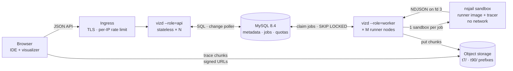
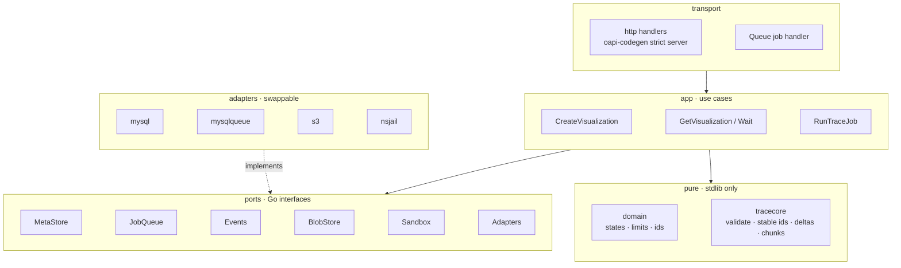
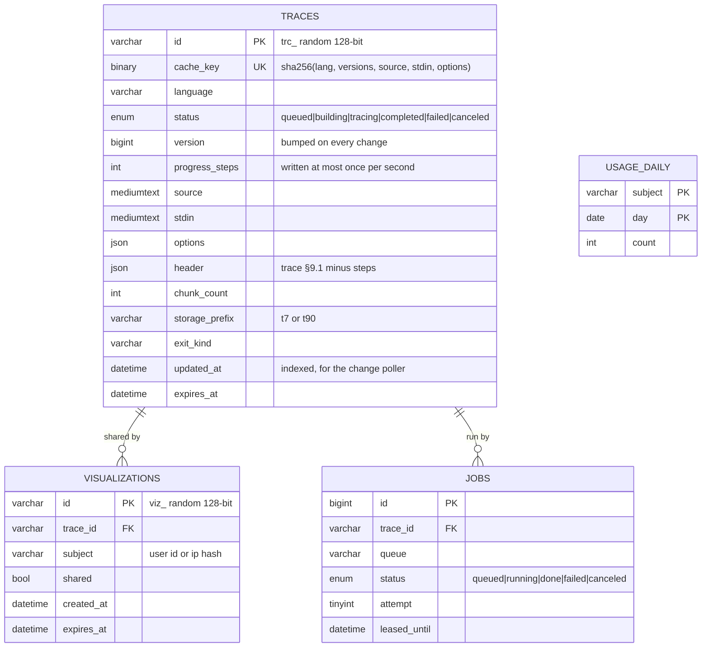
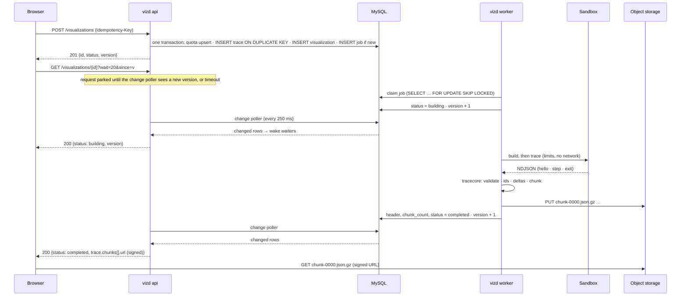
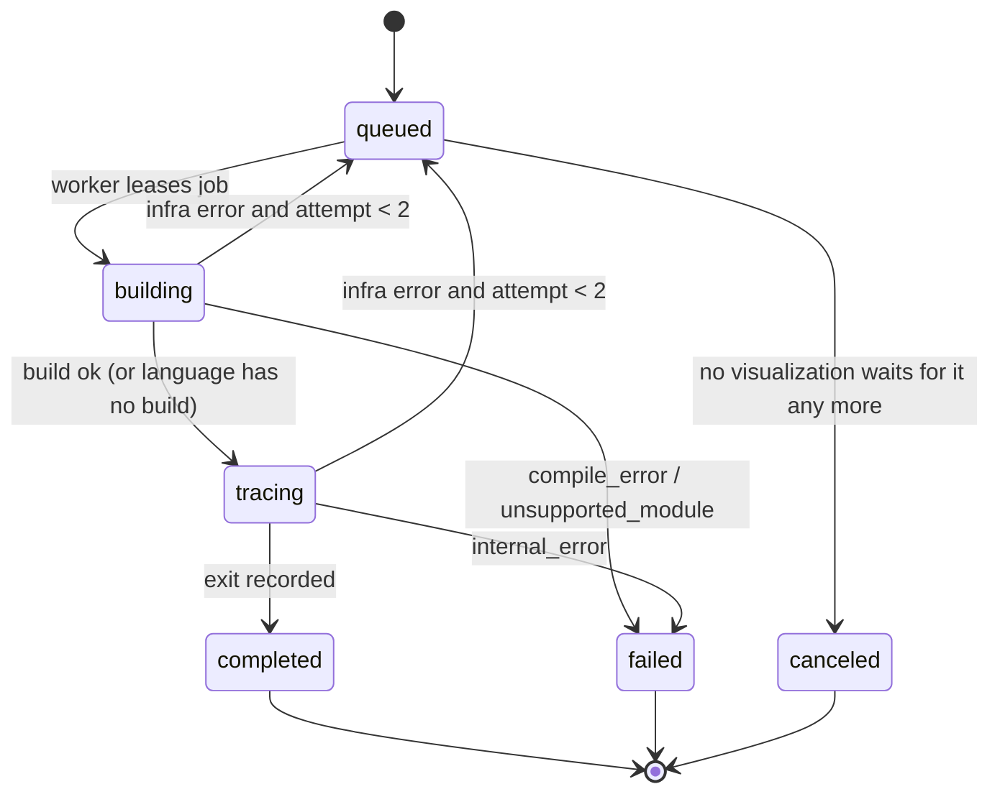
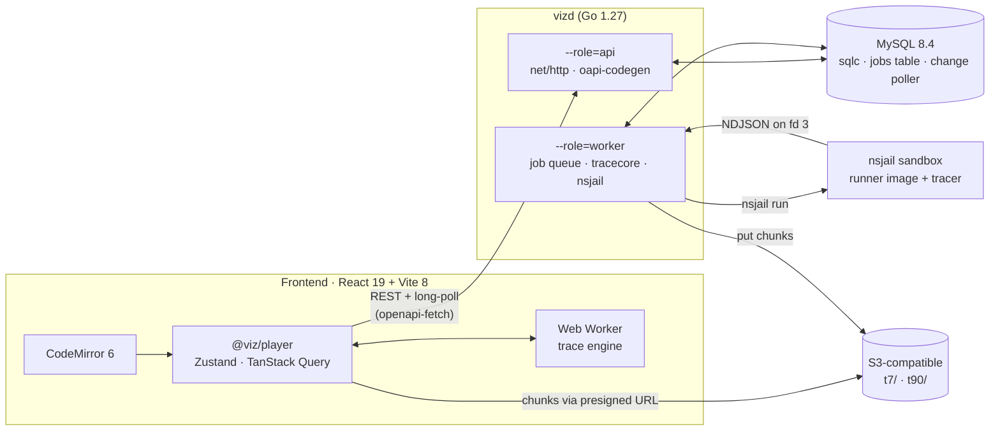

# Code Visualizer — Product & Technical Spec

| | |
|---|---|
| **Status** | **v1.2**: the database is MySQL 8.4 LTS (§7.13), because PostgreSQL isn't available. Student UX (§19) from v1.1. Decisions are in §0; history is in §0.3. |
| **Owner** | Tu Hoang |
| **Last updated** | 2026-10-23 |
| **Scope (v1)** | Python 3 and C++17. The design must let us add more languages later. |
| **Reference product** | CodeChef IDE Visualizer, as tested by hand on 2026-10-23 (see [Appendix A](#appendix-a--codechef-reference-observed)) |

## Contents

0. [Decision record (locked)](#0-decision-record-locked)
1. [Summary](#1-summary)
2. [Goals and non-goals](#2-goals-and-non-goals)
3. [Users and use cases](#3-users-and-use-cases)
4. [Baseline: what CodeChef does and where we improve](#4-baseline-what-codechef-does-and-where-we-improve)
5. [UX specification and mock UI](#5-ux-specification-and-mock-ui)
6. [Functional requirements](#6-functional-requirements)
7. [Architecture](#7-architecture)
8. [API specification](#8-api-specification)
9. [Trace format v1](#9-trace-format-v1)
10. [Language adapters (extensibility)](#10-language-adapters-extensibility)
11. [Limits and quotas](#11-limits-and-quotas)
12. [Security and sandboxing](#12-security-and-sandboxing)
13. [Non-functional requirements](#13-non-functional-requirements)
14. [Analytics](#14-analytics)
15. [Testing strategy](#15-testing-strategy)
16. [Milestones](#16-milestones)
17. [Open questions](#17-open-questions)
18. [Recommended tech stack](#18-recommended-tech-stack)
19. [Student-friendly visualization (v1.1)](#19-student-friendly-visualization-v11)
- [Appendix A — CodeChef reference (observed)](#appendix-a--codechef-reference-observed)
- [Appendix B — Glossary](#appendix-b--glossary)
- [Appendix C — Sandbox and execution-engine options](#appendix-c--sandbox-and-execution-engine-options)

---

## 0. Decision record (locked)

> **Baseline locked on 2026-10-23.** Build against this section. To change a locked decision, add a row to the change log (§0.3) giving the reason and the evidence: a spike result, an incident or a metric.

### 0.1 Locked decisions

| ID | Area | Decision | Alternatives not chosen for v1 | Revisit when | Details |
|---|---|---|---|---|---|
| D1 | Scope | Python 3.12 and C++17 (GCC 13). Other languages come later as adapters. | Java, C, JavaScript in v1 | After M4 | §2, §10 |
| D2 | Execution model | **Record once** in a sandbox, **replay** in the browser. Trace format v1: a keyframe every 50 steps, deltas in between, chunks of 250 steps. | A live debugging session | Not in v1 | §9 |
| D3 | Backend | **Go 1.27**, one binary `vizd` (roles `api`, `worker`, `all`) plus `vizctl`. A modular monolith with ports. | Separate services; Rust | If the teams split | §7.2, §7.4, C.7 |
| D4 | State | Only **MySQL 8.4 LTS** (managed, high availability, binlog point-in-time recovery) and **S3-compatible object storage**: **SeaweedFS on the server's own disk** for the M1 beta. *Changed in v1.2: PostgreSQL isn't available. Changed in v1.7: no managed object storage.* | PostgreSQL (not available), Valkey, NATS, self-hosted MinIO | §7.9 triggers | §7.13, §7.9 |
| D5 | Jobs | Own **`jobs` table on MySQL** claimed with `SKIP LOCKED`, behind the `JobQueue` port. Infrastructure errors are retried once. 30 s deadline. *Changed in v1.2: River needs PostgreSQL.* | River, NATS JetStream, Asynq | Queue work above 30% of MySQL CPU, claim p95 above 200 ms, or above 500 jobs/s | §7.7, §7.13.2 |
| D6 | Status updates | **Long-poll** (`?wait=20`) + a **change poller** on MySQL (every 250 ms, only while requests wait). *Changed in v1.2: no `LISTEN/NOTIFY` on MySQL.* | SSE, WebSocket, binlog streaming | Above 200 poller queries/s in total, or 50 API pods | §8.3, §7.13.3 |
| D7 | Trace delivery | **Presigned URLs** straight from object storage; a CDN later | Serving traces through the API | Egress cost or latency | §8.4 |
| D8 | Caching | Content-addressed cache with **single-flight** on a unique `cache_key` | A separate cache store | — | §7.12 |
| D9 | Sandbox, default | **gVisor `runsc`**, one sandbox per job, on a dedicated runner node pool. **Dropped at G1 (v1.5):** S1 failed. | — | If spike S1 fails | §18.3, Appendix C |
| D10 | Sandbox, Plan B | **nsjail** with a Kafel seccomp policy: `ptrace` allowed, ASLR off through `persona_addr_no_randomize`. **The production sandbox since G1 (v1.5).** | go-judge, isolate | Used only if S1 fails for gVisor | C.9 |
| D11 | Sandbox, Plan C | **Kata + Cloud Hypervisor**: one VM per worker pod, with nsjail per job inside it | Firecracker directly, microsandbox | When a security review requires hardware isolation | C.9 |
| D12 | Tracers | Python: `sys.settrace`. C++: GDB Python API + libstdc++ pretty printers, `-O0 -g3`, a precompiled `bits/stdc++.h`, forced flushing. | Valgrind-based tracer, `sys.monitoring` | Spike S2 (Python) | §7.11 |
| D13 | Frontend | React 19.3 + TypeScript + Vite 8; CodeMirror 6; `@viz/player` (Web Worker engine, kind registry, custom SVG arrows); Tailwind v4 + Radix; TanStack Query; Zustand | Monaco, React Flow, Svelte | — | §18.1 |
| D14 | Contracts | `openapi.yaml` and the JSON Schemas are the source of truth. Go and TypeScript types are generated from them, and CI fails if they drift. | Hand-written types | — | §18.6 |
| D15 | Infrastructure | Kubernetes, KEDA MySQL scaler, per-IP rate limits at the ingress, GitHub Actions, OpenTofu | Plain VMs only | — | §18.4 |
| D16 | Access and limits | Anonymous users allowed, with lower quotas (100/day vs 1,000). 1,000 steps by default, 5,000 maximum. Other limits as in §11. | Sign-in required | After launch metrics | §11 |
| D17 | Retention | 7 days; 90 days once shared; share links can be revoked | — | Privacy review | §7.5 |
| D18 | C++ dialect | `gnu++17` | `gnu++20` | If the judge's default changes | §7.11.2 |
| D19 | Not in v1 | Interactive stdin, AI step explanations, a Pyodide local mode for Python, multi-region | — | Roadmap review after launch | §2, C.6 |
| D20 | Audience and UI | CP and olympiad students; **English-only UI**, strings written inline (v1.3) | Beginner-first UI; Vietnamese UI | After the usability test (§19.11) | §19 |
| D21 | C++ build | Safety checks **on by default**: `_GLIBCXX_DEBUG` + UBSan, plus `--coverage` and `-Wall -Wextra -Wshadow`. One switch turns checks off to match the judge. | Checks off by default; ASan | If the overhead breaks time limits (spike S7) | §19.6 |
| D22 | Narration | Deterministic templates computed in the browser; no AI in v1 | LLM explanations | P2 review | §19.5 |
| D23 | Source parsing | **web-tree-sitter** in the browser (C++ and Python grammars) for index markers, inferred reads, branch outcomes and input tokens | Regexes; server-side parsing | If accuracy misses the target in spike S8 | §19.4.1, §19.9.2 |
| D24 | Trace format v1.1 | Optional fields: sparse sequences and patches, access hints, line hits, input position, untraced tail, call identity | A breaking v2 | — | §19.9 |
| D25 | After the step limit | Keep running untraced to the end (within the time limit), so output, exit status and hit counts are complete | Stop at the limit | — | §19.8 |

### 0.2 Still open (closed by the M0 spikes)

| Open item | Closed by | If the spike is inconclusive |
|---|---|---|
| Final sandbox: D9 or D10 | S1 | **Closed at G1 (v1.5): nsjail (D10).** |
| Python trace hook (Q4) | S2 | `sys.settrace` |
| How arrows are drawn | S3 | Custom SVG overlay; fall back to labels with arrows on hover |
| Keyframe and chunk sizes | S4 | Keyframe every 50 steps, chunks of 250 |
| Long-poll capacity per pod | S5 | Cap parked requests at 5,000 per pod |
| v1.1 build and parsing choices (D21, D23) and big-array tracking | S6–S8, before M3 | Checks stay on; big arrays use the window only; markers only for plain identifiers |

### 0.3 Change log

| Version | Date | Change |
|---|---|---|
| v0.1 | 2026-10-23 | First draft: UX, mock UI, API, trace format, adapters |
| v0.2 | 2026-10-23 | Tech stack (§18) |
| v0.3 | 2026-10-23 | Architecture review: two stateful systems, long-poll, signed URLs, single-flight, scaling model |
| v0.4 | 2026-10-23 | Sandbox and execution-engine options (Appendix C) |
| v1.0 | 2026-10-23 | **Baseline locked** (§0). Plan B is nsjail; Plan C is Kata + Cloud Hypervisor (C.9). |
| v1.1 | 2026-10-23 | Student-friendly visualization for CP students (§19): English-only UI, decisions D20–D25, FR-27–FR-41, trace format v1.1, milestone M5 |
| v1.2 | 2026-10-23 | **Database switched to MySQL 8.4 LTS** because PostgreSQL isn't available: own job queue with `SKIP LOCKED`, change poller instead of `LISTEN/NOTIFY`, MySQL single-flight SQL (§7.13). D4, D5, D6 and D15 changed. |
| v1.3 | 2026-10-23 | **Frontend trimmed to the IDE.** The web app is there to show the backend's traces, not to be a production UI: no i18n files (strings written inline), no Playwright end-to-end or visual-snapshot tests. D20 changed; §13, §15 and §18 updated. |
| v1.4 | 2026-10-23 | C++ locals are `uninit` on their declaration line until it runs (§7.11.2), instead of showing garbage. |
| v1.5 | 2026-10-23 | **G1: the production sandbox is nsjail (D10), not gVisor (D9).** Spike S1b: gVisor runs GDB, but a 1,000-step trace takes 7–9 s on its default platform (target 3 s) and `personality(ADDR_NO_RANDOMIZE)` fails, so traces aren't deterministic (§7.12). nsjail: 1.5 s, 4–8 ms starts, ASLR off. Worker pods run privileged on the runner node pool. Report: `plans/spikes/s1b-sandbox.md`. |
| v1.7 | 2026-10-24 | **Object storage is SeaweedFS on the server's own disk** (D4), because our infrastructure may have no managed S3. The M1 beta runs `vizd --role=all` and SeaweedFS on one server. Presigned URLs stay (D7). SeaweedFS only partly supports lifecycle rules, so the nightly cleanup deletes expired chunks with their rows (§7.5, §7.8). **API rules (BE-06):** `wait` without `since` returns at once; a detached visualization reads `canceled`; a repeated `Idempotency-Key` returns the same visualization in its current state; a cache hit inherits the trace's expiry; only the caller that created a visualization can delete it, while its ID stays the read key (§8.2, §8.3, §8.5, §12). `POST` bodies must be `application/json`, and an anonymous caller's quota counts per IPv4 address or IPv6 /64 (§11, §12). |
| v1.6 | 2026-10-24 | **Python tracer contract (BE-03).** The Python build step is a check (`tracer.py --check`): syntax errors become `compile_error` with diagnostics, blocked imports `unsupported_module` (§7.11.1, §10.2). The trace runs with `python3 -s -P` and `PYTHONHASHSEED=0` instead of `-I`, which ignored the seed, so set order changed between runs (§7.12). Wire `exit` carries the tracer's `lineHits`. A tracer sends one step past `maxSteps` to mark that the program went on, and the core keeps reading for the untraced tail instead of killing (§10.1, D25). §11 says what the heap-object and size limits do to a Python trace. |

---

## 1. Summary

The Code Visualizer lets a user run a program step by step inside our online IDE and see what happens on each line: which line ran, the call stack, every variable, every object in memory with arrows for references, and the output so far.

It works like this:

1. The program runs once, in a sandbox, under a language-specific **tracer**.
2. The tracer records each step into a **trace**: a list of snapshots in one shared format for all languages.
3. The browser **replays** the trace. Stepping forward and back is instant, because nothing runs again.

The design follows CodeChef's visualizer and fixes the gaps we found in it: silent truncation, pointers shown only as raw addresses, large arrays that don't render, missing output, and a data format that differs between languages. The trace format and the adapter interface are shared, so adding a language means writing one adapter. The UI doesn't change.

## 2. Goals and non-goals

### Goals

| ID | Goal |
|---|---|
| G1 | Learners and competitive programmers can see how state changes line by line without adding print statements. |
| G2 | Match CodeChef's Python and C++ visualizers, and fix the gaps listed in §4. |
| G3 | Use one trace format and one renderer for every language. A new language needs only a new adapter (§10). |
| G4 | Untrusted code never runs outside an isolated sandbox. |
| G5 | Traces of up to 1,000 steps feel instant to scrub: stepping takes under 16 ms. |

### Non-goals (v1)

- **Live debugging.** No pausing a running process, editing variables or evaluating expressions. v1 replays a recorded trace.
- **Interactive stdin.** All input is given before the run.
- **Larger programs.** No multi-file projects, threads or async, GUI or graphics output, or third-party libraries. Python's numpy, pandas and matplotlib are blocked in visualize mode.
- **Performance measurement.** A traced run is much slower than a normal one, so we never show its time or memory.

## 3. Users and use cases

| Persona | Need | Example |
|---|---|---|
| Beginner learning Python | Understand references, aliasing, loops and function calls | Why does `b.append(5)` change `a` when `b = a`, but not `c` when `c = a[:]`? |
| Competitive programmer (C++) | Find a bug on a small input; see STL containers; find where a crash happens | A DFS gives a wrong answer; step through it on the sample tree and watch `depth[]` and `child` change |
| Instructor or mentor | Show an execution in class or in a code review | Share a link that opens a trace at step 42 |

## 4. Baseline: what CodeChef does and where we improve

| Area | CodeChef today (observed) | Our requirement |
|---|---|---|
| Languages | Python3, C++ and Java. C, PyPy 3 and JavaScript have only a Run button. | v1: Python 3 and C++17. Other languages through adapters (§10). |
| Step limit | 999 steps. The trace stops with **no warning**; a 2,000-iteration loop stopped at `i = 498`. | Configurable limit, a clear banner, and a way to start tracing from a later line (FR-14, FR-15). |
| Large containers | Arrays and containers over 999 elements are not drawn at all. The UI shows `r`. | Draw the first N elements, show the total size, and let the user ask for a range (FR-11). |
| C++ pointers | Shown as raw addresses only. Structs created with `new` never appear. | Follow pointers to typed objects and draw arrows; `nullptr` shows as `∅` (FR-12). |
| Uninitialized variables | Every local shows from the start of the function, with garbage values. | Hide a variable until its declaration line runs (FR-13). |
| Compiler internals | `__for_range`, `__for_begin` and `__for_end` appear as variables. | Hidden by default, with a toggle (FR-23). |
| C++ stdout | Only output that was flushed appears. With `sync_with_stdio(false)` and no `endl`, the output pane stays empty. | The runner forces output to flush after every write (§7.11.2). |
| C++ globals | Copied into every frame. | One separate **Globals** frame. |
| Stack order | Python sends the outermost frame first; C++ sends the innermost first. | Always outermost first in the data. The UI shows the active frame last. |
| Return values | Recorded for Python only. | Recorded for both languages (FR-9). |
| Wrapper line numbers | Python's `input()` produced a step that pointed at line 328 of the internal wrapper. | Only lines from the user's file ever reach the trace. |
| Run panel after Visualize | Shows the tracer's time and memory (e.g. 3.2 s / 329 MB) as if they were the program's, and says "Successfully executed" even after a segfault. | Show no time or memory for visualize runs. Show the program's real exit status. |
| Trace size | A full snapshot at every step: about 570 KB for 120 steps with large arrays. | Store only changes, with periodic full snapshots ("keyframes") (§9.6). |
| Trace URL | `/api/code-visualizer/{32-hex hash}` | Random, unguessable IDs. Chunks come from short-lived signed URLs, and cache keys are never exposed (§7.12, §8.4). |
| Python explanations | Advertised as plain-English explanations; not seen in the UI. | Out of v1 scope; P2 (FR-21). |

## 5. UX specification and mock UI

> The mockups are monospace wireframes for structure and behavior, not visual design. Final visuals will be made in Figma using the design system's tokens.
>
> **Legend:** `▶` line just executed (blue) · `▷` next line (amber) · `!` error line (red) · `●` breakpoint, or the start of a reference arrow · `●──▶ #2` reference to heap object #2 · `═` border marks the active frame · `*` value changed since the previous step · `∅` null pointer.

### 5.1 Entry point in the IDE

```text
┌────────────────────────────────────────────────────────────────────────────────────────────────────────────┐
│ Online IDE                                                                                                 │
├──────────────────────────────────────────────┬─────────────────────────────────────────────────────────────┤
│ [ Python 3.12 ▾ ]         [Save] [Settings]  │ [ Run ]  [ Visualize ]            Ctrl/Cmd + Shift + Enter  │
├──────────────────────────────────────────────┼─────────────────────────────────────────────────────────────┤
│    1  def square(x):                         │ STDIN                                                       │
│    2      return x * x                       │ ┌────────────────────────────────────────────────────────┐  │
│    3                                         │ │ 5                                                      │  │
│    4  n = int(input())                       │ │                                                        │  │
│    5  a = [1, 2, 3]                          │ │                                                        │  │
│    6  b = a                                  │ └────────────────────────────────────────────────────────┘  │
│    7  c = a[:]                               │                                                             │
│    8  b.append(n)                            │ OUTPUT                                                      │
│    9  d = {"k": square(n)}                   │ Run results appear here.                                    │
│   …                                          │                                                             │
└──────────────────────────────────────────────┴─────────────────────────────────────────────────────────────┘
```

- The **Visualize** button appears only when `GET /api/v1/languages` reports `visualize.enabled = true` for the selected language.
- Clicking it sends the code and stdin currently in the IDE. The visualizer opens straight away in its **Loading** state (§5.6).
- Keyboard shortcut: `Ctrl/Cmd + Shift + Enter`.
- Visualize does **not** change the IDE's Run output panel.

### 5.2 Layout (desktop, at least 1024 px wide)

```text
┌────────────────────────────────────────────────────────────────────────────────────────────────────────────┐
│ HEADER   Visualizer · <language> · <file>      [Settings] [Share] [Open in new tab] [✕]                    │
├──────────────────────────────────────────────┬─────────────────────────────────────────────────────────────┤
│ CODE PANE  (read-only)                       │ STATE PANE                                                  │
│   line numbers · breakpoint gutter           │                                                             │
│   ▶ just executed (blue)   ▷ next (amber)    │ ┌─ STACK ───────────────────┐ ┌─ HEAP ───────────────────┐  │
│   ! error line (red)       ● breakpoint      │ │ Globals (module / file)   │ │ #1 list                  │  │
│                                              │ │ one table per frame       │ │ #2 dict                  │  │
│                                              │ │ outermost → innermost     │ │ #3 Node (struct)         │  │
├──────────────────────────────────────────────┤ │ active frame: ═ border    │ │ cards, first-seen order  │  │
│ CONTROLS                                     │ │ refs drawn as ●──▶ #id    │ │ SVG arrows: ● → card     │  │
│  Step N of M · <event> <detail>              │ └───────────────────────────┘ └──────────────────────────┘  │
│  [|◀]  [◀ Prev]  [Next ▶]  [▶|]  [▶ Play 1x] │                                                             │
│  ━━━━━━━━━━━━━━●──────────────────── slider  │ * = value changed since previous step                       │
├──────────────────┬───────────────────────────┤                                                             │
│ STDIN            │ STDOUT / STDERR           │                                                             │
│ (read-only)      │ output up to current step │                                                             │
│                  │                           │                                                             │
├──────────────────┴───────────────────────────┴─────────────────────────────────────────────────────────────┤
│ STATUS BAR   exit status · banners: error / step limit / truncated data / unsupported feature              │
└────────────────────────────────────────────────────────────────────────────────────────────────────────────┘
```

| Region | Content | Rules |
|---|---|---|
| Header | Language, file name, Settings, Share, Open in new tab, Close | `Esc` closes. Open in new tab uses the permalink (FR-18). |
| Code pane | Read-only code with line numbers and a breakpoint gutter | Scrolls itself to keep the current line visible. Clicking a line number toggles a breakpoint, which applies on the next run. |
| Controls | Step counter, Start, Prev, Next, End, Play, and a slider | See §5.9 for keyboard shortcuts. |
| Stdin / Stdout | Stdin is read-only. Stdout shows everything printed **up to the current step**. | stderr is shown in red. Text from the current step is highlighted. |
| Stack | One table per frame, outermost at the top | The active frame has a `═` border and is scrolled into view. |
| Heap | One card per object, in the order objects first appeared | Arrows are drawn as SVG. Unreachable objects are hidden by default. |
| Status bar | Exit status, step count, banners | Banners are described in §5.6. |

The divider between the left and right panes can be dragged. Its width is saved per user in `localStorage`.

### 5.3 Python example (aliasing and a function call)

```text
┌────────────────────────────────────────────────────────────────────────────────────────────────────────────┐
│ Visualizer · Python 3.12 · main.py               [Settings] [Share] [Open in new tab] [✕]                  │
├──────────────────────────────────────────────┬─────────────────────────────────────────────────────────────┤
│    1  def square(x):                         │ STACK                   HEAP                                │
│ ▷  2      return x * x                       │ ┌─ Global ──────────┐                                       │
│    3                                         │ │ square │ ●──▶ #1  │   #1 function                         │
│    4  n = int(input())                       │ │ n      │ 5        │      square(x)                        │
│    5  a = [1, 2, 3]                          │ │ a      │ ●──▶ #2  │                                       │
│    6  b = a                                  │ │ b      │ ●──▶ #2  │   #2 list · len 4   ◀ a, b            │
│    7  c = a[:]                               │ │ c      │ ●──▶ #3  │   ┌────┬────┬────┬────┐               │
│    8  b.append(n)                            │ └────────┴──────────┘   │ 1  │ 2  │ 3  │ 5  │               │
│ ▶  9  d = {"k": square(n)}                   │ ╔═ square ══════════╗   └────┴────┴────┴────┘               │
│   10  s = "hi"                               │ ║ x      │ 5 *      ║     0    1    2    3                  │
│   11  t = s                                  │ ╚════════╧══════════╝                                       │
│   12  for i in range(2):                     │   ▲ active frame        #3 list · len 3   ◀ c               │
│   13      a[i] += 10                         │                         ┌────┬────┬────┐                    │
│   14  print(a, b, c, d, t)                   │                         │ 1  │ 2  │ 3  │                    │
│                                              │                         └────┴────┴────┘                    │
├──────────────────────────────────────────────┤                           0    1    2                       │
│ Step 9 of 19 · call square(x=5)              │                                                             │
│ [|◀]  [◀ Prev]  [Next ▶]  [▶|]  [▶ Play 1x]  │ * changed since previous step                               │
│ ━━━━━━━━━━━━━━━━━━●─────────────────────     │                                                             │
├──────────────────┬───────────────────────────┤                                                             │
│ STDIN            │ STDOUT                    │                                                             │
│ 5                │ (nothing printed yet)     │                                                             │
├──────────────────┴───────────────────────────┴─────────────────────────────────────────────────────────────┤
│ Ready · 19 steps · exit: normal (0)                                                                        │
└────────────────────────────────────────────────────────────────────────────────────────────────────────────┘
```

- `a` and `b` point to the **same** card (#2), and the card is labelled `◀ a, b`. `c` points to a separate copy (#3). Making aliasing obvious is a core goal for beginners.
- Strings, numbers, booleans and `None` are shown inline in the frame tables. Mutable objects are drawn as cards on the heap.
- A **call** step shows the new frame, with its arguments marked as changed.

### 5.4 C++ example (STL, pointers, large global array)

```text
┌────────────────────────────────────────────────────────────────────────────────────────────────────────────┐
│ Visualizer · C++17 (GCC 13) · main.cpp          [Settings] [Share] [Open in new tab] [✕]                   │
├──────────────────────────────────────────────┬─────────────────────────────────────────────────────────────┤
│    1  #include <bits/stdc++.h>               │ STACK                   HEAP                                │
│    2  using namespace std;                   │ ┌─ Globals ────────┐                                        │
│    3  struct Node { int val; Node* next; };  │ │ MAXN  │ 200005   │    #1 int[200005] · global             │
│    4  const int MAXN = 200005;               │ │ depth │ ●──▶ #1  │    ┌───┬───┬───┬───┐                   │
│    5  int depth[MAXN];                       │ └───────┴──────────┘    │ 0 │ 0 │ 0 │ 0 │ … +199,997        │
│    6                                         │ ╔═ main() ═════════╗    └───┴───┴───┴───┘                   │
│    7  int main() {                           │ ║ v     │ ●──▶ #2  ║      0   1   2   3                     │
│    8      vector<int> v = {4, 1, 3};         │ ║ cnt   │ ●──▶ #3  ║       [Show range…]                    │
│    9      map<string,int> cnt;               │ ║ head  │ ●──▶ #4  ║                                        │
│   10      cnt["ab"] = 2;                     │ ╚═══════╧══════════╝    #2 vector<int> · size 3 · cap 3     │
│   11      Node* head = new Node{1, nullptr}; │   hidden: 2 internals   ┌───┬───┬───┐                       │
│ ▶ 12      head->next = new Node{2, nullptr}; │   [Show]                │ 4 │ 1 │ 3 │                       │
│ ▷ 13      depth[3] = 7;                      │                         └───┴───┴───┘                       │
│   14      sort(v.begin(), v.end());          │                           0   1   2                         │
│   15      cout << v[0] << endl;              │                                                             │
│   16  }                                      │                         #3 map<string,int> · size 1         │
│                                              │                         ┌──────┬───┐                        │
├──────────────────────────────────────────────┤                         │ "ab" │ 2 │                        │
│ Step 12 of 16 · line 12 → 13                 │                         └──────┴───┘                        │
│ [|◀]  [◀ Prev]  [Next ▶]  [▶|]  [▶ Play 1x]  │                                                             │
│ ━━━━━━━━━━━━━━━━━━━━━━━━━━━●────────────     │                         #4 Node              #5 Node *      │
├──────────────────┬───────────────────────────┤                         ┌──────┬──────────┐  ┌──────┬───┐   │
│ STDIN            │ STDOUT                    │                         │ val  │ 1        │  │ val  │ 2 │   │
│ (none)           │ (nothing printed yet)     │                         │ next │ ●──▶ #5* │  │ next │ ∅ │   │
│                                              │                         └──────┴──────────┘  └──────┴───┘   │
│                                              │                                                             │
│                                              │ * changed   ∅ nullptr   hover ● to see the address          │
├──────────────────────────────────────────────┴─────────────────────────────────────────────────────────────┤
│ Ready · 16 steps · exit: normal (0)                                                                        │
└────────────────────────────────────────────────────────────────────────────────────────────────────────────┘
```

- **Globals** is a frame of its own. Its variables are never copied into other frames.
- **Large arrays** (`depth[200005]`) draw the first elements, then `… +N`. `[Show range…]` re-runs the trace and records the requested range (FR-11).
- **Pointers** to user-defined types are followed, so `head` points to card #4, whose `next` points to card #5. Hovering shows the raw address. Turn on *Show memory addresses* to show addresses inline.
- `hidden: 2 internals` counts the compiler-generated variables that are hidden (FR-23).

### 5.5 Matrix view for 2-D data (P1)

```text
┌─ Heap card · matrix view (2-D data) ───────────────────────┐
│ #7 vector<vector<int>> · 3 × 4        [ Matrix ▾ | Cards ] │
│        0    1    2    3                                    │
│     ┌────┬────┬────┬────┐                                  │
│   0 │ 0  │ 1  │ 1  │ 1  │                                  │
│     ├────┼────┼────┼────┤                                  │
│   1 │ 0  │ 1  │ 2  │ 2* │                                  │
│     ├────┼────┼────┼────┤                                  │
│   2 │ 0  │ 1  │ 2  │ 3  │                                  │
│     └────┴────┴────┴────┘                                  │
│   rows #8 #9 #10 are folded into the grid; * = changed     │
└────────────────────────────────────────────────────────────┘
```

- This view is offered when a sequence's elements are all sequences of the same length containing primitives, such as `vector<vector<int>>` or `list[list[int]]`.
- A toggle switches between **Matrix** and **Cards**. The choice is saved for each variable for the rest of the session.
- This makes DP tables readable, which matters for the competitive-programming use case.

### 5.6 States

**Loading.** Progress comes from long-polling (§8.3).

```text
┌─ Visualizer · C++17 (GCC 13) · preparing ────────────────────────────┐
│ ● Queued   ● Building   ◌ Tracing (412 steps so far)   ○ Ready       │
│ ████████████████████░░░░░░░░░░░░░░░░░░                               │
│                                                                      │
│ [ Cancel ]                                                           │
└──────────────────────────────────────────────────────────────────────┘
```

**Build error (C++).** Nothing is shown to step through. The error lines link back to the editor.

```text
┌─ Visualizer · C++17 (GCC 13) · build error ──────────────────────────┐
│ Build failed. Fix the error and visualize again.                     │
│                                                                      │
│ main.cpp:6:14  error: expected ';' before 'return'                   │
│     6 |     int x = 5                                                │
│       |              ^                                               │
│     7 |     return 0;                                                │
│                                                                      │
│ [ Go to line 6 ]                               [ Close ]             │
└──────────────────────────────────────────────────────────────────────┘
```

**Exception or runtime error.** The step that raised it is marked with `!`. The trace continues through stack unwinding to the end.

```text
┌────────────────────────────────────────────────────────────────────────────────────────────────────────────┐
│ Visualizer · Python 3.12 · main.py               [Settings] [Share] [Open in new tab] [✕]                  │
├──────────────────────────────────────────────┬─────────────────────────────────────────────────────────────┤
│    1  def f(arr, i):                         │ STACK                 HEAP                                  │
│ !  2      return arr[i]                      │ ┌─ Global ────────┐                                         │
│    3                                         │ │ f    │ ●──▶ #1  │   #1 function                           │
│    4  x = [10, 20]                           │ │ x    │ ●──▶ #2  │      f(arr, i)                          │
│    5  print(f(x, 5))                         │ └──────┴──────────┘                                         │
│                                              │ ╔═ f ══╤══════════╗   #2 list · len 2                       │
├──────────────────────────────────────────────┤ ║ arr  │ ●──▶ #2  ║   ┌────┬────┐                           │
│ Step 8 of 11 · exception in f()              │ ║ i    │ 5        ║   │ 10 │ 20 │                           │
│ [|◀]  [◀ Prev]  [Next ▶]  [▶|]  [▶ Play 1x]  │ ╚══════╧══════════╝   └────┴────┘                           │
│ ━━━━━━━━━━━━━━━━━━━━━━━━━━━━━●──────────     │                         0    1                              │
├──────────────────────────────────────────────┴─────────────────────────────────────────────────────────────┤
│ !! IndexError: list index out of range  ·  line 2, in f()  ·  raised at step 8, program ended at step 11   │
│    [Jump to error step]                                                                                    │
└────────────────────────────────────────────────────────────────────────────────────────────────────────────┘
```

- C++ signals map to readable messages: `SIGSEGV` becomes "Segmentation fault (invalid memory access)", `SIGFPE` becomes "Arithmetic error (e.g. division by zero)", and `SIGABRT` becomes "Aborted". A signal ends the trace at the step where it happened.
- **Jump to error step** moves the slider to the step where the error was raised.

**Step limit reached.** We never truncate silently.

```text
┌─ Status bar · step limit reached ──────────────────────────────────────────────────────────────────────────┐
│ (!) Trace stopped at step 1,000 (step limit). The program was still running:                               │
│     line 10 in main(), i = 498. Later lines were not recorded.                                             │
│                                                                                                            │
│     [ Start tracing from line… ]   [ Raise limit to 5,000 ]   [ Why? ]                                     │
└────────────────────────────────────────────────────────────────────────────────────────────────────────────┘
```

**Start tracing from line…** (FR-15) skips the early, uninteresting steps. The tracer runs the program at full speed and records nothing until execution first reaches one of the chosen lines.

```text
┌─ Start tracing from ──────────────────────────────────────────┐
│ Skip ahead: record steps only after the program first         │
│ reaches one of these lines.                                   │
│                                                               │
│ Start at line   [ 12   ]                                      │
│ Breakpoints     ● 12   ● 16      (click the gutter to add)    │
│ Max steps       [ 1000 ▾ ]       server max 5,000             │
│                                                               │
│                                     [ Cancel ]  [ Visualize ] │
└───────────────────────────────────────────────────────────────┘
```

**Other states:**

| State | Trigger | UI |
|---|---|---|
| Unsupported module | e.g. `import numpy` in visualize mode | A banner before the run: "numpy isn't supported in the visualizer. Use Run instead." |
| Timeout | Wall time or CPU limit hit | Steps recorded so far stay available, with the banner "Stopped after 15 s". |
| Output limit | stdout over its limit | Output is cut off with `… (output truncated)`. The trace continues. |
| Server busy | HTTP 503 or a full queue | "Visualizer is busy, try again in a few seconds" with a Retry button. |
| Internal error | Tracer crash | "Something went wrong on our side", the trace ID, and a Report link. |

### 5.7 Settings

```text
┌─ Visualizer settings ────────────────────┐
│ Max steps                     [ 1000 ▾ ] │
│ Autoplay speed                [ 1x ▾ ]   │
│ Draw reference arrows         [x]        │
│ Highlight changed values      [x]        │
│ Show unreachable objects      [ ]        │
│ Matrix view for 2-D data      [x]        │
│ Show memory addresses (C/C++) [ ]        │
│ Show compiler internals       [ ]        │
└──────────────────────────────────────────┘
```

Settings are saved per user, in `localStorage` for anonymous users and in the profile for signed-in users. Changing *Max steps* takes effect on the next run.

### 5.8 Narrow screens (under 768 px)

```text
┌────────────────────────────────────────┐    ┌────────────────────────────────────────┐
│ Visualizer · Python 3.12       [✕]     │    │ Visualizer · Python 3.12       [✕]     │
├────────────────────────────────────────┤    ├────────────────────────────────────────┤
│ [■ Code ]  [ State ]  [ Output ]       │    │ [ Code ]  [■ State ]  [ Output ]       │
├────────────────────────────────────────┤    ├────────────────────────────────────────┤
│    1  def square(x):                   │    │ ┌─ Global ──────────┐                  │
│ ▷  2      return x * x                 │    │ │ square │ ●──▶ #1  │                  │
│    3                                   │    │ │ n      │ 5        │                  │
│    4  n = int(input())                 │    │ │ a      │ ●──▶ #2  │                  │
│    5  a = [1, 2, 3]                    │    │ │ b      │ ●──▶ #2  │                  │
│    6  b = a                            │    │ │ c      │ ●──▶ #3  │                  │
│    7  c = a[:]                         │    │ └────────┴──────────┘                  │
│    8  b.append(n)                      │    │ ╔═ square ══════════╗                  │
│ ▶  9  d = {"k": square(n)}             │    │ ║ x      │ 5 *      ║                  │
│   10  s = "hi"                         │    │ ╚════════╧══════════╝                  │
│   …                                    │    │ #2 list · len 4  ◀ a, b                │
├────────────────────────────────────────┤    │ ┌────┬────┬────┬────┐                  │
│ Step 9 / 19 · call square(x=5)         │    │ │ 1  │ 2  │ 3  │ 5  │                  │
│ [|◀]   [◀]   [ ▶ ]   [▶|]              │    │ └────┴────┴────┴────┘                  │
│ ━━━━━━━━━━━━━━●───────────────────     │    ├────────────────────────────────────────┤
└────────────────────────────────────────┘    │ Step 9 / 19 · call square(x=5)         │
                                              │ [|◀]   [◀]   [ ▶ ]   [▶|]              │
                                              │ ━━━━━━━━━━━━━━●───────────────────     │
                                              └────────────────────────────────────────┘
```

- Three tabs: **Code**, **State** and **Output**. The controls stay pinned at the bottom of every tab.
- Arrows are not drawn on narrow screens. References show only as `●──▶ #id` labels, and tapping one scrolls to its card.

### 5.9 Interaction rules

| Action | Mouse / touch | Keyboard |
|---|---|---|
| Next / previous step | Next ▶ / ◀ Prev | `→` / `←` |
| First / last step | \|◀ / ▶\| | `Home` / `End` |
| Play / pause autoplay (P1) | ▶ Play | `Space` |
| Step over: next line in the same frame (P1) | Shift-click Next | `Shift + →` |
| Step out: return to the caller (P1) | — | `Shift + ↑` |
| Scrub | Drag the slider | — |
| Jump to a frame's line | Click the frame title | — |
| Highlight referrers | Hover a card. Its arrows and every `●` pointing to it are highlighted. | — |
| Close | ✕ | `Esc` |

- **Changed values:** after each step, values that changed are bold with an accent background, and new objects get a short fade-in. Changes are found by comparing the current step with the previous one in the browser.
- **Arrow routing:** arrows go from the right edge of the `●` to the left edge of the card. Arrows to the same card are bundled together. If more than 30 arrows are visible, the UI falls back to labels and draws arrows only on hover.
- **Autoplay speeds:** 0.5×, 1×, 2× and 4×, where 1× is 2 steps per second. Autoplay stops at errors and breakpoints.

### 5.10 Accessibility

- Every control can be reached with the keyboard, and keyboard focus is always visible.
- An `aria-live="polite"` region announces each step, for example "Step 9 of 19, call square, line 2".
- Color is never the only signal. Lines are also marked with `▶ ▷ !` in the gutter, and changed values are also bold.
- Contrast meets WCAG 2.2 AA in both light and dark themes. Animations follow `prefers-reduced-motion`.

## 6. Functional requirements

Priority: **P0** = needed for v1 launch · **P1** = soon after launch · **P2** = later

| ID | Requirement | Priority | Notes |
|---|---|---|---|
| FR-1 | Show a Visualize button for languages whose adapter is enabled | P0 | Driven by `GET /languages` |
| FR-2 | Run the user's code with the given stdin inside the sandbox, under the language's tracer | P0 | §7, §12 |
| FR-3 | Step through the trace: Start, Prev, Next, End, slider, keyboard | P0 | §5.9 |
| FR-4 | Highlight the line just executed and the next line | P0 | Gutter marks `▶` and `▷` as well as color |
| FR-5 | Show stack frames and their variables, a separate Globals frame, and highlight the active frame | P0 | Variables in declaration order |
| FR-6 | Show heap objects with IDs that stay the same across steps, plus reference arrows | P0 | IDs `o1, o2…` are given in the order objects first appear |
| FR-7 | Show stdout and stderr up to the current step | P0 | Each step stores only its new output |
| FR-8 | Show exceptions and runtime errors at the step where they happen, with message and line | P0 | Python exceptions; C++ signals |
| FR-9 | Show the return value on `return` steps | P0 | Python: from the trace hook. C++: from GDB's `finish` |
| FR-10 | Highlight values that changed since the previous step | P0 | Computed in the browser |
| FR-11 | For large containers, record up to `maxElements` items and draw the first 100, with "show more" and "show range" | P0 | Show range re-runs the trace with `captureRanges` |
| FR-12 | C++: follow pointers to user-defined types and to array elements, and draw arrows. `nullptr` shows as `∅`; addresses on hover. | P0 | Limited by the per-step object budget |
| FR-13 | Hide variables before their declaration line has run | P0 (C++) | Uses each variable's declaration line from the debug info |
| FR-14 | When the step limit is hit, end the trace with `exit.kind = "step_limit"` and show a banner | P0 | Never truncate silently |
| FR-15 | Start tracing from a line, or from breakpoints | P1 | `options.startAtLines` |
| FR-16 | Autoplay with adjustable speed | P1 | |
| FR-17 | Step over and step out | P0 | Computed from frame depth in the browser; part of Go to… (§19.8) |
| FR-18 | Shareable permalink, optionally opening at a given step | P1 | `/viz/{id}?step=42` |
| FR-19 | Open the visualizer in a new tab | P1 | Same as the permalink |
| FR-20 | Matrix view for 2-D data, with read and write marks | P0 | §5.5, §19.4.3 |
| FR-21 | Plain-English explanation of the current step, generated by AI | P2 | Needs a cost review |
| FR-22 | Show compile errors with links to the right lines | P0 | Parsed from compiler output |
| FR-23 | Hide compiler-generated and runtime-internal variables by default, with a setting to show them | P0 | Adapters flag them as `internal` |
| FR-24 | Hide features a language's adapter can't support, such as pointer settings for Python | P0 | `capabilities` in the manifest (§10.2) |
| FR-25 | C++ safety checks, **on by default**: `_GLIBCXX_DEBUG` + UBSan | P0 | §19.6, D21 |
| FR-26 | Watch expressions | P2 | Needs adapters that can evaluate expressions |
| FR-27 | One-line narration for every step | P0 | Deterministic templates (§19.5) |
| FR-28 | Line hit counts for the whole run, in the gutter | P0 | §19.3, §19.9.3 |
| FR-29 | Index markers and range brackets on arrays | P0 | §19.4.1 |
| FR-30 | Big arrays: window, minimap, non-zero view | P0 | §19.4.2, §19.9.1 |
| FR-31 | Go to…: next change, next time a line runs, next call, next print, first difference, error | P0 | §19.8 |
| FR-32 | Compare with expected output; jump to the first wrong step | P0 | §19.7 |
| FR-33 | Friendly error messages with one hint | P0 | §19.6 |
| FR-34 | Keep running untraced after the step limit | P0 | §19.8, §19.9.5 |
| FR-35 | Input cursor: tokens read so far, and the token read at this step | P0 | Python exact, C++ inferred (§19.9.4) |
| FR-36 | Call tree with repeated-call marks | P1 | §19.4.4 |
| FR-37 | Container widgets, bits view, constant badges, struct-array table | P1 | §19.4.6 |
| FR-38 | Graph and tree views | P1 | §19.4.5 |
| FR-39 | Watch pins with history; timeline lanes | P1 | §19.3, §19.8 |
| FR-40 | Conditional jumps and loop-pass chips | P1 | §19.8 |
| FR-41 | Compiler warnings panel with links to lines | P0 | §19.6 |

## 7. Architecture

### 7.1 Architecture review: what changed in v0.3

v0.2 worked, but it had more moving parts than v1 needs, and it left several important behaviors undefined. This revision removes components, takes our servers out of the trace download path, and defines the failure, retry and scaling behavior.

| # | Problem in v0.2 | Change in v0.3 | Result |
|---|---|---|---|
| 1 | **Four stateful systems:** PostgreSQL, Valkey, object storage, plus the queue | **Two:** PostgreSQL (metadata, queue, quotas, cache index, wake-up events) and object storage (trace chunks). Valkey is dropped from v1. | Fewer things to run, back up, monitor and lose. Valkey comes back only at a measured trigger (§7.9). |
| 2 | Trace chunks were downloaded **through the API** | The worker uploads chunks. The API hands out short-lived **signed URLs**, and the browser downloads chunks straight from object storage (behind a CDN later). | The API only serves small JSON. Download bandwidth scales with storage and CDN, not with our pods. |
| 3 | SSE needed status fan-out across API instances, and that wasn't designed | **Long-polling** (`GET …?wait=20`). Each API instance holds one Postgres `LISTEN` connection and wakes waiting requests in memory. | Works through every proxy and on mobile networks. No sticky sessions, no message broker. |
| 4 | Progress updates would have written to the database many times per job | Progress is sent only with `NOTIFY`. Only **state changes** are written to tables. | About 4 row writes per job |
| 5 | Two services implied two codebases | **One Go binary, `vizd`**, with `--role=api\|worker\|all` | One build, one configuration, and the whole system runs in one process during development |
| 6 | Identical requests each ran their own job (e.g. a class of 100 students running the same sample) | **Single-flight:** a unique `cache_key` makes identical requests attach to the same trace, whether it's queued, running or done (§7.12) | One sandbox run serves everyone |
| 7 | No job state machine or retry rules | Explicit states (§7.7). **Only infrastructure failures are retried**, at most once. The user program's outcome is never retried. `Idempotency-Key` on create. | No duplicate work, and broken code can't cause a retry storm |
| 8 | Workers on runner nodes held full database and storage credentials | **Scoped credentials.** The worker's database role touches only its own job's data. Its storage credential is write-only to one prefix. | A sandbox escape reaches very little |
| 9 | C++ compile time dominated latency (`bits/stdc++.h` takes about 1–2 s) | A **precompiled header** in the C++ runner image (§7.11.2) | The C++ time-to-first-step target in §13 becomes reachable |
| 10 | Capacity wasn't modelled | A sizing formula, sample sizes, and **scale triggers** that say when to change a component (§7.9) | We grow by adding nodes, and change design only when a number says so |
| 11 | Trace retention was left to application jobs | Object storage **lifecycle rules** on two prefixes (`t7/`, `t90/`), plus one nightly SQL delete | No cleanup service to build |

> **v1.2:** the database is now **MySQL 8.4 LTS**, because PostgreSQL isn't available. The PostgreSQL mechanisms named in this table (River, `LISTEN/NOTIFY`) are replaced as described in §7.13. The design decisions themselves are unchanged.

### 7.2 Design principles

1. **One binary, two roles.** `vizd` is a modular monolith. Run `--role=all` on a laptop and split it into `api` and `worker` deployments in production.
2. **Two stateful systems in v1:** MySQL and object storage. Everything else is stateless and can be replaced at any time.
3. **Heavy bytes skip our servers.** Trace chunks go worker → object storage → (CDN) → browser.
4. **Every external dependency sits behind a port** (a Go interface). Each has a v1 adapter and a documented adapter to switch to at scale (§7.4).
5. **Languages are data, not code.** Adding one means adding a runner image and a manifest; no Go changes.
6. **Trust nothing that comes out of the sandbox.** The sandbox has no network and no credentials. The trace core validates everything it reads.
7. **Traces are a cache.** Any trace can be rebuilt from (code, stdin, versions), so trace blobs need no backups. Only MySQL is backed up.

### 7.3 System overview



| Box | State | Scales by | Notes |
|---|---|---|---|
| Ingress | none | Managed / replicas | TLS, per-IP limit on `POST /visualizations`, request size caps |
| `vizd` api | none | Adding pods (CPU) | Validation, quotas, single-flight, long-poll, URL signing |
| `vizd` worker | none (jobs are leased) | Adding runner nodes (KEDA) | Sandbox launcher plus trace core. Slots per node = vCPU − 1. |
| MySQL | **durable** | Bigger instance → ProxySQL or RDS Proxy → read replicas | Managed, highly available, binlog point-in-time recovery (§7.13) |
| Object storage | cache (rebuildable) | Managed service | Lifecycle rules handle expiry |

### 7.4 Inside `vizd`: modules and ports



**Dependency rule:** `transport → app → domain`. Adapters implement ports. `domain` and `tracecore` import nothing outside the standard library, so they are fully unit-testable. `tracecore` is reused by the `vizctl` CLI (§7.10).

| Port | Job | v1 adapter | Scale-out adapter | Switch when (see §7.9) |
|---|---|---|---|---|
| `MetaStore` | Visualizations, traces, quotas, shares | MySQL (go-sql-driver + sqlc) | Same, plus ProxySQL or RDS Proxy and read replicas | MySQL CPU above 60% |
| `JobQueue` | Enqueue, lease, cancel, retry | `jobs` table with `SKIP LOCKED` (§7.13.2) | NATS JetStream | Queue work takes more than 30% of MySQL CPU, claim p95 above 200 ms, or over 500 jobs/s |
| `Events` | Wake up long-polls; progress | Change poller on `traces.updated_at` (§7.13.3) | NATS core pub/sub | Poller queries above 200/s in total, or more than 50 API pods |
| `BlobStore` | Put chunks; sign URLs; copy on share | S3 API (aws-sdk-go-v2) | Same, with a CDN in front | Egress cost or latency |
| `Sandbox` | Run a build or trace with limits | nsjail (D10) | Kata + Cloud Hypervisor (D11), or a remote sandbox service | Stronger isolation needed |
| `Adapters` | Language manifests and capabilities | YAML files mounted as a ConfigMap | Same | — |
| `RateLimiter` | Per-user burst limits | Not needed in v1 (ingress handles bursts; quotas live in MySQL) | Valkey + redis_rate | Rate-limited endpoint above 2,000 req/s |

### 7.5 Data model and storage layout



- **Object keys:** `{t7|t90}/{traceId}/chunk-0000.json.gz`, one chunk per 250 steps. Chunk boundaries line up with keyframes (250 = 5 × 50).
- **Retention:** new traces go under `t7/` and expire 7 days after they were created. Sharing does a server-side copy to `t90/` (90 days) and updates `storage_prefix`. A nightly cleanup deletes the rows past `expires_at`, then the chunks of the traces it deleted. *v1.7: SeaweedFS only partly supports lifecycle rules, so the cleanup deletes chunks, not the bucket.*
- **Why a trace and a visualization are separate:** many users (visualizations) can share one trace (single-flight and cache). Ownership, sharing and quotas belong to the visualization, never to the trace.

### 7.6 Request lifecycle



### 7.7 Job states and retries



- **The user program's outcome is never retried.** Exceptions, signals, timeouts and step, output or memory limits all end as `completed`, with `exit.kind` set. Only **infrastructure errors** are retried, at most once and on another worker: the sandbox failed to start, the node was drained, or storage failed.
- **Hard deadline:** 30 s per job (enforced by the worker; the 45 s lease covers it, §7.13.2). If it's hit, the sandbox is killed. Steps recorded so far are kept, with `truncation.reason = time_limit`.
- **Cancel:** `DELETE /visualizations/{id}` detaches that visualization. The job is canceled only if no other visualization is waiting on the same trace.
- **Idempotency:** `POST` with the same `Idempotency-Key` within 24 h returns the original response.

### 7.8 Failure modes

| Failure | Behavior | User sees |
|---|---|---|
| A worker crashes mid-job | The lease expires and the rescuer re-queues the job (attempt + 1, §7.13.2). The node janitor kills orphaned sandboxes (by label and age). | A few seconds of extra wait |
| A node is drained or preempted | `SIGTERM`: stop leasing; finish running jobs within 25 s; otherwise return them to the queue | Nothing, or a short delay |
| MySQL is unavailable | `POST` returns `503 capacity`. Already-issued trace URLs keep working until they expire. Long-polls end and the client backs off. | "Visualizer is busy" with Retry |
| Object storage is unavailable | Uploads retry 3 times with backoff, then fail as an infra error (one more attempt) | Delay, or "Something went wrong" |
| Queue is backed up | `POST` returns `503 capacity` with `Retry-After` once queued jobs exceed `slots × 10` | "Visualizer is busy" |
| Tracer output is broken or malicious | Schema validation fails, and the job fails with `internal_error`. A redacted sample is logged. | "Something went wrong" plus a trace ID |
| A permalink goes viral | Each view is one small JSON request (cached for 60 s), and chunks come from storage or CDN | Nothing |
| The change poller's query fails | It retries on the next tick. Parked requests re-read their row when they time out, so no update is lost, at worst it's late. | At most one `wait` period of delay |
| The nightly cleanup can't delete a trace's chunks | Its rows are already gone, so the chunks stay as orphans. The cleanup logs the trace ID and goes on. | Nothing |
| Deadlock or lock-wait timeout (MySQL 1213, 1205) | The transaction is retried up to 3 times with jitter (§7.13.4) | Nothing, or a short delay |

### 7.9 Scaling model

**Sizing.** One slot = 1 vCPU + 512 MB, running one job at a time.

`slots = peak jobs/s × average job seconds ÷ 0.7 target utilization`

| Peak load | Avg job | Slots | Runner nodes (8 vCPU = 7 slots) | API pods | MySQL |
|---|---|---|---|---|---|
| 1 job/s (beta) | 2 s | 3 | 1 (+1 spare) | 2 | 2 vCPU, managed HA |
| 10 jobs/s | 2 s | 29 | 5 | 2–3 | 4 vCPU |
| 50 jobs/s | 2 s | 143 | 21 | 4–6 | 8 vCPU + ProxySQL or RDS Proxy |

Database load stays small. Each job costs about 4 row writes, 3 queue writes (insert, claim, finish) and at most 2 progress writes, so roughly 450 writes/s at 50 jobs/s. Each API pod with waiting requests adds 4 poller reads per second, and each idle worker slot adds up to 5 claim reads per second.

**Autoscaling.** KEDA's MySQL scaler runs `SELECT count(*) FROM traces WHERE status IN ('queued','building','tracing')` and targets 1 in-flight job per slot. Runner nodes come from the cluster autoscaler. API pods scale on CPU.

**Scale triggers.** Change a component only when a number says so.

| Signal | Threshold | Action |
|---|---|---|
| Queue wait p95 | > 2 s for 10 min | More runner nodes (automatic). If that doesn't help, raise the node pool limit. |
| One language takes most of the capacity (e.g. C++ during contests) | > 70% of slots | A queue per runtime (the `jobs.queue` column), with its own node pool and KEDA scaler |
| MySQL CPU | > 60% sustained | ProxySQL or RDS Proxy; then move `JobQueue` to NATS JetStream |
| Poller queries, or API pod count | > 200/s in total, or > 50 pods | Move `Events` to NATS core |
| Rate-limited endpoint traffic | > 2,000 req/s | Add the Valkey `RateLimiter` |
| Trace download egress | Cost or latency | CDN with signed URLs in front of object storage |
| Users far from the region | p95 time to first step above target | Regional runner pools and regional buckets; MySQL stays a single primary |

### 7.10 Extension points

| To add… | Change | Don't touch |
|---|---|---|
| A **language** | A runner image, a manifest and a type map; pass the conformance suite (§10.4) | Go code, API, UI |
| A **value kind or widget** | The trace schema (minor version), the type maps that emit it, and one renderer component registered under its `kind` | API, worker, storage |
| A **sandbox technology** | One `Sandbox` adapter | Everything else |
| A **queue or events backend** | One `JobQueue` or `Events` adapter | Handlers and use cases |
| A **trace consumer** (AI step explanations, analytics, course embeds) | A separate service that reads traces through the API or `BlobStore` and listens for `completed` | The trace pipeline |
| A **client** (VS Code extension, mobile, embed in a course page) | The public API plus the `@viz/player` package (trace engine and renderer, no IDE dependency) | Backend |
| **Adapter development** | `vizctl trace --lang cpp17-gcc main.cpp < input` runs an adapter locally in Docker and prints the finished trace. It uses the same `tracecore`. | — |

**Frontend extension points.** `@viz/player` keeps a **kind registry**: `kind → React component`, with `opaque` as the fallback. It also keeps a **formatter registry**: `language → value formatter`, e.g. C++ `char` as `'a' (97)`. A new widget is one component and one registry line.

### 7.11 Tracers in v1

#### 7.11.1 Python 3.12

- **Runtime:** CPython 3.12. The tracer starts with `python3 -s -P /opt/viz/tracer.py main.py` and `PYTHONHASHSEED=0` in its environment. `-I` would ignore `PYTHONHASHSEED`, so string hashes, and with them set order and `print(some_set)`, would change on every run (§7.12). `-s -P` keeps the user site and the script directory off `sys.path`, and the sandbox sets the rest of the environment.
- **Hook:** `sys.settrace` in v1. We may switch to `sys.monitoring` (PEP 669) to cut overhead (open question Q4).
- **Running the code:** `exec(compile(src, "main.py", "exec"), {"__name__": "__main__"})`. Only frames whose `co_filename == "main.py"` produce steps; tracer and library frames are skipped. This prevents the CodeChef bug where a step pointed at line 328 of the wrapper.
- **Events:** `call`, `line`, `return` (with the return value) and `exception`. A `call` step reports the function's first **body** line, so the `def` line isn't a separate step.
- **Stdin and stdout:** `sys.stdin` is replaced by a `StringIO` holding the input. `sys.stdout` and `sys.stderr` are replaced by writers that tag each chunk with the current step number.
- **What gets recorded:** each object is identified by `id(obj)` and becomes a native ID. `int`, `float`, `bool`, `str` and `None` are shown inline. Module-level names starting with `__`, imported modules, and imported functions are flagged `internal`.
- **Blocked modules:** numpy, pandas, matplotlib and any other non-stdlib import fail before the run with `unsupported_module`. The allowlist lives in the adapter manifest.
- **Build step:** Python has no compiler, so its build step is a check: `python3 -I /opt/viz/tracer.py --check main.py`. A syntax error exits 1 with `main.py:L:C: error: …` diagnostics (`compile_error`); an import that isn't in `modules.allow` exits 3 with the same format (`unsupported_module`). The worker treats it like any other build (§7.7).
- **Threads:** a thread started from `main.py` runs to the end before `start()` returns, so its steps form one call stack with the caller's. This traces the common `threading.Thread(target=main)` trick for a bigger stack. A program whose thread waits on the thread that started it hangs until the time limit.

#### 7.11.2 C++17 (GCC 13)

- **Build:** `g++ -std=gnu++17 -O0 -g3 -fno-omit-frame-pointer main.cpp /opt/viz/flush_init.cpp -o main`
- **Safety checks and coverage (default, D21):** the build also adds `-D_GLIBCXX_DEBUG -fsanitize=undefined -fno-sanitize-recover=all --coverage -Wall -Wextra -Wshadow`, with a matching precompiled header (§19.6).
- **Precompiled header:** the runner image ships `bits/stdc++.h.gch`, built with the **same** flags. GCC uses it automatically for `#include <bits/stdc++.h>`, which cuts about 1–2 s from typical competitive-programming code. Spike S1 measures the real gain.
- **Forced flushing:** `flush_init.cpp` sets stdout to unbuffered and turns on `std::unitbuf` before `main()` runs. Output then appears at the step that printed it, even when the user calls `ios::sync_with_stdio(false)`:

  ```cpp
  #include <cstdio>
  #include <iostream>
  static const int viz_flush_init = [] {
      std::setvbuf(stdout, nullptr, _IONBF, 0);
      std::cout << std::unitbuf;
      return 0;
  }();
  ```

- **Tracer:** GDB in batch mode, driven by `/opt/viz/trace.py` through GDB's Python API, with the libstdc++ pretty printers loaded.
  - The program stops at `main`. The tracer then repeats `step`. Code outside the user's file is skipped (`skip -gfi /usr/*`), and if a stop lands in non-user code the tracer runs `finish`. Each stop inside `main.cpp` is one step.
  - Frames are read from `gdb.newest_frame()` and walked outward. The list is reversed so the outermost frame comes first.
  - Variables come from `frame.block()`. A variable is hidden while `symbol.line > current line`. On its own declaration line it is `uninit` until that line has run in the current entry of its block, so a loop-body local is `uninit` again on each iteration and a `for` counter only on the first. This fixes the garbage values. Names that start with `__`, or are otherwise compiler-generated, are flagged `internal`.
  - Globals come from the static block of the user's compilation unit and go into a separate frame.
  - Pointers: if the target is a user `struct`/`class` or lies inside an array we already recorded, it is followed and recorded as an object keyed by `(address, type)`. Following stops after `maxPointerDepth` hops or at the per-step object budget.
  - Return values come from `finish` (`gdb.FinishBreakpoint.return_value`) when a user function returns.
  - Signals `SIGSEGV`, `SIGFPE` and `SIGABRT` produce an `error` step and then `exit {kind: "signal"}`.
- **Known limit:** steps are per source line. `for (...) sum += i;` on one line is a single step. Stepping by statement would need DWARF column info and `stepi`; that's P2.

### 7.12 Caching, single-flight and determinism

- **Cache key:** `sha256(languageId, runtimeVersion, adapterVersion, source, stdin, normalizedOptions)`, stored in `traces.cache_key` (unique).
- **Single-flight in one transaction (MySQL):** `INSERT INTO traces … ON DUPLICATE KEY UPDATE id = id`, then check the affected-row count, then `SELECT … FOR UPDATE` by `cache_key`.
  - If the row is **new** (1 row affected), a job is queued in the same transaction.
  - If it **already exists** (0 rows affected), the new visualization just points to it, whether it's queued, running or completed.
  - A row that `failed` because of infrastructure, or whose blobs have expired, is reset and queued again.
- **Never exposed:** the cache key never leaves the server. Clients only see random `viz_` IDs, and object keys use random `trc_` IDs.
- **Non-deterministic programs** (`rand()` without a seed, time, addresses): the adapter seeds the C and Python RNGs to a fixed value and sets `ASLR=off` inside the sandbox. Re-runs from "Show range…" then match the original run. Results that depend on wall-clock time can still differ. The UI says so if a re-run's step count doesn't match.

### 7.13 Database: MySQL 8.4 LTS (v1.2)

**Why:** PostgreSQL isn't available in our infrastructure, so the one durable database is **MySQL** (D4). The architecture doesn't change: there are still two stateful systems, the same ports, and the same API. What changes is how three PostgreSQL features are replaced: the River queue, `LISTEN/NOTIFY`, and `INSERT … ON CONFLICT … RETURNING`.

**Version:** use **MySQL 8.4 LTS**, or 9.7 LTS where the provider offers it.
- MySQL **8.0 reached end of life in April 2026**, so don't start on it.
- The minimum for this design is 8.0.1, which added `SKIP LOCKED`. MySQL 5.7 needs the fallback described under "Job queue" below.
- Managed options: Amazon RDS or Aurora MySQL, Cloud SQL for MySQL, Azure Database for MySQL Flexible Server, or the company's own MySQL with replicas and binlog backups.

**Server and session settings:**
- InnoDB, `utf8mb4`, UTC everywhere;
- `binlog_format=ROW`, `sql_mode` including `STRICT_TRANS_TABLES`;
- application sessions use `transaction_isolation = READ-COMMITTED`, which means fewer gap locks and fewer deadlocks than the default.

#### 7.13.1 What replaces each PostgreSQL feature

| PostgreSQL feature (v1.1) | MySQL replacement (v1.2) | Effect |
|---|---|---|
| **River** job queue | Our own `JobQueue` adapter: a `jobs` table claimed with `SELECT … FOR UPDATE SKIP LOCKED` (§7.13.2) | About 400 lines of Go and **+2.5 BE days** in M1. Same behavior: transactional enqueue, leases, retries, cancel. |
| `LISTEN/NOTIFY` to wake long-polls | A **change poller** in each API pod (§7.13.3) | Wake-up latency ≤ 250 ms plus the query time. About 4 small queries per second per API pod, and **none when no requests are waiting**. |
| Progress sent only with `NOTIFY` | A `progress_steps` column, written **at most once per second** per running job | About 1 extra write per second per running job |
| `INSERT … ON CONFLICT DO NOTHING RETURNING id` | `INSERT … ON DUPLICATE KEY UPDATE id = id`, then use the affected-row count (1 = new, 0 = already there), then `SELECT … FOR UPDATE` by `cache_key` | Same single-flight result (§7.12) |
| Column types `bytea`, `jsonb`, `timestamptz` | `BINARY(32)`, `JSON`, `DATETIME(6)` stored in UTC; `source` and `stdin` as `MEDIUMTEXT` with `utf8mb4_bin` (a 64 KB limit doesn't fit `TEXT` in utf8mb4) | — |
| pgx driver | `go-sql-driver/mysql` with `parseTime=true` and `loc=UTC`. **sqlc** (MySQL engine) and **goose** (MySQL dialect) stay. | — |
| PgBouncer | **ProxySQL** (self-hosted) or **RDS Proxy** (managed), only when the trigger fires | Transactions keep one backend connection until they commit |
| KEDA PostgreSQL scaler | **KEDA MySQL scaler** with the same in-flight-jobs query | — |
| Point-in-time recovery | Managed MySQL high availability (Multi-AZ or equivalent) + binlog point-in-time recovery | Same RPO and RTO targets (§13) |
| Nightly `DELETE` of expired rows | **Batched** deletes: `DELETE … WHERE expires_at < NOW(6) LIMIT 1000`, repeated until nothing is left | No long locks, no replica lag spikes |

#### 7.13.2 Job queue on MySQL

```sql
CREATE TABLE jobs (
  id           BIGINT UNSIGNED AUTO_INCREMENT PRIMARY KEY,
  trace_id     VARCHAR(40)  NOT NULL,                -- trc_…
  queue        VARCHAR(32)  NOT NULL DEFAULT 'default',  -- later: one queue per runtime
  status       ENUM('queued','running','done','failed','canceled') NOT NULL DEFAULT 'queued',
  priority     TINYINT      NOT NULL DEFAULT 0,      -- signed-in users first
  attempt      TINYINT      NOT NULL DEFAULT 0,
  run_after    DATETIME(6)  NOT NULL,
  leased_by    VARCHAR(64)  NULL,                    -- worker pod + slot
  leased_until DATETIME(6)  NULL,
  created_at   DATETIME(6)  NOT NULL,
  updated_at   DATETIME(6)  NOT NULL,
  KEY claim_idx (queue, status, priority, run_after, id),
  KEY lease_idx (status, leased_until),
  KEY trace_idx (trace_id)
) ENGINE=InnoDB;
```

- **Enqueue:** in the same transaction that creates the trace (§7.6), so a job exists only if the trace row was committed. That transaction holds the trace row's lock, so there's never more than one live job per trace.
- **Claim:** in a short transaction:
  1. `SELECT id, trace_id FROM jobs FORCE INDEX (claim_idx) WHERE queue = ? AND status = 'queued' AND run_after <= NOW(6) ORDER BY priority DESC, run_after, id LIMIT 1 FOR UPDATE SKIP LOCKED`
  2. `UPDATE jobs SET status = 'running', attempt = attempt + 1, leased_by = ?, leased_until = NOW(6) + INTERVAL 45 SECOND WHERE id = ?`
  3. commit.

  Workers never block each other.
- **Polling instead of notifications:** an idle worker claims every 200 ms (with jitter, backing off to 1 s after 10 empty tries), and claims again right after finishing a job. This adds about 100 ms of average queue latency, well inside the §13 targets.
- **Lease and deadline:** the job deadline stays 30 s (§7.7). The lease is 45 s, so a live job never loses it. Every write by the worker checks `leased_by = ?`, so a worker that lost its lease can't overwrite the job.
- **Rescuer:** any worker, at most once every 10 s, runs `UPDATE jobs SET status = 'queued', run_after = NOW(6) WHERE status = 'running' AND leased_until < NOW(6) AND attempt < 2`. The same query with `attempt >= 2` marks jobs as `failed` (`internal_error`). This replaces River's rescuer.
- **Cancel:** `UPDATE jobs SET status = 'canceled' WHERE trace_id = ? AND status = 'queued'`. If the job is already running, the worker sees the cancel at its next lease check (every second) and kills the sandbox.
- **Cleanup:** finished jobs are deleted in batches after 24 hours.
- **MySQL 5.7 fallback** (no `SKIP LOCKED`): claim with `UPDATE jobs SET status = 'running', leased_by = ? … WHERE status = 'queued' … ORDER BY … LIMIT 1`, then read the row back by `leased_by`. It's correct, but has more lock waits once there are many workers.
- **Testing:** property tests that no job is lost or run twice when workers are killed at random, plus a load test at 2× peak. If they show problems, NATS JetStream replaces this adapter (§7.9).

#### 7.13.3 Change poller (replaces `LISTEN/NOTIFY`)

- **Columns:** each `traces` row has `version` (incremented on every status or progress change) and `updated_at DATETIME(6)`, with an index on `updated_at`.
- **Loop:** while it has parked long-polls, each API pod runs every 250 ms:

  `SELECT id, version, status, progress_steps FROM traces WHERE updated_at >= ? ORDER BY updated_at LIMIT 500`

  The `?` is the last seen time minus 1 s of overlap. Results are de-duplicated by `(id, version)`, and matching parked requests are woken in memory. With no parked requests, the pod sends no queries.
- **Reads from the primary,** because replica lag would delay wake-ups.
- **Failure:** if the query fails, parked requests still re-read their own row when their `wait` runs out (§8.3), so updates are late at worst, never lost.

#### 7.13.4 Transactions, locks and deadlocks

- **Lock order:** every transaction takes locks in the same order: `usage_daily` → `traces` → `visualizations` → `jobs`.
- **Retries:** transactions are retried up to 3 times with jitter on MySQL errors **1213** (deadlock) and **1205** (lock wait timeout).
- **Keep them short:** the create transaction holds no lock while calling anything outside the database.
- **Quota upsert:** `INSERT INTO usage_daily … ON DUPLICATE KEY UPDATE count = count + 1`, then check `count` within the same transaction.
- **JSON columns** (`options`, `header`) are never filtered on. If a filter is ever needed, add a generated column with its own index.

## 8. API specification

- **Base:** `/api/v1`. All bodies are JSON, UTF-8.
- **Auth:** optional; anonymous users get lower limits (§11).
- **Errors:** every error uses the same envelope (§8.7).
- **Endpoints:** five in all. Trace chunks are **not** served by the API; they come from signed URLs (§8.4).

| Method and path | Purpose |
|---|---|
| `GET /languages` | Languages and their visualize capabilities |
| `POST /visualizations` | Create, or attach to an identical trace |
| `GET /visualizations/{id}?wait=&since=` | Status, with long-polling; trace manifest once completed |
| `DELETE /visualizations/{id}` | Cancel or detach |
| `POST /visualizations/{id}/share` | Create a permalink and extend retention (P1) |

### 8.1 `GET /languages`

```json
{
  "languages": [
    {
      "id": "python3",
      "displayName": "Python 3.12",
      "editorMode": "python",
      "visualize": {
        "enabled": true,
        "capabilities": {
          "returnValues": true,
          "pointers": false,
          "exceptions": true,
          "startAtLines": true,
          "captureRanges": true
        },
        "limits": { "maxSteps": 1000, "maxStepsCeiling": 5000 }
      }
    },
    {
      "id": "cpp17-gcc",
      "displayName": "C++17 (GCC 13)",
      "editorMode": "c_cpp",
      "visualize": {
        "enabled": true,
        "capabilities": {
          "returnValues": true,
          "pointers": true,
          "exceptions": true,
          "startAtLines": true,
          "captureRanges": true
        },
        "limits": { "maxSteps": 1000, "maxStepsCeiling": 5000 }
      }
    }
  ]
}
```

The response is cacheable for 5 minutes.

### 8.2 `POST /visualizations`

Headers: `Idempotency-Key: <uuid>` (optional, honored for 24 h). A repeat from the same caller returns `201` with the visualization the first request created, in its current state; it doesn't count against the quota.

A visualization lives until its trace expires. A cache hit on an older trace inherits that trace's `expiresAt`.

```json
{
  "language": "cpp17-gcc",
  "source": "#include <bits/stdc++.h>\nusing namespace std;\nint main() { int a = 1; cout << a << endl; }\n",
  "stdin": "",
  "options": {
    "maxSteps": 1000,
    "startAtLines": [],
    "captureRanges": { "depth": [[0, 50]] },
    "showInternals": false,
    "safetyChecks": true
  },
  "context": { "problemCode": null, "client": "ide-web/4.12.0" }
}
```

`safetyChecks` is optional and on unless it is `false` (D21, §19.6). `false` builds without the language's safety checks, which is a different trace, so it's part of the cache key; `true` and leaving it out build the same program. A language without safety checks (Python) rejects `false` with `400 invalid_request`.

A successful request always returns **`201 Created`**, with `Location` and the same body as `GET` (§8.3). If an identical trace is already completed, `status` is `completed` immediately (a cache hit).

| Status | When | Code |
|---|---|---|
| `201` | Created, or attached to an identical trace | — |
| `400` | Malformed body or invalid options | `invalid_request` |
| `413` | Source or stdin too large | `payload_too_large` |
| `422` | Language unknown, or visualize disabled for it | `unsupported_language` |
| `429` | Per-IP limit at the ingress, or daily quota used up | `rate_limited` + `Retry-After` |
| `503` | Queue above its cap, or the database unavailable | `capacity` + `Retry-After` |

### 8.3 `GET /visualizations/{id}?wait=20&since=3`

- **Without `wait`:** returns immediately.
- **With `wait` (seconds, max 20):** if the status is not final and `version` is still ≤ `since`, the server holds the request until something changes or `wait` runs out. Then it returns `200` with the current state. Without `since`, `wait` is ignored and the request returns at once.
- `version` goes up on every status or progress change. Clients loop `GET ?wait=20&since=<version>` until the status is final.

While tracing:

```json
{
  "id": "viz_5f2c9d3a7b1e4c08",
  "status": "tracing",
  "version": 3,
  "language": "cpp17-gcc",
  "createdAt": "2026-10-23T08:12:03Z",
  "progress": { "steps": 412 }
}
```

Completed. `trace.header` is the §9.1 document without `steps`. Fetching the chunks in order and concatenating their steps gives the full trace.

```json
{
  "id": "viz_5f2c9d3a7b1e4c08",
  "status": "completed",
  "version": 5,
  "language": "cpp17-gcc",
  "createdAt": "2026-10-23T08:12:03Z",
  "expiresAt": "2026-10-30T08:12:03Z",
  "build": { "ok": true, "durationMs": 640, "diagnostics": [] },
  "trace": {
    "header": {
      "version": "1.0",
      "language": { "id": "cpp17-gcc", "runtime": "GCC 13.2", "adapter": "cpp-gdb/1.0.0" },
      "source": { "file": "main.cpp", "lineCount": 3 },
      "options": { "maxSteps": 1000, "startAtLines": [] },
      "summary": {
        "stepCount": 16,
        "truncated": false,
        "truncation": null,
        "exit": { "kind": "normal", "code": 0, "signal": null, "message": null }
      },
      "encoding": { "mode": "delta", "keyframeInterval": 50 }
    },
    "chunks": [
      {
        "index": 0,
        "fromStep": 0,
        "toStep": 15,
        "sizeBytes": 18234,
        "sha256": "9f2b6c41d0e3a87c55b1e0f4a2d9c3b7e6f1a0d4c8b2e5f7a9c1d3e5f7a9b1c3",
        "url": "https://traces.example.com/t7/trc_8c1f4e2a9b7d6c35/chunk-0000.json.gz?sig=REDACTED"
      }
    ],
    "urlsExpireAt": "2026-10-23T08:27:05Z"
  }
}
```

A failed build:

```json
{
  "id": "viz_9a01be77c2d34f51",
  "status": "failed",
  "version": 3,
  "failure": { "stage": "build", "kind": "compile_error" },
  "build": {
    "ok": false,
    "durationMs": 920,
    "diagnostics": [
      { "line": 6, "column": 14, "severity": "error", "message": "expected ';' before 'return'" }
    ],
    "raw": "main.cpp: In function 'int main()':\nmain.cpp:6:14: error: expected ';' before 'return'\n"
  }
}
```

- `status` is one of `queued`, `building`, `tracing`, `completed`, `failed` or `canceled`.
- `failure.kind` is one of `compile_error`, `unsupported_module`, `sandbox_error` or `internal_error`.
- A runtime error in the user's program **does not** fail the job: the trace is complete, and the error is recorded in it.

### 8.4 Trace chunks (signed URLs)

- Chunks are downloaded **directly from object storage** (or the CDN) using `trace.chunks[].url`. They are not served by `vizd`.
- A chunk is a JSON array of steps (§9.2), gzip-compressed and served with `Content-Encoding: gzip`. Every chunk starts with a keyframe.
- **URLs expire after 15 minutes.** To get fresh ones, call `GET /visualizations/{id}` again. Because the chunks never change, the browser caches them (`Cache-Control: private, max-age=86400, immutable`).
- The client checks `sha256` before using a chunk. It is the hash of the unzipped JSON, because the browser removes `Content-Encoding: gzip` before the client sees the bytes.

### 8.5 `DELETE /visualizations/{id}`

Returns `204`. The visualization is detached: from then on `GET` returns it with `status: canceled` until it expires. Its trace job is canceled only if no other visualization still waits on it (§7.7). A visualization detached because its caller started a third active one (§11) reads the same way. Only the caller that created the visualization can delete it; anyone else gets `404 not_found`, as for an unknown ID.

### 8.6 `POST /visualizations/{id}/share` (P1)

Returns `{"url": "https://ide.example.com/viz/viz_5f2c…", "expiresAt": "…"}`. The trace's chunks are copied from `t7/` to `t90/`. Calling it again returns the same link.

### 8.7 Error envelope

```json
{
  "error": {
    "code": "rate_limited",
    "message": "Too many visualizations. Try again in 20 seconds.",
    "retryAfterSec": 20,
    "requestId": "req_01HF8Z3K9Q"
  }
}
```

Error codes: `invalid_request`, `payload_too_large`, `unsupported_language`, `rate_limited`, `capacity`, `not_found`, `expired` and `internal_error`.

## 9. Trace format v1

One format for all languages. The UI only understands these types. Adapters translate their own language's types into them (§10.3).

### 9.1 Top level

```jsonc
{
  "version": "1.0",                       // follows semver rules (see §9.7)
  "id": "trc_8c1f4e2a9b7d6c35",           // trace id (one trace can back many visualizations, §7.5)
  "language": { "id": "python3", "runtime": "CPython 3.12.4", "adapter": "py-settrace/1.2.0" },
  "source": { "file": "main.py", "lineCount": 14 },
  "options": { "maxSteps": 1000, "startAtLines": [] },
  "summary": {
    "stepCount": 19,
    "truncated": false,
    "truncation": null,                   // or { "reason": "step_limit" | "time_limit" | "size_limit", "atLine": 10 }
    "exit": { "kind": "normal", "code": 0, "signal": null, "message": null }
  },
  "encoding": { "mode": "delta", "keyframeInterval": 50 },
  "steps": [ /* Step, see §9.2 */ ]
}
```

`exit.kind` is one of `normal`, `exception`, `signal`, `timeout`, `memory_limit`, `step_limit`, `output_limit` or `internal_error`.

### 9.2 Step

```jsonc
{
  "i": 8,                     // 0-based; the UI shows i + 1
  "event": "call",            // call | line | return | exception | exit
  "prevLine": 9,              // line just executed (blue); null at i = 0
  "line": 2,                  // next line to execute (amber); for exception: the line that raised
  "keyframe": false,          // true when i % keyframeInterval == 0
  "stack": ["f0", "f1"],      // frame ids, outermost → innermost; always present
  "frames": { },              // keyframe: every frame; delta: new or changed frames only (whole frame)
  "heap": { },                // keyframe: every reachable object; delta: new or changed objects only
  "removedObjects": [],       // delta only: object ids no longer reachable
  "stdout": "",               // text written during this step only
  "stderr": "",
  "error": null               // { "type": "IndexError", "message": "list index out of range", "line": 2 }
}
```

### 9.3 Frame

```jsonc
{
  "id": "f1",
  "name": "square",
  "kind": "function",          // global | function | method | lambda
  "line": 2,                   // current line in this frame
  "locals": [                  // in declaration order
    { "name": "x", "value": { "t": "int", "v": "5" } },
    { "name": "__for_range", "value": { "t": "ref", "id": "o9" }, "internal": true }
  ],
  "returnValue": null          // set on the 'return' step of this frame
}
```

### 9.4 Values

| `t` | Fields | Example | Notes |
|---|---|---|---|
| `int` `float` `bool` `char` | `v` (always a string) | `{"t":"int","v":"79800"}` | Strings keep 64-bit precision. A `char` also has `code`: `{"t":"char","v":"a","code":97}` |
| `str` | `v`, optional `len` and `truncated` | `{"t":"str","v":"chef"}` | Shown inline. Values over 1,000 characters are cut. |
| `none` | — | `{"t":"none"}` | Python `None` |
| `ref` | `id` | `{"t":"ref","id":"o2"}` | Arrow to a heap object |
| `ptr` | `addr`, `target`, optional `index` | `{"t":"ptr","addr":"0x55555556aeb0","target":"o4"}` | C/C++ pointer. `addr "0x0"` means `nullptr` (`∅`). `target` is null if the pointer wasn't followed. `index` points into an array cell. |
| `uninit` | — | `{"t":"uninit"}` | Declared but never assigned (only when the adapter can tell) |
| `unavailable` | `reason` | `{"t":"unavailable","reason":"optimized_out"}` | Couldn't be read |

Any value may also have `type`, the declared type in the source language (e.g. `"long long"`, `"Node*"`). The UI shows it on hover.

### 9.5 Heap object kinds

| `kind` | Fields | UI widget |
|---|---|---|
| `sequence` | `type`, `length`, `items[]`, `window {start, count}`, `truncated`, `fixed`, `meta` (e.g. `capacity`) | Indexed cells; matrix view if 2-D (§5.5) |
| `set` | `type`, `length`, `items[]`, `ordered`, `truncated` | Cells without indices |
| `mapping` | `type`, `length`, `entries[{key, value}]`, `ordered`, `truncated` | Two-column key/value table |
| `record` | `type`, `fields[{name, value}]` | Field table (struct, class instance, `pair`, `tuple`) |
| `function` | `name`, `signature` | `square(x)` |
| `class` | `name` | Class name |
| `opaque` | `type`, `summary` | Plain text, e.g. `"std::priority_queue with 3 elements"` |

`opaque` is the fallback, so an adapter can always produce *something* for a type it doesn't map yet.

### 9.6 Example: Python step 9 (delta)

```json
{
  "i": 8,
  "event": "call",
  "prevLine": 9,
  "line": 2,
  "keyframe": false,
  "stack": ["f0", "f1"],
  "frames": {
    "f1": {
      "id": "f1",
      "name": "square",
      "kind": "function",
      "line": 2,
      "locals": [{ "name": "x", "value": { "t": "int", "v": "5" } }],
      "returnValue": null
    }
  },
  "heap": {},
  "removedObjects": [],
  "stdout": "",
  "stderr": "",
  "error": null
}
```

**Rebuilding a step in the browser:** start from the nearest keyframe at or before step `k`, then apply each delta in order. A delta replaces frames and objects whole and removes the IDs in `removedObjects`; `stack` is taken from step `k`. With an interval of 50, any step needs at most 49 deltas. The UI caches materialized states in an LRU of 200 steps.

**Size target:** ≤ 2 MB gzip for 1,000 steps with default limits. CodeChef's format used about 4.7 KB per step even for small programs.

### 9.7 Versioning

- **Minor version** (e.g. `1.1`): adds optional fields or a new `kind`/`t`. Old UIs must ignore fields they don't know, and must render an unknown `kind` as `opaque` and an unknown `t` as plain text.
- **Trace format v1.1** (§19.9) is the first minor version. It adds sparse sequences and patches, access hints, line hits, input position, the untraced tail and call identity.
- **Major version** (e.g. `2.0`): breaking changes. The API serves the major version the client asks for (`Accept: application/vnd.viz.trace+json; version=1`).

## 10. Language adapters (extensibility)

An adapter is everything that's specific to one language: a sandbox image, a build command, and a tracer. A tracer writes a **wire protocol** stream. Everything else is shared and written once: stable IDs, delta encoding, limits, storage, the API and the UI.

### 10.1 Wire protocol (adapter → trace core)

The tracer writes NDJSON (one JSON message per line) to **file descriptor 3**. The program's own stdout and stderr stay on fd 1 and 2. The core reads those too and attributes each chunk to the current step.

| Message | Fields | Notes |
|---|---|---|
| `hello` | `protocol: 1`, `language`, `runtime`, `adapter` | Must be the first message |
| `step` | `event`, `line`, `prevLine`, `stack: [Frame]`, `heap: {nativeId: Object}`, `error?` | Always a **full** snapshot. Object IDs are the adapter's own (Python `id()`, C++ `address:type`). |
| `out` | `stream: "stdout" \| "stderr"`, `data` | Optional. Only needed if the adapter captures output itself instead of through fd 1/2. |
| `exit` | `kind`, `code`, `signal`, `message`, `lineHits?` | Must be the last message. `lineHits` (`{"<line>": count}`, the tracer's own counter over the whole run) is copied to `summary.lineHits` with `lineHitsSource: "counter"` (§19.9.3). |
| `log` | `level`, `message` | Adapter debug output. Kept in internal logs, never shown to users. |

- **Output belongs to the next step.** Output that arrives between step k−1 and step k, in `out` messages or on fd 1/2 (`viz-shim` forwards everything the program wrote there before the tracer began a wire line ahead of that line), was printed while step k's `prevLine` ran, so it goes to step k. Output after the last step goes to the last step, or to the untraced tail when the trace stopped at the step limit.
- **Step limit (D25).** The core passes `VIZ_MAX_STEPS` in the tracer's environment. A tracer sends at most `maxSteps + 1` steps; the extra one only marks that the program went on. The core drops it and any later step, records `truncation.step_limit`, and keeps reading `out` and `exit` to fill `summary.untracedTail` (§19.9.5). This is not a kill.

Adapters always send full snapshots. The core then:

1. maps native IDs to stable `o1, o2…` in order of first appearance;
2. computes deltas and keyframes;
3. enforces `maxSteps`, the size budget and the time budget. On the size or time limit it kills the sandbox; at the step limit it stops recording (above). Either way the trace ends with the right `truncation`;
4. drops `internal` variables unless `showInternals` is on;
5. checks every message against the JSON Schema and rejects malformed ones.

This keeps adapters small and makes every language behave the same way.

### 10.2 Adapter manifest

```yaml
id: cpp17-gcc
displayName: "C++17 (GCC 13)"
editorMode: c_cpp
image: registry.internal/viz-runner-cpp:13.2-gdb14-1
sourceFile: main.cpp
build:
  cmd: ["g++", "-std=gnu++17", "-O0", "-g3", "-fno-omit-frame-pointer",
        "main.cpp", "/opt/viz/flush_init.cpp", "-o", "main"]
  timeoutMs: 10000
trace:
  cmd: ["gdb", "-q", "-nx", "-batch", "-x", "/opt/viz/trace.py", "--args", "./main"]
  env: { VIZ_PROTOCOL_FD: "3" }
capabilities:
  returnValues: true
  pointers: true
  exceptions: true          # signals become error steps
  startAtLines: true
  captureRanges: true
limits:                     # optional overrides of the §11 defaults
  maxSteps: 1000
typeMap: /opt/viz/typemap.yaml
enabled: true
rollout: { percent: 100 }
```

The Python manifest is the same apart from the build, a check instead of a compiler (`build.cmd: ["python3", "-I", "/opt/viz/tracer.py", "--check", "main.py"]`, with `build.unsupportedModuleExit: 3` naming the exit code that means `unsupported_module`), `trace.cmd: ["python3", "-s", "-P", "/opt/viz/tracer.py", "main.py"]` with `PYTHONHASHSEED: "0"` in `trace.env` (§7.11.1), `capabilities.pointers: false`, and a `modules.allow` list. The worker passes `modules.allow` to the build as `VIZ_MODULES_ALLOW` (comma-separated) and `options.maxSteps` to the trace as `VIZ_MAX_STEPS`.

### 10.3 Type mapping (v1)

**Python**

| Python type | Trace value / kind |
|---|---|
| `int`, `float`, `bool` | `int` / `float` / `bool` (inline) |
| `str` | `str` (inline) |
| `None` | `none` |
| `list`, `collections.deque` | `sequence` |
| `tuple` | `sequence` with `fixed: true` |
| `set`, `frozenset` | `set` (`ordered: false`) |
| `dict`, `OrderedDict`, `defaultdict`, `Counter` | `mapping` (`ordered: true`) |
| user class instance | `record` (fields from `__dict__` / `__slots__`) |
| function, lambda, bound method | `function` |
| class | `class` |
| anything else (generator, file, module…) | `opaque` with `repr()` cut to 200 characters |

**C++**

| C++ type | Trace value / kind |
|---|---|
| integer and floating types, `bool`, `enum` | `int` / `float` / `bool` (`enum` shows the enumerator name) |
| `char` | `char` with `code` |
| `std::string`, `const char*` that points to readable memory | `str` |
| `T[N]`, `std::array<T,N>` | `sequence` with `fixed: true` |
| `std::vector`, `std::deque`, `std::list` | `sequence` (`meta.capacity` for vector) |
| `std::set`, `std::multiset`, `std::unordered_set` | `set` (`ordered` true/false) |
| `std::map`, `std::multimap`, `std::unordered_map` | `mapping` |
| `std::pair`, `std::tuple` | `record` (`first`/`second`, or `0..n`) |
| `std::stack`, `std::queue`, `std::priority_queue` | `sequence` of the underlying container, with `meta.adapter` |
| `std::bitset<N>` | `sequence` of `bool` |
| user `struct` / `class` | `record` |
| `T*` | `ptr` (followed under the §7.11.2 rules) |
| `T&` | The referenced value, with `type: "T&"` |
| anything else | `opaque` with the pretty-printer's summary |

### 10.4 Adding a new language: checklist

1. **Runner image:** the toolchain, the tracer, and pinned versions. Image size ≤ 1.5 GB.
2. **Tracer:** produces the wire protocol (§10.1). Choose one of:
   - **Native tracer:** the language's own hook (like `sys.settrace`) or debugger API (GDB/LLDB Python). Best fidelity.
   - **Generic DAP bridge:** a shared adapter that drives any Debug Adapter Protocol server: `launch`, then a loop of `stepIn`/`next`, `stackTrace`, `scopes` and `variables`. It's the fastest way to add a language, at the cost of speed and type detail.
3. **Type map:** every common type maps to a §9.5 kind. Everything else becomes `opaque`.
4. **Capabilities** declared honestly in the manifest. The UI hides what isn't supported.
5. **Conformance suite:** at least 30 programs (§15) pass, including ports of the shared Python/C++ examples.
6. **Security review** of the image: no setuid binaries, no network tools needed at runtime.
7. **Register the manifest** behind a feature flag. Roll out at 5% → 50% → 100%.

No UI changes are needed unless the language needs a **new kind**. A new kind means a minor version bump of the trace format and a new renderer widget.

### 10.5 Candidate future adapters

| Language | Suggested approach | Notes |
|---|---|---|
| C (GCC) | Reuse the C++ adapter with `gcc -std=c17` | Cheapest addition |
| Java 21 | JDI-based tracer (Java Debug Interface) | `ArrayList` → `sequence`, `HashMap` → `mapping`. CodeChef already supports Java. |
| JavaScript (Node 22) | Inspector protocol (CDP) or the DAP bridge | Closures need a `scope` view (new optional field) |
| Go | Delve through the DAP bridge | Goroutines are out of scope |
| Rust | Reuse the GDB tracer with rust-gdb pretty printers | `Vec` → `sequence`, `HashMap` → `mapping` |

## 11. Limits and quotas

All of these are configurable per language in the manifest, with global ceilings.

| Limit | Default | Ceiling | When it's hit |
|---|---|---|---|
| Source size | 64 KB | 64 KB | `413 payload_too_large` |
| Stdin size | 64 KB | 256 KB | `413 payload_too_large` |
| Steps recorded | 1,000 | 5,000 | `truncation.reason = step_limit` and a banner |
| Wall time (build + trace) | 15 s | 30 s | `time_limit`; steps recorded so far are kept |
| CPU time | 10 s | 20 s | Same as wall time |
| Memory | 256 MB | 512 MB | `exit.kind = memory_limit` |
| Build time (C++) | 10 s | 10 s | `compile_error` "Build timed out" |
| Items recorded per container | 1,000 | 10,000 | `truncated: true`, `length` = real size |
| Items drawn before "show more" | 100 | — | UI only |
| Heap objects per step | 500 | 2,000 | Pointers aren't followed further; `target: null`. A Python reference past the budget becomes `unavailable` with reason `object_limit` |
| Pointer-follow depth (C++) | 32 | 128 | Same as above |
| String length recorded | 1,000 chars | 10,000 | `truncated: true` |
| Stack frames recorded | 100 innermost (+ the Globals frame) | 500 | The UI shows "N more frames" |
| Stack size (rlimit) | 256 MB | 512 MB | Deep recursion behaves as on a typical judge. Stack use counts toward the memory limit. |
| Output recorded | 64 KB | 1 MB | `exit.kind = output_limit` if the program keeps writing |
| Trace size, uncompressed | 20 MB | 50 MB | `truncation.reason = size_limit`, `exit.kind = step_limit` (there is no size exit kind) |
| Create rate per IP (ingress) | 30/min | — | `429` with `Retry-After` |
| Daily quota (MySQL) | Anonymous 100 per IPv4 address or IPv6 /64 (one home gets a whole /64), signed in 1,000 | — | `429` with `Retry-After` (next UTC midnight) |
| Active visualizations per user | 2 | — | A third request detaches the oldest queued one (§8.5 rules) |
| Trace retention | 7 days; 90 days once shared (`t7/` and `t90/`; the nightly cleanup deletes rows and chunks, §7.5) | — | `410 expired` |

## 12. Security and sandboxing

**Trust boundary.** Everything that comes out of the sandbox is **untrusted**, including the adapter's trace stream. In Python the tracer shares a process with the user's code, so that code can write fake messages to fd 3. That's acceptable: a user can only fake their own trace. But it means the core must validate every message, and all limits must be enforced by the **core, outside the sandbox**.

| Control | Requirement |
|---|---|
| Isolation | One short-lived sandbox per job (gVisor or Firecracker microVM; nsjail at minimum). It is destroyed after the job, and no state is reused. |
| Network | None: no network namespace and no DNS. |
| Filesystem | Read-only root image. A writable `tmpfs` at `/work` of at most 64 MB. |
| Processes | At most 32 PIDs, which stops fork bombs. GDB may `ptrace` only inside the sandbox's own PID namespace. |
| Syscalls | A seccomp allowlist per image. |
| Identity | Runs as a non-root UID with no capabilities. |
| Resources | cgroup limits for CPU, memory and PIDs (§11). The core also keeps its own wall-clock watchdog. |
| Separation | Visualize runners are a separate pool from the judge and submission infrastructure. |
| Credentials | Runner nodes hold only **scoped** credentials. The database role can lease jobs and update the trace it runs, and nothing else. The storage key is write-only to `t7/`. The API's storage key can read, sign and copy. |
| Trace access | Chunks are only reachable through signed URLs that expire after 15 minutes. Buckets are private, and object keys use random `trc_` IDs. |
| IDs | Visualization IDs are 128-bit random values. Cache keys (content hashes) are never exposed, so nobody can find someone else's code by hashing guesses. The ID is the read key: whoever has it can `GET` the visualization, so permalinks and an anonymous caller whose IP changed keep working. `DELETE` also checks that the caller created it (v1.7). |
| Request bodies | `POST` bodies must be `application/json`; any other type gets `400 invalid_request`. A `text/plain` form post skips the browser's CORS preflight, so without this a foreign page could spend its visitors' quota (v1.7). |
| Rendering | The UI renders every string from the trace as **text**, never as HTML. Control characters are escaped, and long lines wrap. |
| Privacy | Traces are private to their owner until shared. Share links can be revoked. Anonymous traces are deleted after 7 days. |
| Abuse | Rate limits (§11) plus anomaly alerts, for example the same IP using its daily quota within minutes. |

## 13. Non-functional requirements

| Category | Target |
|---|---|
| Time to first step (p50 / p95), Python | ≤ 1.5 s / ≤ 4 s |
| Time to first step (p50 / p95), C++ (includes compile) | ≤ 3 s / ≤ 7 s |
| Step navigation in the UI | ≤ 16 ms per step for a 1,000-step trace on a mid-range laptop |
| Trace payload | ≤ 2 MB gzip for 1,000 steps with default limits |
| Availability | 99.5% monthly for the visualize API (the IDE's Run feature is not affected by visualizer outages) |
| Durability and recovery | MySQL: managed high availability with binlog point-in-time recovery (RPO ≤ 5 min, RTO ≤ 30 min). Traces are a rebuildable cache, so they have no backup. |
| Graceful operations | Rolling deploys with no failed jobs: workers drain within 25 s, and long-polls end cleanly so clients retry |
| Capacity, initial | 1 job/s peak (beta sizing in §7.9), autoscaling to 50 jobs/s without design changes |
| Browser support | Last 2 versions of Chrome, Edge, Firefox and Safari; iOS Safari 17+; Android Chrome |
| Localization | **English only** (D20). Strings are written inline; a second language would bring i18n in then. |

## 14. Analytics

| Event | Properties |
|---|---|
| `viz_open` | language, entry point (`ide` \| `problem` \| `permalink`), stdin present |
| `viz_ready` | language, stepCount, truncated, truncation reason, exit kind, queue ms, build ms, trace ms, sizeBytes |
| `viz_failed` | language, failure kind |
| `viz_nav` | action (`next` \| `prev` \| `start` \| `end` \| `scrub` \| `play` \| `step_over` \| `step_out`), sampled at 10% |
| `viz_feature` | feature (`show_range` \| `start_at_line` \| `matrix_view` \| `settings_change`) |
| `viz_share` | language, stepCount |

**Success metrics:** the share of IDE sessions that use Visualize; median steps viewed per trace; truncation rate (target < 10%); time to first step; how often users go back to Run within 2 minutes after visualizing (a sign of a fix-and-retry loop).

## 15. Testing strategy

- **Golden traces:** fixtures live in `fixtures/{language}/{case}/` as `main.*`, `stdin` and `expected.trace.json`. Values that change between runs, such as addresses and timings, are masked before comparing.
- **Conformance suite (all languages):** the same programs ported to each language, checking that kinds match. For example, a Python `list` and a C++ `vector` both produce `sequence`, and recursion depth and exception steps line up. A new adapter must pass it before it can be enabled.
- **Regression cases from CodeChef's quirks** (Appendix A.3), each its own fixture:
  - a 2,000-iteration loop gives `truncation.step_limit` and a banner;
  - a global `int[200005]` is recorded as a window and is not hidden;
  - `sync_with_stdio(false)` with no `endl` still shows its output;
  - a range-for doesn't show `__for_range` by default;
  - a segfault becomes an error step with the right exit kind;
  - Python `input()` doesn't produce a step outside the user's file.
- **Adapter unit tests:** one per type-map row in §10.3.
- **UI:** Storybook stories driven by fixture traces, and axe accessibility checks.
- **Load:** k6 at 2× expected peak. Check queue latency and how autoscaling responds.
- **Security:** fork bomb, network attempts, writing outside `/work`, huge output, infinite loops, deep recursion, fake fd-3 messages, and a 50 MB single-line stdout.

## 16. Milestones

These are rough estimates for 2 engineers plus 1 designer, to be refined after review.

| Milestone | Scope | Estimate |
|---|---|---|
| M0 — Format and player | Spikes S1–S5 (§18.7); they close the items in §0.2, trace format v1, JSON Schema, a renderer driven by hand-written fixtures, mock-to-design handoff | 3 weeks |
| M1 — Python beta | Python adapter, trace core, API, sandbox, Loading/Error states, internal beta | 3 weeks |
| M2 — C++ | GDB adapter, pointer following, forced flushing, globals frame, compile errors | 4 weeks |
| M3 — Launch polish + student UX | Step-limit UX, start-at-line, autoplay, permalinks, analytics, load tests, and the **P0 items of §19.12**, after spikes S6–S8 | 5 weeks |
| M4 — Prove extensibility | C adapter (reusing C++) or the generic DAP bridge | 2 weeks |
| M5 — CP data views | The **P1 items of §19.12**: call tree, graph and tree views, containers, bits, timeline lanes, conditional jumps; usability test (§19.11) | 4 weeks |

## 17. Open questions

Most of these are now decided (§0). Q4 and Q9 stay open until the M0 spikes.

| # | Question | Status |
|---|---|---|
| Q1 | Can anonymous users visualize, or must they sign in? | **Decided (D16):** anonymous users allowed, with lower limits |
| Q2 | Is a 1,000-step default right? Should signed-in users get 5,000 by default? | **Decided (D16):** 1,000 for everyone; 5,000 on request |
| Q3 | How long do we keep shared traces, and what does the privacy policy say about it? | **Decided (D17):** 90 days, revocable |
| Q4 | Python: `sys.settrace` (simple) or `sys.monitoring` (faster, 3.12+ only)? | **Open until S2.** Default: `settrace` |
| Q5 | Should the visualizer appear on practice-problem pages with the sample input filled in? | **Decided:** yes in M3, behind a flag |
| Q6 | C++ dialect: `gnu++17` or `gnu++20`? | **Decided (D18):** `gnu++17` |
| Q7 | AI step explanations (FR-21): which provider, what cost per trace, and do we cache them? | **Decided (D19):** not in v1 |
| Q8 | Interactive stdin in a later version? | **Decided (D19):** no |
| Q9 | Sandbox: gVisor, nsjail or go-judge (Appendix C)? | **Closed at G1 (v1.5): nsjail (D10).** gVisor failed S1 |
| Q10 | Managed cloud (S3/GCS + managed MySQL) or self-hosted (SeaweedFS + our own MySQL)? | **Decided (D4, v1.7):** managed MySQL; SeaweedFS on the server's disk for the beta |

## 18. Recommended tech stack

These recommendations reflect what was current in October 2026. They follow four rules:

1. **Go for every server-side service we own,** shipped as one binary, `vizd` (roles `api` and `worker`), plus the `vizctl` CLI for adapter authors (§7.2, §7.10).
2. **Tracers use whatever the target language needs.** The Python tracer has to be Python because it runs inside the program's process. The C++ tracer is a GDB Python script.
3. **Schemas are the source of truth.** `openapi.yaml` and `trace.v1.schema.json` generate both the Go types and the TypeScript types, so the two sides can't drift apart.
4. **Two stateful systems in v1:** MySQL and object storage. Anything else is added only when a §7.9 scale trigger fires.

### 18.1 Frontend

| Layer | Pick | Why | Alternatives |
|---|---|---|---|
| Language and build | **TypeScript** (strict) + **Vite 8** | Vite 8 bundles with Rolldown, which is much faster to build. `@vitejs/plugin-react` v6 no longer needs Babel. | Next.js, only if we need server-rendered SEO pages. The IDE is an app, not a content site. |
| UI framework | **React 19.3** + **React Compiler 1.0** | Largest ecosystem and hiring pool. The compiler memoizes components automatically, which matters because every step change re-renders the stack and heap. | Svelte 5, SolidJS: fast and small, but a smaller ecosystem |
| Code editor (IDE) and code pane (visualizer) | **CodeMirror 6** | Roughly 50–200 kB, against several MB for Monaco. Works well on mobile and with screen readers. Line decorations and gutter markers fit `▶ ▷ ! ●` exactly. | Monaco, if the IDE later needs IntelliSense. It could be used in the IDE while the visualizer keeps CodeMirror 6. |
| Server state and API client | **TanStack Query** + **openapi-fetch** (types from **openapi-typescript**) | Typed calls generated from `openapi.yaml`, plus caching and retries. The long-poll loop (§8.3) is a small `useQuery` refetch loop. | orval, ky |
| UI state | **Zustand** | Small store for current step, settings and panel sizes. Simple to persist to `localStorage`. | Redux Toolkit, Jotai |
| Trace engine | Plain TypeScript in a **Web Worker** via **Comlink** | Rebuilding steps from keyframes and deltas, plus the 200-step LRU, runs off the main thread. Scrubbing stays smooth (the §13 target is 16 ms per step). | Main thread, for tiny traces only |
| Stack and heap cards | React components + **Tailwind CSS v4** + **Radix UI** primitives (shadcn/ui) | Fast styling, accessible popovers and tooltips, easy light and dark themes | CSS Modules |
| Reference arrows | **Custom SVG overlay**: `ResizeObserver` + `getBoundingClientRect`, cubic Bézier paths | The layout is fixed columns (stack, then heap), not a free-form graph. About 150 lines of code, with full control over bundling and hover highlighting (§5.9). | **@xyflow/react** (React Flow 12) if we add a "graph mode" for linked lists and trees, with **elkjs** for automatic layout |
| Player package | **`@viz/player`**: trace engine, renderer, and kind and formatter registries (§7.10) | Reused by the IDE, the permalink page and future embeds. It has no IDE dependency. | — |
| Long lists | **TanStack Virtual** | Heap columns with hundreds of objects, and containers with "show more" | react-window |
| Source parsing (browser) | **web-tree-sitter** with the C++ and Python grammars | Index markers, inferred reads, branch outcomes and input tokens (D23) | Regexes (fragile) |
| Graph and tree layout | **elkjs** (layered) | Stable layouts between steps for the graph and tree views (§19.4.5) | d3-force (nodes move between steps) |
| Testing | **Vitest** + Testing Library · **Storybook** with fixture traces · **axe-core** · **MSW** to mock the API | The same fixture traces drive unit tests and stories | Playwright, if end-to-end tests are ever needed |

### 18.2 Backend (Go)

| Layer | Pick | Why | Alternatives |
|---|---|---|---|
| Language | **Go 1.27** (1.27.3 is the latest patch release, from 2026-10-19) | One language for the API, worker and sandbox launcher. Good concurrency for streaming and fan-out. | — |
| HTTP and API | Standard library **`net/http`** (method and path patterns, available since Go 1.22) + **oapi-codegen** "strict server" from `openapi.yaml` | Spec-first, because the TypeScript client is generated from the same file. No framework lock-in. | **Huma** (code-first, generates the spec from Go). **chi** if we want its middleware set. **ogen** (no reflection). |
| Status updates | **Long-poll** handlers + a **change poller** on MySQL (one query every 250 ms per pod, only while requests wait; in-memory fan-out) | No broker, no sticky sessions; works through every proxy (§7.13.3) | SSE over the same fan-out if live progress ever needs to be smoother; NATS at the §7.9 trigger |
| Job queue | **Own `JobQueue` adapter on MySQL**: a `jobs` table claimed with `FOR UPDATE SKIP LOCKED`, leases, a rescuer (§7.13.2) | Enqueueing happens in the same transaction as creating the trace row. No extra infrastructure. River, the Postgres-only queue, isn't an option on MySQL. | **NATS JetStream** at the §7.9 trigger. **Asynq**, if a Redis-compatible store is added. |
| Database | **MySQL 8.4 LTS** (or 9.7 LTS; managed, HA, binlog point-in-time recovery) + **go-sql-driver/mysql** + **sqlc** + **goose** | Type-safe SQL without an ORM. Stores traces, visualizations, quotas and jobs (§7.5). MySQL 8.0 is end-of-life since April 2026. | Atlas for migrations; GORM (not recommended) |
| Connection pooling | Go's `database/sql` pool; **ProxySQL** or **RDS Proxy** once the trigger fires | Transactions keep one backend connection until commit | — |
| Rate limits and cache | **Ingress rate limiting** (per IP), with **daily quotas, concurrency caps and the cache index in MySQL**, all in the create transaction | Exact and transactional, with no extra system to run (§7.1 #1) | **Valkey 8+** + **go-redis v9** + **redis_rate**, only after the §7.9 trigger (Valkey is BSD-licensed; Redis 8 is AGPL) |
| Object storage | S3 API via **aws-sdk-go-v2**. Managed: **S3 / GCS / Cloudflare R2**. Self-hosted: **SeaweedFS** (Apache-2.0). | Trace chunks are immutable blobs, downloaded by the browser through **presigned URLs**. The nightly cleanup deletes expired chunks (§7.5). **M1 beta (v1.7): SeaweedFS on the server's disk.** | **Avoid MinIO Community Edition**: its repository was archived in April 2026 and it no longer gets updates. Garage (AGPL). |
| Compression | **klauspost/compress** (gzip, zstd) + **andybalholm/brotli** | Fast, pure Go | Standard library gzip |
| Schema validation | **santhosh-tekuri/jsonschema v6** in the worker; Go structs generated with **go-jsonschema**; TypeScript types with **json-schema-to-typescript** | Every wire message from the sandbox is untrusted (§12) and is validated before use | Hand-written structs with `DisallowUnknownFields` |
| Packaging | **One static binary, `vizd`** (`--role=api\|worker\|all`), plus **`vizctl`** (run an adapter locally, print or validate a trace) | One build and one image for the services; `vizctl` reuses `tracecore` | Separate services, only if the teams split |
| Configuration and flags | **caarlos0/env**; a `feature_flags` table in MySQL | Enough for the rollouts in §10.4 (5% → 50% → 100%) | OpenFeature + flagd |
| Observability | **log/slog** (JSON) + **OpenTelemetry Go** → OTel Collector → **Prometheus / Grafana / Tempo** | One trace ID follows a request from the API through the job queue to the worker and sandbox | Datadog, if the company already uses it |
| Testing and quality | `go test` + **go-cmp** + golden files (`-update`) · **testcontainers-go** (MySQL, SeaweedFS) · **k6** · **golangci-lint** · **govulncheck** | Golden traces (§15) compare as JSON diffs | testify |

### 18.3 Sandbox, tracers and runner images

| Component | Pick | Notes |
|---|---|---|
| Isolation | **nsjail (D10)**, with one jail per command started by the Go worker | Chosen at G1 (v1.5). gVisor ran GDB but failed S1: 7–9 s per 1,000 steps on its default platform, and no way to turn ASLR off. nsjail: 1.5 s, 4–8 ms starts, ASLR off. |
| Isolation, Plan C | **Plan C (D11): Kata + Cloud Hypervisor**, one VM per worker pod with nsjail per job. | Details in Appendix C.9; all alternatives, including Rust options, in Appendix C. Avoid ptrace-based sandboxes: they conflict with GDB. |
| Python tracer | Python script using `sys.settrace` (v1) | It must run inside the user's interpreter. `sys.monitoring` is to be benchmarked (Q4). |
| C++ tracer | **GDB Python API** script + libstdc++ pretty printers | Keep the step loop **inside** the sandbox. Driving GDB/MI from Go on the host (e.g. `cyrus-and/gdb`) would cross the sandbox boundary on every step: slower, and the debugger would sit closer to the host. |
| Generic DAP bridge (future languages) | A **static Go binary** built with **google/go-dap**, copied into each runner image | It talks to the language's own debug adapter (debugpy, Delve, js-debug…) inside the sandbox and writes the wire protocol on fd 3. Go code is reused for every language added later (§10.4). |
| Runner images | Debian slim base, pinned toolchain versions, built with **Docker BuildKit**, signed with **cosign** | One image per adapter (`viz-runner-python`, `viz-runner-cpp`) |

> **Settled at G1 (v1.5):** GDB needs `ptrace` *inside* the sandbox. It works under nsjail, and a 1,000-step trace takes 1.5 s (spike S1b).

### 18.4 Infrastructure

| Concern | Pick | Notes |
|---|---|---|
| Orchestration | **Kubernetes** with a dedicated **runner node pool** for the privileged worker pods that run nsjail. The API and workers run as Deployments. | For the M1 beta, 2–3 VMs running systemd + Docker + nsjail are enough. *v1.7: the beta runs `vizd --role=all` and SeaweedFS on one server.* |
| Autoscaling | **KEDA MySQL scaler** on in-flight jobs per slot (§7.9). Cluster autoscaler for runner nodes. HPA on CPU for API pods. | No metrics exporter needed for the queue |
| Trace delivery | **Presigned object-storage URLs** in v1; a **CDN with signed URLs** after the egress trigger (§7.9) | No API in the data path |
| Frontend hosting | Static build on a CDN (Cloudflare or CloudFront) | The API sits on its own subdomain |
| CI/CD | **GitHub Actions**: lint, test, build images, deploy | Golden-trace and conformance suites (§15) block merges |
| Infrastructure as code | **OpenTofu** (or Terraform) | — |

### 18.5 How it fits together



### 18.6 Repository layout (monorepo)

```text
viz/
├── api/openapi.yaml                 # API contract (source of truth)
├── schema/
│   ├── trace.v1.schema.json         # trace format, §9
│   └── wire.v1.schema.json          # adapter → core protocol, §10.1
├── cmd/
│   ├── vizd/                        # one binary: --role=api|worker|all
│   └── vizctl/                      # adapter dev CLI: trace, validate, diff
├── internal/
│   ├── domain/                      # pure: states, limits, ids (stdlib only)
│   ├── tracecore/                   # pure: validate, stable ids, deltas, chunks
│   ├── app/                         # use cases: create, get/wait, run job
│   ├── ports/                       # MetaStore, JobQueue, Events, BlobStore, Sandbox
│   ├── adapters/
│   │   ├── mysql/                   # sqlc queries, change poller (Events)
│   │   ├── mysqlqueue/              # JobQueue (SKIP LOCKED)
│   │   ├── s3/                      # BlobStore, presign
│   │   └── nsjail/                  # Sandbox (D10)
│   ├── transport/http/              # oapi-codegen strict server, long-poll
│   └── gen/                         # generated types (do not edit)
├── adapters/                        # language adapters (data + images)
│   ├── python/   {tracer.py, manifest.yaml, Dockerfile}
│   ├── cpp/      {trace.py, flush_init.cpp, typemap.yaml, manifest.yaml, Dockerfile}
│   └── dapbridge/                   # static Go binary (google/go-dap)
├── web/
│   ├── packages/player/             # @viz/player: engine + renderer + registries
│   └── apps/ide/                    # IDE app (CodeMirror 6, uses @viz/player)
├── fixtures/{python,cpp}/<case>/{main.*, stdin, expected.trace.json}
├── deploy/{k8s, tofu}
└── Makefile                         # make gen | test | golden-update | images
```

**Code generation:** `make gen` runs `oapi-codegen` and `openapi-typescript` on `api/openapi.yaml`, and `go-jsonschema` and `json-schema-to-typescript` on `schema/*.json`. CI fails if the generated files are out of date.

### 18.7 Spikes before committing (first week of M0)

| # | Spike | Pass criteria |
|---|---|---|
| S1 | GDB tracer inside **gVisor** (D9) and **nsjail** (D10, config in C.9) | `ptrace` works. Sandbox start ≤ 300 ms. A 1,000-step C++ trace takes ≤ 3 s. |
| S2 | Python `sys.settrace` vs `sys.monitoring` | Overhead on a 1,000-step program. Pick one for v1 (Q4). |
| S3 | SVG arrow overlay | 500 objects and 30 arrows; stepping ≤ 16 ms on a mid-range laptop |
| S4 | Trace size with keyframes and deltas | A real competitive-programming program (e.g. a DFS on a 200k-element global array) stays ≤ 2 MB gzip for 1,000 steps |
| S5 | Long-poll fan-out with the MySQL change poller | One API pod holds 5,000 parked requests. A status change reaches the client in ≤ 400 ms p95. Memory stays ≤ 200 MB. |
| S6 | Whole-array read and diff in GDB (before M3) | A 200,005-int array: read and diff in ≤ 2 ms per step; 1,000 steps in ≤ 3 s in total |
| S7 | Safety checks and coverage overhead (before M3) | Compile in ≤ 3 s with the precompiled header; run time ≤ 3× unchecked on 10 CP solutions |
| S8 | tree-sitter inference accuracy (before M3) | On 50 real CP solutions, markers and inferred reads are correct on ≥ 95% of steps |

## 19. Student-friendly visualization (v1.1)

**Audience:** students training for olympiads and competitive programming (HSG, ICPC-style contests). **UI language:** English only (D20).

This section **extends §5**; where the two conflict, §19 wins. Everything here runs on the same trace (§9), plus a few optional fields (§19.9).

### 19.1 What CP students need

| Student job | What gets in the way today | What we show |
|---|---|---|
| Find why the answer is wrong on the sample | Clicking Next hundreds of times | Compare with the expected output and jump to the step that printed the first wrong character (§19.7) |
| See what a loop really does (binary search, two pointers) | Indices are just numbers in a table | **Index markers** on the array, and a bracket for ranges like `l..r` (§19.4.1) |
| Follow a DP table as it fills | 2-D arrays shown as nested lists | **Matrix view**: the cell written and the cells read in each step (§19.4.3) |
| Follow recursion or DFS | A flat stack forgets the calls that already returned | **Call tree** with arguments, return values and repeated calls (§19.4.4) |
| Debug a graph algorithm | Adjacency lists are hard to read | **Graph view**, with nodes coloured by another array such as `dist` (§19.4.5) |
| Catch overflow and out-of-range bugs | A segfault, or a silently wrong answer | **Safety checks** with plain-English errors (§19.6) |
| See which code is slow | No data | **Line hit counts** for the whole run (§19.3) |
| Work with real CP sizes (n = 200,000) | Big arrays are hidden | **Windows, a minimap and a non-zero view** (§19.4.2) |

### 19.2 Design principles

1. **Show the algorithm, not the memory.** Default views take the shape of the algorithm: an array with pointers, a matrix, a tree, a graph. Raw addresses appear only on demand.
2. **Each step tells one small story.** A one-line narration says what changed (§19.5), and the change is highlighted where it happened.
3. **Jump, don't crawl.** A student should rarely press Next more than a few times. "Go to…" finds the interesting step (§19.8).
4. **Never mislead.** Anything inferred (read accesses, suggested views, hints) is labelled as inferred. Values always come from the trace.
5. **Work at CP sizes.** Every view handles n = 200,000 without freezing, through windows, summaries and virtual lists.
6. **Compact by default, details on hover.** CP students like dense screens. Hover or focus shows types, old values and addresses.
7. **Keyboard first.** Every action has a shortcut; the mouse is optional.

### 19.3 Layout v1.1 (desktop)

```text
┌────────────────────────────────────────────────────────────────────────────────────────────────────────────┐
│ Visualizer · C++17 (GCC 13) · main.cpp      Safety checks: on      [Settings] [Share] [✕]                  │
├──────────────────────────────────────────────────┬─────────────────────────────────────────────────────────┤
│    1       int main() {                          │ WATCH  name · value · history              [+ Pin]      │
│    2   ×1      int n, x; cin >> n >> x;          │ ┌───────┬───────┬────────────────────────────┐          │
│    3   ×1      vector<int> a(n);                 │ │ l     │ 4     │ 0 → 4                      │          │
│    4   ×9      for (auto &v : a) cin >> v;       │ │ r     │ 7     │ 7 (unchanged)              │          │
│    5   ×1      int l = 0, r = n - 1, ans = -1;   │ │ mid   │ 5 *   │ 3 → 5                      │          │
│    6   ×4      while (l <= r) {                  │ │ ans   │ -1    │ -1 (unchanged)             │          │
│ ▶  7   ×3          int mid = (l + r) / 2;        │ └───────┴───────┴────────────────────────────┘          │
│ ▷  8   ×3          if (a[mid] >= x)              │                                                         │
│    9   ×1              ans = mid, r = mid - 1;   │ DATA                                                    │
│   10               else                          │ a · vector<int> · size 8        View as [Cells ▾]       │
│   11   ×2              l = mid + 1;              │                       l   mid        r                  │
│   12           }                                 │                       ▼    ▼         ▼                  │
│   13   ×1      cout << ans << "\n";              │ ┌────┬────┬────┬────┬────┬────┬────┬────┐               │
│   14       }                                     │ │ 1  │ 3  │ 5  │ 7  │ 9  │ 11 │ 13 │ 15 │               │
│                                                  │ └────┴────┴────┴────┴────┴────┴────┴────┘               │
├──────────────────────────────────────────────────┤   0    1    2    3    4    5    6    7                  │
│ Step 11 of 20 · line 7 → 8                       │                       └──── l..r ────┘                  │
│ » mid = 5 (was 3), from l = 4 and r = 7          │                                                         │
│ [|◀] [◀] [Next ▶] [▶|] [Go to… ▾] [▶ Play]       │ LOCALS  main() · n = 8 · x = 13 · v hidden (loop var)   │
│    ◆   ◆                                ■        │                                                         │
│  ━━━━━━━━━━━━━━━━━━━━━━●━━━━━━━━━━━━━━━━━━━      │                                                         │
│  ◆ read input   ■ printed   ● you are here       │                                                         │
├──────────────────────────────────────────────────┼─────────────────────────────────────────────────────────┤
│ INPUT · 10 of 10 tokens read                     │ OUTPUT                     EXPECTED (pasted)            │
│ 8 13                                             │ (nothing printed yet)      6                            │
│ 1 3 5 7 9 11 13 15▮                              │                                                         │
└──────────────────────────────────────────────────┴─────────────────────────────────────────────────────────┘
```

- **Code gutter:** `×n` is how many times the line ran in the **whole run** (§19.9.3). The hottest lines get a warm tint. Hovering shows, for example, "ran 9 times · 35% of all lines run".
- **Narration (`»`)** under the step counter (§19.5).
- **Timeline strip.** Markers:
  - `◆` input read
  - `■` output
  - `▲` a call of the selected function
  - `!` error
  - `●` current step

  Clicking a marker jumps to that step.
- **Right column, top to bottom:**
  - **WATCH:** pinned variables with their value and recent history. Variables used on the current line are added automatically (tagged *auto*) and drop off when the line changes.
  - **DATA:** the arrays and containers in focus, each in its best view (§19.4).
  - **LOCALS:** everything else, as compact one-liners.
  - **Calls tab:** the call stack, shown as a tree or a stack (§19.4.4).
- **Bottom row:**
  - **INPUT** shows how much of stdin has been read, and highlights the token read at this step (§19.9.4).
  - **OUTPUT** shows printed text, with an optional **EXPECTED** column (§19.7).
- **Display options:** Compact (default) or Comfortable density; font size S, M or L; light or dark theme.

### 19.4 Data views

The view is picked from the value's shape. Only **Matrix** and the container widgets switch on automatically. Other views appear as a one-click suggestion chip ("View as Graph?"), and the student's choice is remembered for that variable name during the session.

| Shape detected | Default view | Other views |
|---|---|---|
| 1-D numbers (`int[]`, `vector<int>`, `list[int]`) | Cells with index markers | Bars (good for sorting), Non-zero only |
| 1-D with more than 64 elements | Window + minimap (§19.4.2) | Non-zero only, Go to index |
| 2-D numbers with equal row lengths | **Matrix** (§19.4.3) | Cells |
| `vector<int> adj[N]`, `vector<vector<int>>` with ragged rows of values in `[0, N)`, or named `adj`, `g`, `graph` | Cells | **Graph suggested** (§19.4.5) |
| Edge list: a vector of pairs or structs `{u, v[, w]}` | Table | Graph suggested |
| Integer array named `par`, `parent`, `p`, `fa` with values in `[-1, N)` | Cells | **Tree suggested** |
| `stack`, `queue`, `deque`, `priority_queue` | Container widget (§19.4.6) | Cells |
| `set`, `map`, `multiset`, `unordered_*`, Python `dict`/`set` | Sorted table | — |
| Integer named `mask`, `bits` or `state`, or used with `<<`, `&`, `\|` on the current line | Number | **Bits suggested** (§19.4.6) |
| Array of structs or tuples | **Table**: one row per element, one column per field | Cells |
| `string` | Inline text, with index markers when used with `[i]` | Cells |

#### 19.4.1 Index markers and ranges

See the `a` array in the §19.3 layout.

- **Where markers come from:** an index marker is an integer variable used as a subscript of that array on the **current or previous line**, found by parsing the line (D23). Subscripts of the form *identifier ± constant* are supported, so `a[i+1]` gets a marker labelled `i+1`.
- **Limits and pins:** up to 4 markers per array; more collapse into "+2". Students can pin markers ("Mark `l`, `r` on `a`") so they stay on every step.
- **Ranges:** when two markers form a known pair, such as (`l`, `r`), (`lo`, `hi`), (`L`, `R`), (`left`, `right`) or (`i`, `j`), a bracket joins them. If `l > r`, the bracket shows "empty range".
- **Out of bounds:** a marker beyond the array is drawn at the edge in red ("i = 8 ▶ out of range, size 8"). This catches an off-by-one even when nothing crashes.

#### 19.4.2 Big arrays

```text
┌─ Big arrays · CP global array, step 66 ────────────────────────────────────────┐
│ depth · int[200005] · global · 4 non-zero cells              View as [Cells ▾] │
│                                                                                │
│ minimap  0 ▕▇·······································▏ 200,004                  │
│            ▲ window 0–7 (follows u)                                            │
│                                                                                │
│                   u                                                            │
│                   ▼                                                            │
│ ┌───┬───┬───┬───┬───┬───┬───┬───┐                                              │
│ │ 0 │ 1 │ 1 │ 2 │ 2*│ 0 │ 0 │ 0 │ … +199,997                                   │
│ └───┴───┴───┴───┴───┴───┴───┴───┘                                              │
│   0   1   2   3   4   5   6   7                                                │
│                                                                                │
│ [◀ Window] [Window ▶] [Go to index…] [Non-zero only]                           │
│                                                                                │
│ Non-zero only:  [1]=1  [2]=1  [3]=2  [4]=2*                                    │
└────────────────────────────────────────────────────────────────────────────────┘
```

- **Window:** 16 cells (8 in the mock) that follow the active marker. `[` and `]` move it, and "Go to index…" jumps anywhere.
- **Minimap:** the whole array, with ticks for non-default values and for cells changed in this step, plus the window position.
- **Non-zero only:** lists only the cells that differ from the default. The default is the most common value, usually `0`, `-1` or `INF`.
- **Needs from the tracer:** sparse sequences and exact dirty-cell tracking (§19.9.1).

#### 19.4.3 Matrix view (DP)

```text
┌─ Matrix view · line 9: dp[i][j] = dp[i-1][j] + dp[i][j-1] ───────────────┐
│ dp · vector<vector<long long>> · 4 × 5                View as [Matrix ▾] │
│                                                                          │
│ » dp[2][3] = 10 (was ·)  from dp[1][3] = 4 and dp[2][2] = 6              │
│                                                                          │
│                                j=3                                       │
│                                 ▼                                        │
│            0      1      2      3      4                                 │
│        ┌──────┬──────┬──────┬──────┬──────┐                              │
│    0   │  1   │  1   │  1   │  1   │  1   │                              │
│        ├──────┼──────┼──────┼──────┼──────┤                              │
│    1   │  1   │  2   │  3   │ (4)  │  5   │                              │
│        ├──────┼──────┼──────┼──────┼──────┤                              │
│  i=2 ▶ │  1   │  3   │ (6)  │ [10] │  ·   │                              │
│        ├──────┼──────┼──────┼──────┼──────┤                              │
│    3   │  1   │  ·   │  ·   │  ·   │  ·   │                              │
│        └──────┴──────┴──────┴──────┴──────┘                              │
│                                                                          │
│ [x] written this step   (x) read this step   · not set yet               │
└──────────────────────────────────────────────────────────────────────────┘
```

- **Cell marks:**
  - `[x]` was written this step. This is exact, from the trace diff.
  - `(x)` was read this step. This is **inferred** from the line (§19.9.2).
  - `·` was never set (still the default value).
- **Row and column markers** `i` and `j` come from the subscripts on the current line.
- **Narration** shows the computation with the values filled in.
- **Big tables:** up to 30 × 30 cells visible with scrolling, frozen headers, and an optional heat tint by value.
- **String DP (LCS, edit distance):** "Label rows by `s`, columns by `t`" puts the characters of two strings on the headers.

#### 19.4.4 Calls: tree and stack

```text
┌─ Recursion · fib(5) with memo, step 41 ─────────────────────────────────────┐
│ CALLS  [Tree ▾ | Stack]                              STACK (innermost last) │
│ fib(5) …                                             ┌─ main() ──────┐      │
│ ├─ fib(4) → 3                                        │ ans  │ …      │      │
│ │  ├─ fib(3) → 2                                     └──────┴────────┘      │
│ │  │  ├─ fib(2) → 1                                  ┌─ fib(5) ──────┐      │
│ │  │  │  ├─ fib(1) → 1                               │ n    │ 5      │      │
│ │  │  │  └─ fib(0) → 0                               └──────┴────────┘      │
│ │  │  └─ fib(1) → 1   ↺ repeated                     ╔═ fib(3) ══════╗      │
│ │  └─ fib(2) → 1   ↺ repeated                        ║ n    │ 3      ║      │
│ └─ fib(3) …        ↺ repeated · ▶ active (line 3)    ╚══════╧════════╝      │
│                                                                             │
│ ↺ same arguments as an earlier call                                         │
│ ▶ active call   … still running                                             │
│ depth 2 now · max depth 5 · 9 calls so far                                  │
└─────────────────────────────────────────────────────────────────────────────┘
```

- **Built from** call and return events (`callId` and `parentCallId`, §19.9.6). Each node shows its arguments and return value; `…` means the call is still running.
- **↺ repeated** marks a call with exactly the same arguments as an earlier call. This rule is exact, not a guess. It shows the exponential blow-up of plain recursion, and how memoization makes repeated calls return at once.
- **Collapsing:**
  - more than 8 siblings collapse into "+N calls";
  - more than 50 levels show the first and last 10 ("… 980 more levels");
  - "Collapse repeated calls" hides ↺ subtrees.
- **Jumping:** click a node to go to its call step; Shift-click to go to its return step.
- **Stack mode:** frames innermost last; more than 20 frames collapse in the middle.

#### 19.4.5 Graph and tree views

```text
┌─ Graph view · BFS, line 14: for (int v : adj[u]) ──────────────────────────────────────────────────────────┐
│ adj · vector<int>[200005] · 6 nodes, 6 edges      View as [Graph ▾]    q · queue<int> · size 2             │
│                                                                                                            │
│   [1] d=0 ──────── [2] d=1  ◀ u                                        front ▶ ┌───┬───┐ ◀ back            │
│    │  ╲               ┊                                                        │ 3 │ 4 │                   │
│    │    ╲             ┊  checking v = 5                                        └───┴───┘                   │
│   [3] d=1  [4] d=1 ─ (5)                                                                                   │
│             │                                                          Color nodes by  [ dist ▾ ]          │
│            (6)                                                         Label nodes by  [ index ▾ ]         │
│                                                                        [x] Undirected (edges stored twice) │
│ [x] visited   (x) not visited   ┊ edge being checked                                                       │
└────────────────────────────────────────────────────────────────────────────────────────────────────────────┘
```

- **Sources:**
  - adjacency lists: `vector<int> adj[N]`, `vector<vector<int>>`, or `vector<pair<int,int>> adj[N]` for weighted graphs;
  - edge lists of pairs or structs;
  - parent arrays, which give a tree view;
  - the DFS tree, made of the edges along which nodes were first visited.
- **What's highlighted:**
  - **current node:** the variable used to index `adj` on the current line (`adj[u]` highlights `u`);
  - **edge being checked:** `(u, v)` when `v` loops over `adj[u]`;
  - **colours and labels** come from another array of size N chosen by the student, such as `dist`, `depth`, `vis`, `color` or `low`.
- **Layout:** layered (BFS level or tree depth) with **elkjs**. Node positions stay stable between steps.
- **Size limit:** above 200 nodes, only the 2-hop neighbourhood of the current node is drawn, with a count of hidden nodes.
- **Undirected detection:** if every edge appears in both directions, it's drawn once.

#### 19.4.6 Containers, bits and values

```text
┌─ Containers and bits ─────────────────────────────────────────────────────────────────────────┐
│ st · stack<int> · size 3    q · deque<int> · size 3         pq · priority_queue<int> · size 4 │
│ top ▶ ┌────┐                                                                                  │
│       │ 8  │                front ▶ ┌───┬───┬───┐ ◀ back    top ▶ 9   then 7, 5, 2            │
│       ├────┤                        │ 4 │ 7 │ 1 │           (sorted for reading;              │
│       │ 3  │                        └───┴───┴───┘            heap order on hover)             │
│       ├────┤                                                                                  │
│       │ 5  │                                                                                  │
│       └────┘                                                                                  │
│                                                                                               │
│ cnt · map<string,int> · size 2      mask · int · View as [Bits ▾]                             │
│ ┌──────┬─────┐                      bit   7 6 5 4 3 2 1 0                                     │
│ │ "ab" │ 2   │                            0 0 1 0 1 1 0 1   = 45                              │
│ │ "cd" │ 1 * │                      set bits {0, 2, 3, 5} · popcount 4                        │
│ └──────┴─────┘                                                                                │
└───────────────────────────────────────────────────────────────────────────────────────────────┘
```

- **Containers:**
  - `stack`: vertical, top first.
  - `queue` and `deque`: horizontal, with front and back.
  - `priority_queue`: sorted with the top first; the heap order is shown on hover.
  - `set` and `map`: a sorted table. A `multiset` shows repeats as `5 ×3`. `pair` and `tuple` are shown inline as `(4, 2)`.
- **Bits view:** bit indices, the value, the list of set bits and the popcount. The student picks the width (8, 16, 32, 64 or *n*).
- **Value formatting:**
  - `char` as `'a'` (`97` on hover);
  - `bool` as `true` or `false`;
  - floating-point to 6 significant digits (full value on hover);
  - thousands separators on hover.
- **Constant badges:**
  - `INT_MAX`, `LLONG_MAX` and `0x3f3f3f3f` get a badge;
  - values equal to a variable named `INF` or `inf` show **∞ INF**;
  - `1e9+7` and `998244353` show **MOD**.

### 19.5 Narration: one line per step

Narration is **deterministic**: it's built in the browser from the difference between two steps, using templates, with no AI (D22). When a step matches several rules, the first rule in this table wins:

| Rule | Template | Example |
|---|---|---|
| Error | The friendly message (§19.6) | `Index out of range: a[5], size 5` |
| Call | Call *f*(*args*) | `Call dfs(u = 3, p = 5)` |
| Return | *f* returns *v* | `fib returns 3` |
| Input read | Read *v* from input | `Read 13 from input (token 2 of 10)` |
| Output | Printed "*text*" | `Printed "6\n"` |
| Assignment (reads inferred from the right-hand side, D23) | *x* = *v* (was *w*), from *a* = … and *b* = … | `dp[2][3] = 10 (was ·), from dp[1][3] = 4 and dp[2][2] = 6` |
| Other changes | *x* = *v* (was *w*); up to 3, then "+N more" | `i = 4 (was 3) · sum = 10 (was 6)` |
| Loop header re-entered | Loop at line *L*: pass *k* | `Loop at line 6: pass 3` |
| Branch taken (an `if` or `while` line with no changes) | Condition on line *L* was true/false | `Condition on line 8 was false → else` |
| Nothing else | Line *L* ran | `Line 12 ran` |

- **Branch outcome** is read from where execution goes next, matched against the parsed structure of the code (D23).
- **Story panel:** a log of the last 20 narrations. Hovering the timeline shows the narration of any step.

### 19.6 Safety checks and friendly errors

```text
┌─ Friendly runtime error (safety checks on) ─────────────────────────────────┐
│ !! Index out of range · line 14 · step 87                                   │
│                                                                             │
│    a[i] was used with i = 5, but a has size 5 (valid indices 0–4).          │
│    Hint: valid indices are 0 to size − 1. Check loop bounds such as i <= n. │
│                                                                             │
│    [Jump to step 87]   [Show values at step 86]   [Raw message ▾]           │
└─────────────────────────────────────────────────────────────────────────────┘

┌─ Signed overflow caught by UBSan ───────────────────────────────────────────┐
│ !! Integer overflow · line 9 · step 40                                      │
│                                                                             │
│    sum + a[i] = 2147483000 + 1000 does not fit in int (max 2,147,483,647).  │
│    Hint: declare sum as long long, or apply % MOD earlier.                  │
└─────────────────────────────────────────────────────────────────────────────┘
```

- **On by default for C++ (D21):** `-D_GLIBCXX_DEBUG` (bounds checks for `vector`, `string`, `deque` and iterators), `-fsanitize=undefined` (signed overflow, shifts, division by zero, and `-fsanitize=bounds` for fixed-size arrays) and `-fno-sanitize-recover=all`.
- **Switching off:** checks can be turned off in Settings to match the judge exactly, for a bug that only shows up without them.
- **Precompiled headers:** two variants, one with checks and one without, because they're built with different macros.
- **Exact error step:** the tracer sets breakpoints on the report functions (`__ubsan_handle_*`, `__gnu_debug::_Error_formatter::_M_error`). The error lands on the exact step and user line, with the values involved.
- **Warnings panel:** the build runs with `-Wall -Wextra -Wshadow`, and warnings link to their lines. This catches most uninitialized variables before the run.
- **Stack size:** set to 256 MB (configurable), so a deep DFS behaves as it would on a typical judge.

Message templates (one sentence plus one hint):

| Problem | Message | Hint |
|---|---|---|
| Index out of range (vector, string, array) | `a[i]` was used with i = 5, but a has size 5 (valid indices 0–4). | Valid indices are 0 to size − 1. Check loop bounds such as `i <= n`. |
| Signed overflow | `sum + a[i]` = 2147483000 + 1000 does not fit in int (max 2,147,483,647). | Use `long long`, or apply `% MOD` earlier. |
| Division by zero | `x / y` with y = 0. | Check the divisor before dividing. |
| Empty container | `q.front()` on an empty queue (or `top()` on an empty stack, `*s.begin()` on an empty set) | Check `.empty()` first. |
| Recursion too deep (C++) | The recursion went 100,000 calls deep and ran out of stack. | Use an iterative version, or check the judge's stack limit. |
| Recursion too deep (Python) | Python stops at 1,000 nested calls by default. | Use `sys.setrecursionlimit(10**6)` or an iterative DFS. |
| Python `IndexError` | Index 5 is out of range for list `x` (length 2). | Same as C++. |
| Anything else | The raw message | — |

### 19.7 Expected output and the first wrong step

```text
┌─ Compare with expected output ────────────────────────────────────────┐
│ OUTPUT (your program)          EXPECTED (pasted)          [x] Compare │
│ 1 2 3                          1 2 3                                  │
│ 4 5 7   ◀ differs at char 5    4 5 6                                  │
│                                                                       │
│ First difference: expected "6", got "7".                              │
│ It was printed at step 214 (line 23).      [Jump to step 214]         │
└───────────────────────────────────────────────────────────────────────┘
```

- **Where the expected output comes from:** paste it, or it's filled in from the problem's sample when the visualizer is opened from a problem page.
- **Comparison:** ignores trailing whitespace and line endings, as most judges do. An "exact" toggle turns that off.
- **First wrong step:** the first differing character is mapped to the step that printed it (each step stores its own stdout, §9.2), with a "Jump to step" button.
- **Output too short:** "Output ended early: 3 more lines expected", with a jump to the last print or the exit.

### 19.8 Navigation: jump, don't crawl

```text
┌─ Go to… ────────────────────────────────────────────────┐
│ Next step / previous step                     → / ←     │
│ Step over (next line in this call)            Shift + → │
│ Step out (back to the caller)                 Shift + ↑ │
│ Next time line [ 12 ] runs                    L         │
│ Next change of [ dp[2][3] ▾ ]                 C         │
│ Next call of   [ dfs ▾ ]                      F         │
│ Next print to output                          P         │
│ First difference from expected output         D         │
│ Error step                                    E         │
└─────────────────────────────────────────────────────────┘
```

```text
┌─ Timeline · pinned variables ───────────────────────────────────┐
│            step 1                                            20 │
│ events        ◆    ◆                                       ■    │
│ l          ───────────┼─────────┼──────────┼─────────────────── │
│ r          ───────────┼───────────────────────────────┼──────── │
│ mid        ────────────────┼──────────┼──────────┼───────────── │
│ ans        ───────────┼───────────────────────────────┼──────── │
│                                       ●  step 11                │
│ ┼ value set or changed (click to jump)   ● current step         │
│                                                                 │
│ [◀ Prev change of mid]   [Next change of mid ▶]                 │
└─────────────────────────────────────────────────────────────────┘
```

- **All searches run in the browser** over the loaded trace, so they're instant.
- **"Next change of"** accepts a variable, one cell (`dp[2][3]`) or a whole array (any cell).
- **Breakpoints:** set in the code gutter. They stop autoplay and drive "Next time line … runs".
- **Conditional jump (P1):** "Next step where `i == 5`" or "where `dp[i][j] > 100`", evaluated in the browser.
- **Loop passes (P1):** on a loop header, chips `1 2 3 … 8` jump between passes.
- **After the step limit (D25):** the program keeps running untraced until it finishes or hits the time limit, so output, exit status and hit counts stay complete. The status bar says "Traced the first 1,000 steps; the program then finished normally (not traced)". "Start tracing from line…" (§5.6) shows later parts.

### 19.9 Trace and tracer additions (trace format v1.1)

All additions are optional and backward compatible (§9.7). Older players ignore them.

#### 19.9.1 Sparse sequences and dirty cells

```jsonc
{
  "kind": "sequence", "type": "int[200005]", "length": 200005,
  "sparse": {
    "default": { "t": "int", "v": "0" },
    "items": { "1": { "t": "int", "v": "1" }, "2": { "t": "int", "v": "1" }, "3": { "t": "int", "v": "2" } }
  },
  "window": { "start": 0, "count": 16 }
}
```

- **Keyframe:** a big array is stored as its default value plus the non-default cells, up to 10,000. Beyond that, `truncated: true` is set and only the window is kept.
- **Delta:** only changed cells are sent, as `"patch": { "4": { "t": "int", "v": "2" } }`.
- **C++:** the tracer reads each array with one memory read per step (`gdb.Inferior.read_memory`; at most 4 MB per array and 16 MB per step). It diffs the array against the previous step, so dirty cells are exact. Arrays over the budget fall back to the window.
- **Python:** lists up to 100,000 elements are compared against a copy from the previous step.

#### 19.9.2 Access hints (reads are inferred)

```jsonc
{
  "access": [
    { "obj": "o7", "path": [2, 3], "mode": "w" },
    { "obj": "o7", "path": [1, 3], "mode": "r", "inferred": true },
    { "obj": "o7", "path": [2, 2], "mode": "r", "inferred": true }
  ]
}
```

- **Writes** come from the diff, so they're exact.
- **Reads** are inferred in the browser. It parses the executed line with tree-sitter (D23), finds subscripts whose index is *identifier ± constant*, and evaluates them with the values from **before** the line ran. Hovering shows "read (inferred)".
- **Adapters with exact information** (a future instrumented tracer, for example) may send `access` directly. The browser then uses that and skips its own inference.

#### 19.9.3 Line hit counts for the whole run

```jsonc
{ "summary": { "lineHits": { "4": 9, "6": 4, "7": 3 }, "lineHitsSource": "gcov" } }
```

- **C++:** built with `--coverage`. After the program exits, the counts are read from gcov; they're exact when the program exits normally. After a crash, counts come from the recorded steps only, with `lineHitsSource: "trace"`.
- **Python:** the tracer keeps a cheap line counter running after the step limit (no snapshots) until the program ends.

#### 19.9.4 Input position

```jsonc
{ "stdinPos": { "bytes": 17, "token": 3, "inferred": false } }
```

- **Python:** exact (`StringIO.tell()` on the replaced stdin).
- **C++:** inferred. libstdc++ buffers input, especially after `sync_with_stdio(false)`, so the file offset isn't usable. Instead, each `>>` operand on a `cin` line, or each `%` conversion in `scanf`, consumes one whitespace-separated token; `getline` consumes up to the newline. These steps are marked `inferred: true`. Exact C++ positions are P2.

#### 19.9.5 Untraced tail

```jsonc
{
  "summary": {
    "truncated": true,
    "truncation": { "reason": "step_limit", "atLine": 10 },
    "untracedTail": {
      "completed": true,
      "exit": { "kind": "normal", "code": 0 },
      "stdoutBytes": 1234
    }
  }
}
```

- **C++:** after the step limit, the tracer deletes its breakpoints and lets the program continue at full speed.
- **Python:** after the limit, the trace hook is replaced by the line counter only.
- **Exit:** `summary.exit.kind` is `step_limit` (FR-14). The program's own exit is `untracedTail.exit`; `completed` is false when the tail ended at a limit (time, memory, output) instead of by itself.
- **Storage:** output printed after the last traced step goes into a final object, `tail.txt.gz`, listed in the trace manifest.

#### 19.9.6 Call identity

Call steps carry `callId` and `parentCallId`, and return steps carry `callId`. The browser builds the call tree in one pass and detects repeated calls by comparing arguments.

### 19.10 Visual language

| Meaning | Colour (light theme) | Shape or mark (colour is never the only cue) |
|---|---|---|
| Line just executed | Blue band | `▶` in the gutter |
| Next line | Amber outline | `▷` |
| Written this step | Orange fill | `[x]`, bold |
| Read this step (inferred) | Green outline | `(x)` |
| Changed since the previous step | Bold value, fades after one step | `*` |
| Error | Red | `!` |
| Index marker | Violet label | `▼` |
| Not set or default | Grey | `·` |
| Graph node visited / not visited | Filled / hollow | `[x]` / `(x)` |

- **Palette:** colour-blind-safe (Okabe–Ito based), checked with deuteranopia and protanopia simulation, WCAG 2.2 AA contrast in both themes.
- **Motion:** a 150 ms highlight fade only. The layout never moves between steps, so positions stay stable. `prefers-reduced-motion` turns the fade off.

### 19.11 Usability acceptance criteria

A moderated test with 8 CP students of mixed levels, using the English UI:

| Task | Target |
|---|---|
| Find the first step where the output goes wrong (expected output given) | 7 of 8 within 60 s |
| Say which line runs most often | 8 of 8 within 15 s |
| In a binary search, give `l`, `mid` and `r` after the 3rd pass | 7 of 8 within 45 s |
| Find the step where `dp[3][4]` is first set, and which cells it came from | 6 of 8 within 90 s |
| Explain why a recursive solution is slow, using the call tree | 6 of 8 |
| Find the cause of an out-of-range crash | 7 of 8 within 60 s |

Also a System Usability Scale (SUS) score of at least 75, and analytics on `viz_goto` (which jump types students use, §14).

### 19.12 Priorities and rollout

| Features | Priority | Milestone |
|---|---|---|
| Narration line; hit counts; index markers and ranges; Go to… (next change, next time a line runs, next print, error, step over and out); expected-output compare; safety checks and friendly errors; big-array windows (sparse and dirty cells); matrix view; untraced tail; input cursor (Python exact, C++ inferred) | **P0** | M3 |
| Call tree; container widgets; bits view; timeline lanes; watch pins with history; struct-array table; constant badges | P1 | M5 |
| Graph and tree views; conditional jumps; loop-pass chips; string labels on matrix headers | P1 | M5 |
| Bars view; exact C++ input position; compare two runs; AI step explanations | P2 | Later |

---

## Appendix A — CodeChef reference (observed)

> Everything below was found by hand-testing CodeChef on **2026-10-23**. None of it is documented, and it may change at any time. It's here as a design reference only. We won't call CodeChef's APIs.

### A.1 Request flow

1. `POST https://www.codechef.com/api/ide/run/all` with `{sourceCode, language, input, contestCode: "PRACTICE", isCodeVisualizer: "1"}` returns `{status: "OK", code_status, timestamp}`.
2. The page polls `GET /api/ide/run/all?timestamp=…&isCodeVisualizer=1` until the response holds `{time, date, status, result, memory, signal, public, input, output, stderr, cmpinfo, code_status, timestamp, hash}`.
3. `GET /api/code-visualizer/{hash}` (32 hex characters) returns `{status: "success", message: "Successful", language_id, output}`. `output` is a **JSON string**.

Language IDs: Python3 = `116`, C++ = `42`, Java = `10`. The visualizer is available for Python3, C++ and Java. C, PyPy 3 and JavaScript have Run only.

### A.2 Trace shape (`JSON.parse(output)`)

```jsonc
{
  "in":  { "code": "...", "input": "5", "break_line_numbers": [] },
  "out": [
    {
      "step_no": 8, "event": "call",          // call | line | return | exception
      "current_object_name": "square",
      "last_line_no": 9, "next_line_no": 1,
      "last_line_content": "...", "next_line_content": "...",   // C++ only
      "error_message": "", "printed_string": "",                // printed_string = all output so far
      "frame_list": [
        { "object_name": "<module>", "lineno": 9,
          "locals": { "a": ["REF", 2], "n": ["VALUE", 5] } },
        { "object_name": "square", "lineno": 1,
          "locals": { "x": ["VALUE", 5] }, "return": ["VALUE", 25] }
      ],
      "heap": { "2": { "type": "LIST", "value": [1, 2, 3, 5] } }
    }
  ]
}
```

- **Python heap types:** `LIST`, `TUPLE`, `SET`, `DICT`, `FUNCTION`.
- **C++ heap types:** `array`, `std::vector` (length, capacity), `std::map` (with `str`), `std::set` (with `str_notation`), `std::pair`. C++ values are all strings. Frames also have `file_name` and `is_user_code`.
- **Java heap types:** `ARRAY`, `ArrayList`, `HashMap`. Frames also have `class_name`.
- **Exception message format:** `"Exception at line 2: IndexError with value list index out of range"`. A C++ segfault reports `"Runtime Error: Segmentation Fault"` on the last step.

### A.3 Quirks we design around

- **Steps:** capped at **999** with no message (§4, FR-14).
- **Large data:** arrays and containers over 999 elements are replaced by the string `"Array has more than 999 elements"` or `"Container has more than 999 values"`. The UI shows `r`.
- **C++ locals:** every local is shown from the start of the function. Uninitialized ones show garbage, and an unconstructed `vector` shows as "more than 999 values".
- **Compiler internals:** `__for_range`, `__for_begin` and `__for_end` show up for range-for loops.
- **C++ pointers:** shown as addresses only. Objects created with `new` never appear.
- **C++ globals:** copied into every frame.
- **Frame order:** Python sends the outermost frame first; C++ sends the innermost first.
- **C++ return values:** not recorded, and there's no `return` event for each call.
- **C++ steps:** per line. A one-line `for` loop is one step.
- **C++ output:** only flushed output shows, so `sync_with_stdio(false)` with no `endl` gives empty output.
- **Python `input()`:** produces a step that points at line 328 of the internal wrapper (`/mnt/sol.py`, which runs the code through `runpy.run_path`).
- **Run panel after Visualize:** shows the traced run's numbers (about 3.2 s / 329 MB) and says "Successfully executed" even after a segfault.
- **Trace size:** about 4.7 KB per step even for small programs, and about 570 KB for 120 steps once large global arrays are involved.

## Appendix B — Glossary

| Term | Meaning |
|---|---|
| **Step** | One recorded stop in the program, usually just before a new source line runs |
| **Frame** | One active function call, or the Globals scope, and its variables |
| **Heap object** | A value drawn as a card and reached through a reference (`ref`) or pointer (`ptr`) |
| **Keyframe** | A step stored as a full snapshot, so the UI can jump to it without replaying earlier steps |
| **Delta** | A step stored as only what changed since the previous step |
| **Adapter** | The language-specific package: sandbox image, build command, tracer and type map |
| **Trace core** | The shared worker code that turns adapter output into a stored trace |
| **Wire protocol** | The NDJSON messages an adapter writes on fd 3 |
| **Slot** | Capacity for one job at a time on a runner node: 1 vCPU + 512 MB |
| **Single-flight** | Identical requests share one trace, and one job runs no matter how many users ask (§7.12) |
| **Long-poll** | A `GET` the server holds open until the status changes or `wait` runs out (§8.3) |
| **Trace vs visualization** | A trace is the recorded run (shareable cache). A visualization is one user's handle on it, with owner, quota and sharing (§7.5). |
| **Index marker** | A label above an array cell showing which variable currently indexes it (§19.4.1) |
| **Narration** | The one-line, template-based description of what a step changed (§19.5) |
| **Hit count** | How many times a line ran in the whole program run (§19.9.3) |
| **Dirty cell** | An array cell whose value changed in this step, found by diffing (§19.9.1) |
| **Change poller** | The loop in each API pod that reads recently changed `traces` rows and wakes waiting long-polls; replaces `LISTEN/NOTIFY` on MySQL (§7.13.3) |
| **Untraced tail** | The part of the run after the step limit, executed without recording steps (§19.9.5) |

## Appendix C — Sandbox and execution-engine options

> Researched on **2026-10-23**. Items marked † come from general knowledge and were **not** confirmed in the sources read that day. Check them before relying on them.

**The constraint that matters most for us:** our C++ tracer is GDB, and GDB uses `ptrace` to control the user's program. So a sandbox must (1) allow `ptrace` *inside* the box, and (2) must **not** be a ptrace-based sandbox itself. Linux allows only one tracer per process, so if the sandbox is already tracing the program, GDB can't attach.

### C.1 Selection criteria

| # | Criterion | Why |
|---|---|---|
| 1 | `ptrace` works inside the sandbox | GDB-based C++ tracer (§7.11.2) |
| 2 | Start ≤ 300 ms; jobs run ≤ 30 s | §13 latency targets |
| 3 | No network, read-only root, cgroup limits on CPU, memory and PIDs | §12 |
| 4 | Callable from Go (CLI, library or API) | §18 |
| 5 | Runs on our Kubernetes nodes (cgroup v2; KVM only if we pick VMs) | §18.4 |
| 6 | The license allows use in a closed-source service | Calling a GPL tool as a separate process is fine. Linking a GPL library into `vizd` is not. |

### C.2 Judge-style sandboxes (process level, shared host kernel)

| Project | Written in | How it isolates | Interface | License | Status (Oct 2026) | Fit for us |
|---|---|---|---|---|---|---|
| **go-judge** | Go | Namespaces, cgroup v1/v2, a default seccomp filter, a pool of reusable environments | REST, gRPC, WebSocket, streaming | MIT | v1.13.3 (2026-10-13); used by HOJ and other judges; ~620★ | **Plan B.** Ready-made API and container pool; about 20 MB per container plus tmpfs. Its default seccomp filter blocks "dangerous" syscalls, so `ptrace` needs a **custom profile**. A `seccomp-convert` tool turns Docker (Moby) profiles into its format. |
| **isolate** (IOI) | C | Namespaces + cgroups; `isolate-cg-keeper` keeps a delegated systemd slice | CLI | GPL-2.0+ † | Active (last push 2026-08); ~1.5k★; used by CMS (IOI) and Judge0 | **Plan B** for the lowest overhead. Proven in contests. One CLI call per run, so we'd build the pool ourselves. |
| **nsjail** (Google) | C++ | Namespaces, cgroups, rlimits, seccomp-bpf written in the **Kafel** policy language, protobuf config | CLI | Apache-2.0 † | Mature | **Plan B.** The finest syscall control: allow `ptrace` only where needed, with one config file per adapter. |
| **Judge0 CE** | Ruby on Rails + isolate | A complete system: API, queue, workers | REST; 90+ languages | GPL-3.0 | ~4.5k★. Users report that 1.13.1 needs **cgroup v1** on the host. | **Not a fit.** It's a whole platform with its own queue and result format, and has no hook for our tracer. Requiring cgroup v1 is painful on modern hosts. |
| **Piston** | Node.js | Docker + cgroup v2 | REST | MIT | ~2.8k★; its public API is now restricted | **Not a fit.** It only runs code; there's no hook for tracing. |
| **codapi** | Go | Docker / Podman containers | HTTP API + JS widget | Apache-2.0 | v0.13.x; ~2.1k★; mostly one maintainer | **Not a sandbox for us** (Docker-level isolation), but a good design reference for a sandbox registry and embeddable snippets. |
| **DMOJ cptbox** | Python + C | **ptrace**-based syscall interception | Library | AGPL-3.0 † | Mature | **Incompatible.** The sandbox is itself the tracer, so GDB can't attach. The same applies to go-sandbox's ptrace runner. |

### C.3 VM-level isolation (strongest; needs KVM)

| Project | Written in | Key facts | Fit for us |
|---|---|---|---|
| **Firecracker** | Rust | User space in ~125 ms; < 5 MiB overhead; up to 150 microVMs/s per host; snapshots; Apache-2.0. Used by AWS Lambda/Fargate, Fly.io and E2B. Needs `/dev/kvm`. | **Plan C.** GDB works normally inside the guest. Operating it is hard: kernel images, root filesystems, TAP networking and the jailer. Go: `firecracker-go-sdk`. |
| **Cloud Hypervisor** | Rust | User space in < 100 ms; governed by the Linux Foundation; GPU passthrough, hotplug. The default VMM in most production Kata deployments. | Plan C, through Kata |
| **Kata Containers** | Go + Rust | Each pod runs as a VM through a `RuntimeClass` (Cloud Hypervisor or Firecracker) | Plan C if we switch to one pod per sandbox |
| **libkrun / microsandbox** | Rust (libkrun is a C library with Rust bindings) | microsandbox v0.5.x (June 2026), Apache-2.0, ~6.5k★, ~320 ms boot (the vendor's own benchmark), OCI images, SDKs **including Go**. Pre-1.0; breaking changes expected. | **Watch list.** Promising, but not mature enough yet. |
| **E2B** | Go/TS on Firecracker | Open-source sandbox platform (Apache-2.0): orchestrator, runtime, SDKs. Self-hosted "Embed" is a single machine; more than one node needs BYOC or their cloud. | **Not a fit.** Built for long-lived AI-agent sessions; too much for 2-second jobs. |

### C.4 Orchestration add-on

**kubernetes-sigs/agent-sandbox** adds the CRDs `Sandbox`, `SandboxTemplate`, `SandboxClaim` and `SandboxWarmPool` on top of gVisor or Kata runtime classes. It's Apache-2.0 and under active development. It fits a **pod-per-sandbox** design with warm pools. Our v1 runs many short sandboxes inside each worker pod (one `runsc` per job), so we don't need it now. Revisit it if we move to Plan C.

### C.5 Building blocks, if we ever write our own launcher

| Need | Go | Rust |
|---|---|---|
| Namespaces, cgroups, seccomp | **go-sandbox** (the library under go-judge), runc/libcontainer | **hakoniwa** v1.8.0 (2026-09-25): namespaces, cgroup v2, rlimits, Landlock, seccomp. CLI under GPL-3.0; library under LGPL-3.0 with a linking exception. **judger** (judger-rs): MIT, v0.6.x, a small project made for judges. |
| User-space kernel | **gVisor** (written in Go) | — |
| microVMs | `firecracker-go-sdk`, microsandbox Go SDK | Firecracker, Cloud Hypervisor, libkrun (native) |
| OCI runtime | runc | youki † |
| WASM runtime | wasmtime-go † | Wasmtime (native) |

### C.6 Other approaches worth knowing

- **Python in the browser (Pyodide).** `sys.settrace` works in Pyodide, so a Python trace could run with **no server cost** and even offline. Lessons from people who have built this: cap steps as well as time, copy state when you capture it (because `f_locals` holds references), and handle exception unwinding (a `return` event still fires with `arg=None`). The first load is several MB †. This could be a P2 "local mode" for Python; C++ still needs the server.
- **Valgrind-based C/C++ tracer (Python Tutor's backend).** It compiles with `-ggdb -O0 -fno-omit-frame-pointer`, runs under a modified Memcheck, and converts the result to trace JSON. It needs no `ptrace`, and Memcheck knows exactly which bytes are uninitialized and where heap blocks are. Downsides: an old Valgrind 3.11 fork, Python 2 scripts, GPL, and much slower than stepping with GDB. **Reference only.**
- **WASM runtimes (Wasmtime and others).** Strong in-process isolation, but no GDB or `ptrace` inside, so tracing C++ would need compile-time instrumentation. Not for v1.

### C.7 Does Rust (or another language) open up more options?

**Not in a meaningful way.** Sandboxes are separate programs or services. We drive them through a CLI, an API or an SDK, and Go can call all of them:

| Option | From Go | From Rust |
|---|---|---|
| gVisor | Native (written in Go); `runsc` CLI | `runsc` CLI |
| go-judge / go-sandbox | REST/gRPC, or embed the library | REST/gRPC |
| isolate, nsjail | CLI | CLI |
| Firecracker, Cloud Hypervisor | `firecracker-go-sdk`, REST API | Native crates, REST API |
| microsandbox | Go SDK | Native |
| libkrun | C library through cgo | Native bindings |
| hakoniwa, judger | CLI | Native library |

Rust only helps if we (a) write our **own privileged launcher**, the part that runs as root, where memory safety matters most, or (b) embed libkrun or Wasmtime **inside** our process. Neither is on the v1 path. **Recommendation:** keep Go for `vizd`, and treat the sandbox as a pluggable `Sandbox` adapter (§7.4).

### C.8 Recommendation

| Role | Choice | Reason |
|---|---|---|
| **Default** | **gVisor `runsc`** | Written in Go; joined the CNCF in 2026. Its syscall table lists `ptrace` as **partial support**: only `PTRACE_PEEKSIGINFO` and `PTRACE_SECCOMP_GET_FILTER` are unsupported. GDB shouldn't need those for normal stepping †; **confirm in spike S1**. |
| **Plan B** (faster, shared host kernel) | **nsjail** (locked as D10). go-judge and isolate stay as fallbacks. | Faster starts and contest-proven, but weaker isolation than gVisor. Runs only on hardened, dedicated runner nodes. |
| **Plan C** (if a security review requires VMs) | **Kata + Cloud Hypervisor**, one VM per worker pod with nsjail per job (locked as D11). Firecracker is the alternative. | Strongest isolation at a moderate cost: one VM boot per worker pod, not per job |
| **Watch** | microsandbox 1.0, agent-sandbox, Pyodide local mode | Revisit at each milestone |
| **Avoid** | ptrace-based sandboxes; Judge0 or Piston as the engine | They conflict with GDB or offer no tracer hook (and Judge0 needs cgroup v1) |

### C.9 Plan B and Plan C in detail (locked: D10, D11)

**Plan B: nsjail (D10).** Used only if spike S1 shows GDB can't run properly under gVisor.

- **Why nsjail rather than go-judge or isolate:** it gives the finest control over syscalls (Kafel policies), it's driven by one config file per adapter, and Compiler Explorer runs it in production for both compiling and running code.
- **Integration:** the worker runs `nsjail --config /etc/viz/cpp.cfg --bindmount <job dir>:/work` for each job and reads NDJSON from fd 3. It's one new `Sandbox` adapter; nothing else changes.
- **What GDB needs:**
  - the seccomp policy must allow `ptrace`;
  - `persona_addr_no_randomize: true` turns off ASLR for the whole jail, so GDB doesn't need the `personality` syscall (which avoids "Error disabling address space randomization") and runs stay deterministic (§7.12);
  - limit RAM with cgroups rather than `rlimit_as`.
- **Kubernetes:** the worker pod needs to create user namespaces and mounts. That usually takes a custom seccomp or AppArmor profile, so runner pods only go on the dedicated runner node pool, which holds no secrets (§12).

Config sketch for the C++ adapter. Field names come from nsjail's `config.proto` and `config.cc`; check the `cgroup_mem_max` unit and `pass_fd` against the version you install.

```text
name: "viz-cpp"
mode: ONCE
hostname: "viz"
cwd: "/work"
time_limit: 15
clone_newnet: true                 # no network
use_cgroupv2: true
cgroup_mem_max: 536870912          # 512 MB
cgroup_pids_max: 32
cgroup_cpu_ms_per_sec: 1000        # 1 vCPU
rlimit_as_type: INF                # limit memory with cgroups instead
rlimit_fsize: 64                   # MiB
persona_addr_no_randomize: true    # ASLR off; GDB needs no personality()
pass_fd: 3                         # NDJSON channel to the worker

mount { src: "/opt/viz/rootfs-cpp" dst: "/" is_bind: true rw: false }
mount { dst: "/tmp" fstype: "tmpfs" rw: true options: "size=67108864" }
# /work (the job's code and stdin) is added with --bindmount at run time

seccomp_string: "POLICY viz {"
seccomp_string: "  ERRNO(1) { mount, umount2, pivot_root, unshare, setns, bpf,"
seccomp_string: "             perf_event_open, keyctl, add_key, request_key,"
seccomp_string: "             init_module, finit_module, delete_module, kexec_load, reboot }"
seccomp_string: "}"
seccomp_string: "USE viz DEFAULT ALLOW"

exec_bin { path: "/usr/bin/gdb" arg: "-q" arg: "-nx" arg: "-batch"
           arg: "-x" arg: "/opt/viz/trace.py" arg: "--args" arg: "./main" }
```

The sketch blocks a list of dangerous syscalls and allows the rest, which is the fastest way to get running. An allowlist (`DEFAULT KILL`) is stricter but has to be tuned against g++, gdb and python; tighten it before general availability.

**Plan C: Kata + Cloud Hypervisor (D11).** Used only when a security review requires hardware isolation.

- **Shape:** each **worker pod** runs in its own Kata VM (RuntimeClass `kata-clh`), and each **job** inside the pod runs under nsjail, with the same config as Plan B.
- **Why this shape:** the VM boot is paid once per worker pod, not once per job. The VM keeps the node and other pods safe, and nsjail keeps jobs apart. If a job escapes nsjail, it only reaches its worker's VM, which holds scoped credentials (§12).
- **What it needs:** KVM nodes, either bare metal or nested virtualization. AWS offers nested virtualization on C8i, M8i and R8i since February 2026, and GCP and Azure also support it. Kata is installed with kata-deploy.
- **What changes:** only the runner node pool and the `RuntimeClass` of the worker deployment. `vizd`, the API and the UI stay the same.
- **Not chosen:** driving Cloud Hypervisor or Firecracker per job from our own code (kernel, rootfs, guest agent and vsock to run ourselves). Revisit only if per-job VMs become a hard requirement.

