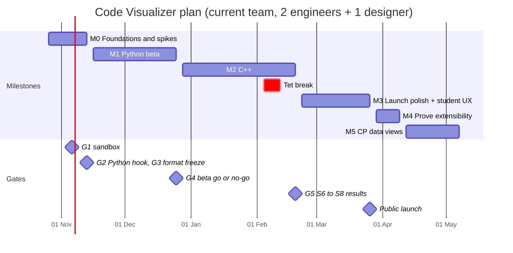

# Code Visualizer — Work Plan (start here)

| | |
|---|---|
| **Based on** | `code-visualizer-spec.md` v1.1 (decisions in §0, milestones in §16, student UX in §19). Every **§** in this file points to the spec. |
| **Team assumed** | 2 engineers + 1 designer (spec §16), split as **BE** (Go, sandbox, tracers), **FE** (React, player), **DS** (designer), and **Lead** (Tu: product and technical decisions) |
| **Start date** | Monday 2026-10-26 |
| **Estimates** | Ideal person-days, including tests. Capacity is planned at **4.5 focus days per person per week**. |
| **Detail level** | M0 and M1 are broken down task by task here. **Per-role plans with M2–M5 broken down:** `workplan-backend.md` and `workplan-frontend.md`. |

## 1. Start here: the first week

Do these in order. The riskiest work (GDB inside the sandbox) starts first, and the trace schema comes early because everything else depends on it.

| # | When | Who | Do | Why first |
|---|---|---|---|---|
| 1 | Mon morning | Lead | Walk the team through spec §0 (decisions) and this plan; import the tasks into the tracker (M0-04); **confirm which MySQL version and hosting we get** (8.4 LTS wanted) | Everyone works from the same baseline |
| 2 | Mon | BE, FE | Repo skeleton (M0-01, M0-02) | Unblocks everything |
| 3 | Mon–Tue | BE | Trace schema (M0-05) | FE needs it for codegen, fixtures and the engine |
| 4 | Mon–Tue | FE | Code pane with CodeMirror 6 (M0-17) | Needs no schema; visible progress on day 2 |
| 5 | Mon–Fri | DS | Design tokens and layout v1.1 (M0-20) | Engineers need the tokens before styling anything |
| 6 | Wed | BE | Wire schema (M0-06), then CI (M0-03) | The tracer prototype writes this format |
| 7 | Wed–Thu | FE | Codegen (M0-07), then fixtures (M0-08) | The player runs on fixtures until the tracers exist |
| 8 | Next Mon | BE | Start the GDB prototype (M0-09) | Highest technical risk; gate G1 depends on it |

## 2. Timeline

| Milestone | Dates | Weeks of work | Exit criteria |
|---|---|---|---|
| **M0** Foundations and spikes | 26 Oct – 13 Nov 2026 | 3 | Spikes S1–S4 reported (S5 may move to M1); trace format frozen; player scrubs a 1,000-step fixture at ≤ 16 ms per step; design handoff for M1 screens |
| **M1** Python beta | 16 Nov – 25 Dec 2026 | **6** (spec said 3; see *Capacity check*) | Internal beta: Python visualizations work end to end on staging |
| **M2** C++ | 28 Dec 2026 – 19 Feb 2027 | **6.5** (+ New Year and Tết; bottom-up for one BE) | C++ traces with STL, pointers, globals frame and compile errors; spikes S6–S7 reported (S8 is done in M1) |
| **M3** Launch polish + student UX | 22 Feb – 26 Mar 2027 | 5 | All P0 items in spec §19.12; load and security tests pass; **public launch** |
| **M4** Prove extensibility | 29 Mar – 9 Apr 2027 | 2 | A third language (C) added without UI changes |
| **M5** CP data views | 12 Apr – 7 May 2027 | 4 | All P1 items in spec §19.12; usability test meets spec §19.11 |

- **Holidays:** about one week off around Tết (6 Feb 2027), plus 1 Jan. Adjust to your company calendar.
- **These dates assume option A** (one backend engineer), using the bottom-up estimates in `workplan-backend.md`.
- **With a second backend engineer from 16 Nov (option B):** M1 takes 3 weeks and M2 4 weeks, and launch moves about **5 weeks earlier, to around 19 Feb 2027** (see *Capacity check*).

## 3. Decision gates

| Gate | Date | Decides | Input | Default if unclear | Owner |
|---|---|---|---|---|---|
| **G1** | Fri 6 Nov | Sandbox: gVisor (D9) or nsjail (D10) | S1 report (M0-10) | gVisor, if GDB works in it | Lead + BE |
| **G2** | Fri 13 Nov | Python hook: `settrace` or `sys.monitoring` (Q4) | S2 (M0-11) | `settrace` | BE |
| **G3** | Fri 13 Nov | Freeze trace format 1.0 + 1.1 optional fields | S4 (M0-12), fixtures | Keyframe every 50 steps, chunks of 250 | Lead |
| **G4** | Fri 25 Dec (or the nearest working day) | Python beta go or no-go; team size for M2–M3 | M1 demo, beta feedback, *Capacity check* | Keep the current team, use the dates in *Timeline* | Lead |
| **G5** | Fri 19 Feb | Safety checks on by default (D21), tree-sitter (D23), big-array tracking | S6–S7 (M2), S8 (M1-F01) | The defaults in spec §0.2 | Lead + BE + FE |

Each gate result goes into the spec's change log (§0.3), even when the default is kept.

## 4. M0: Foundations and spikes (26 Oct – 13 Nov)

### 4.1 Tasks

| ID | Task | Owner | Days | Depends on | Done when | Spec |
|---|---|---|---|---|---|---|
| M0-01 | Go repo skeleton: `cmd/vizd`, `cmd/vizctl`, `internal/*` packages, Makefile targets (`gen`, `test`, `golden-update`) | BE | 0.5 | — | `make test` passes on an empty project | §18.6 |
| M0-02 | Web workspace: pnpm, Vite 8, React 19.3, strict TypeScript, Tailwind v4, Vitest, `packages/player` and `apps/ide` | FE | 0.5 | — | `pnpm test` and `pnpm build` pass | §18.1, §18.6 |
| M0-03 | CI on GitHub Actions: golangci-lint, `go test`, govulncheck; tsc, eslint, vitest; required on pull requests | BE | 1 | M0-01, M0-02 | A pull request shows all checks | §18.2 |
| M0-04 | Import this plan into the tracker; set the Friday demo and gate meetings | Lead | 0.5 | — | Every task has an owner and a due week | — |
| M0-05 | `schema/trace.v1.schema.json`: the §9 format plus the optional v1.1 fields | BE | 2 | M0-01 | Validates every fixture; a test suite with invalid examples | §9, §19.9 |
| M0-06 | `schema/wire.v1.schema.json`: the adapter-to-core messages | BE | 1 | M0-05 | Validates the S1 prototype output | §10.1 |
| M0-07 | Codegen: TypeScript and Go types from the schemas; `make gen`; CI fails on drift | FE | 1 | M0-05 | Generated types compile and CI catches a hand edit | §18.6, D14 |
| M0-08 | Hand-written fixtures: Python aliasing, binary search, DP grid, fib with memo, runtime exception, plus a synthetic 1,000-step trace | FE | 1.5 | M0-05 | All fixtures pass the schema | §5.3, §19.3, §19.4 |
| M0-09 | **S1a**: prototype C++ tracer (GDB Python script) that writes wire NDJSON for 3 programs (loop, recursion, STL) | BE | 2 | M0-06 | Prints valid wire messages for all 3 | §7.11.2 |
| M0-10 | **S1b**: run the prototype under gVisor `runsc` and under nsjail (config C.9); measure `ptrace`, start time and 1,000-step time; write a 1-page report | BE | 2 | M0-09 | Report answers the S1 pass criteria for both sandboxes | §18.7, C.9 |
| M0-11 | **S2**: Python `settrace` vs `sys.monitoring` overhead on a 1,000-step program | BE | 1.5 | — | Numbers and a recommendation | §18.7 |
| M0-12 | **S4**: convert S1 output to the v1 delta format (throwaway script); measure a DFS on a 200k global array | BE | 1.5 | M0-10 | ≤ 2 MB gzip for 1,000 steps, or a proposed fix | §18.7 |
| M0-13 | **S3**: SVG arrow overlay prototype with 500 objects and 30 arrows | FE | 2 | M0-02 | ≤ 16 ms per step on a mid-range laptop | §18.7 |
| M0-14 | **S5** (stretch): long-poll fan-out with the MySQL change poller, 5,000 parked requests per pod | BE | 1.5 | — | A status change reaches the client in ≤ 400 ms p95; memory ≤ 200 MB. If not done, first task of M1. | §18.7 |
| M0-15 | `@viz/player` skeleton: load the trace header and chunks from local files, check sha256 | FE | 1 | M0-07 | Loads every fixture | §8.4 |
| M0-16 | Trace engine in a Web Worker (Comlink): rebuild steps from keyframes and deltas, 200-step LRU | FE | 3 | M0-15 | ≤ 16 ms per step on the 1,000-step fixture; unit tests | §9.6 |
| M0-17 | Code pane: CodeMirror 6 read-only, `▶ ▷ !` gutter, hit-count column | FE | 2 | M0-02 | Renders the binary search fixture as in the §19.3 mock | §19.3 |
| M0-18 | Controls: Start, Prev, Next, End, slider, keyboard shortcuts | FE | 1.5 | M0-16 | All §5.9 shortcuts work | §5.9 |
| M0-19 | Basic state panel: frames as tables, inline values, references as `#id` labels (cards come in M1) | FE | 1 | M0-16 | Every fixture is readable step by step | §5.2 |
| M0-20 | Hi-fi designs: tokens (Okabe–Ito palette, light and dark), layout v1.1, all §5.6 states, array with markers, matrix | DS | 8 | — | Handoff for all M1 screens by 13 Nov | §5, §19 |
| M0-21 | Usability test plan; start recruiting 8 CP students for the M5 test | DS | 2 | — | Plan with the §19.11 tasks; 8 names | §19.11 |
| M0-22 | Run gates G1, G2 and G3; record the results in spec §0.3 | Lead | 1 | M0-10, M0-11, M0-12 | Change-log entries written | §0.3 |

### 4.2 Week by week

| Week | BE | FE | DS | Lead |
|---|---|---|---|---|
| **1** (26–30 Oct) | M0-01, M0-05, M0-06, M0-03 | M0-02, M0-17, M0-07, start M0-08 | M0-20 (tokens, layout v1.1) | Kickoff, M0-04 |
| **2** (2–6 Nov) | M0-09, M0-10 | Finish M0-08, M0-13, M0-15, start M0-16 | M0-20 (states, array, matrix) | **G1** on Fri |
| **3** (9–13 Nov) | M0-11, M0-12, M0-14 (stretch) | Finish M0-16, M0-18, M0-19 | M0-20 handoff, M0-21 | **G2, G3** and M0 demo on Fri |

## 5. M1: Python beta (16 Nov – 25 Dec)

### 5.1 Tasks

| ID | Task | Owner | Days | Depends on | Done when | Spec |
|---|---|---|---|---|---|---|
| M1-01 | `api/openapi.yaml` for the five endpoints; oapi-codegen strict server stubs | BE | 1.5 | M0-07 | Server and TypeScript client generate from one file | §8 |
| M1-02 | Local dev stack: Docker Compose with MySQL 8.4 and SeaweedFS; `vizd --role=all` starts | BE | 1 | M0-01 | One command brings up the whole system | §7.2 |
| M1-03 | Database (MySQL): `traces`, `visualizations`, `usage_daily` and `jobs` tables; goose migrations; sqlc queries; deadlock retry helper | BE | 1.5 | M1-02 | Migrations run up and down; queries are tested | §7.5, §7.13 |
| M1-04 | `tracecore`: validate wire messages, stable IDs, deltas and keyframes, chunking, limits, truncation | BE | 4 | M0-06, G3 | Golden tests on the S1 outputs and fixtures | §10.1, §9 |
| M1-05 | Python tracer `tracer.py`: hook per G2; frames from `main.py` only; stdout tagging; exact `stdinPos`; internal flags; blocked modules; `callId`; line counter and untraced tail after the limit | BE | 4 | G2 | Every Python fixture is reproduced from real code | §7.11.1, §19.9 |
| M1-06 | Python runner image and manifest; `vizctl trace` CLI | BE | 1.5 | M1-04, M1-05 | `vizctl trace --lang python3 main.py` prints a valid trace | §10.2, §7.10 |
| M1-07 | Sandbox adapter chosen at G1 (`runsc` or nsjail), with the §11 limits | BE | 2 | G1 | Fork bomb, network and filesystem tests are blocked | §12, §11 |
| M1-08 | **Job queue on MySQL** (claim with `SKIP LOCKED`, leases, rescuer, cancel, cleanup) and worker (state machine, retry rules, 30 s deadline, janitor, graceful shutdown) | BE | 4.5 | M1-03 | No job lost or run twice when workers are killed at random; all §7.8 failure cases tested | §7.7, §7.8, §7.13.2 |
| M1-09 | API: create (single-flight transaction, quotas, idempotency), get with long-poll (change-poller fan-out), delete; presigned chunk URLs | BE | 3 | M1-01, M1-03 | Contract tests pass for all §8 examples | §8, §7.12 |
| M1-10 | Object storage: put chunks, presign, `t7/` and `t90/` lifecycle rules | BE | 1 | M1-02 | Objects expire per the rules on staging | §7.5 |
| M1-11 | Observability: JSON logs (slog), OpenTelemetry from API to worker, Prometheus metrics (queue wait, build and trace time) | BE | 1 | M1-08 | One request traced end to end in Grafana | §18.2 |
| M1-12 | Staging with OpenTofu: Kubernetes namespace, runner node pool with the G1 sandbox, KEDA MySQL scaler, managed MySQL 8.4 and bucket | BE | 2.5 | M1-07 | Staging autoscales from 1 to 3 runner pods under load | §18.4 |
| M1-13 | IDE: CodeMirror 6 editor, language picker from `GET /languages`, Visualize button and shortcut | FE | 2 | M1-01 | Matches the §5.1 mock | §5.1 |
| M1-14 | API client (openapi-fetch + TanStack Query), long-poll loop, cancel | FE | 1.5 | M1-01 | Survives an API restart mid-poll | §8.3 |
| M1-15 | States: loading progress, build error, runtime error banner, step-limit banner, busy and retry | FE | 2 | M0-20 | Every §5.6 state has a story | §5.6 |
| M1-16 | Heap cards and kind registry (`sequence`, `set`, `mapping`, `record`, `function`, `opaque` fallback) | FE | 3 | M0-19 | Matches the §5.3 mock | §9.5, §7.10 |
| M1-17 | Arrow overlay from S3, with bundling and hover highlight | FE | 2 | M0-13, M1-16 | Meets the S3 numbers in the real UI | §5.9 |
| M1-18 | Narration v0: call, return, value changes, output (subset of §19.5) | FE | 1.5 | M0-16 | Every fixture step has a narration line | §19.5 |
| M1-19 | Storybook on fixtures | FE | 0.5 | M1-16 | Every fixture renders in a story | §15 |
| M1-21 | Hi-fi designs for the P0 student views: big array, index markers, matrix, expected output, friendly errors, Go to… | DS | 6 | — | Matrix, Go to… and compare by **Fri 4 Dec**; the rest before M2 ends | §19 |
| M1-22 | Design QA of the M1 build | DS | 2 | M1-17 | Issues filed and fixed | — |
| M1-23 | Internal beta: invite 10–20 students and teachers; feedback form | Lead | 1 | M1-12 | Feedback collected before G4 | — |

### 5.2 Capacity check

| Milestone | Spec estimate | BE load | FE load | Available per person | Verdict |
|---|---|---|---|---|---|
| M0 | 3 weeks | 13 days | 13.5 days | 13.5 days | Fits, but tight. S5 is the first thing to move. |
| M1 | 3 weeks | **27.5 days** (+2.5 for the MySQL job queue) | 12.5 days (+12.5 pulled forward under A) | 13.5 days (27 over 6 weeks) | **BE is over by about 14 days.** FE fits. |
| M2 | 4 weeks | **29 days** | 17.5 days | 18 days | **BE is over by about 11 days.** FE fits. |
| M3 | 5 weeks | 20.5 days | 21.5 days | 22.5 days | Both fit |

**Recommendation:** pick one before 16 Nov.
- **A: keep the team.** M1 runs 6 weeks and M2 about 6.5 weeks for BE, which is what the *Timeline* shows; launch around 26 Mar 2027. FE uses the spare weeks to pull work forward: spike S8, the matrix view, Go to… and expected-output compare in M1, then M5 views during M2.
- **B: add a backend engineer** (hire or contractor) from 16 Nov. M1 stays at 3 weeks, M2 at 4, and launch moves to around 19 Feb 2027. M2 and M3 are backend-heavy (GDB tracer, safety checks, sparse arrays, gcov), so the extra engineer stays busy through M3.

## 6. M2–M5: epics (to be broken down at G4)

| Milestone | Epic | Owner | Size | Spec |
|---|---|---|---|---|
| **M2** C++ | GDB tracer `trace.py`: frames, globals frame, hiding variables before their declaration, internal flags, return values, signals as error steps | BE | L | §7.11.2 |
| | Type map and pretty printers; pointer following; sparse sequences and dirty-cell diffing | BE | L | §10.3, §19.9.1 |
| | C++ build: forced flushing, two precompiled headers, safety checks, `--coverage`, warnings | BE | M | §7.11.2, §19.6 |
| | **Spikes S6, S7** (BE), then gate G5. S8 is done by FE in M1 week 7 (M1-F01). | BE | M | §18.7 |
| | FE: pointer arrows, C++ value formatters, struct cards, compile-error and warnings panel | FE | M | §5.4, §19.6 |
| **M3** Launch + student UX | BE: friendly-error payloads from sanitizer breakpoints, gcov line hits, untraced tail, share and permalinks, analytics, k6 load test, security tests | BE | L | §19.6, §19.9, §15 |
| | FE: full narration, hit-count gutter, input cursor, friendly-error UI, autoplay, share, WATCH panel, narrow layout, accessibility. Under option A, index markers, big arrays and the matrix view land in M2, and Go to… and compare in M1. | FE | L | §19.3–§19.8 |
| | Accessibility pass, design QA, launch checklist | DS, Lead | M | §5.10, §19.10 |
| **M4** Extensibility | C adapter (reusing C++); conformance suite. The DAP bridge doesn't fit in 2 weeks. | BE | M | §10.4 |
| **M5** CP data views | Call tree, graph and tree views (elkjs), containers, bits, timeline lanes, watch pins, conditional jumps, loop-pass chips, struct table, constant badges | FE (+ BE for `callId` and exact access hints) | L | §19.4–§19.8 |
| | Usability test with 8 CP students; fix the top issues | DS, Lead | M | §19.11 |

Sizes: **S** ≤ 3 days · **M** 4–8 days · **L** 9–15 days.

## 7. Top risks

| # | Risk | Likelihood | Impact | Mitigation | Watch from |
|---|---|---|---|---|---|
| 1 | GDB doesn't work properly under gVisor's partial `ptrace` | Medium | High | S1 in week 2; nsjail (D10) is ready as Plan B | M0-10 |
| 2 | C++ tracing is too slow: GDB step plus pretty printers ≥ 3 s for 1,000 steps | Medium | High | Measure in S1; capture fewer variables per step; batch memory reads (S6) | M0-10 |
| 3 | Backend capacity (*Capacity check*) delays the launch | High | Medium | Decide A or B before 16 Nov | Now |
| 4 | Student-UX scope grows (§19 is large) | Medium | Medium | Only the P0 list goes into M3; everything else waits for M5 | M3 |
| 5 | Big CP arrays make traces too large | Medium | Medium | Sparse sequences and dirty cells; S4 and S6 measure early | M0-12 |
| 6 | nsjail or gVisor needs extra Kubernetes privileges | Medium | Low | A dedicated runner node pool with no secrets (§12) | M1-12 |
| 7 | Holidays (New Year, Tết) cut into M2 | Certain | Low | Already in the dates (*Timeline*); no gate falls in a holiday week | — |
| 8 | Our own MySQL job queue loses or duplicates jobs (River isn't available) | Low | High | Lease checks on every write; property tests that kill workers at random; load test at 2× peak; NATS JetStream adapter as the fallback (spec §7.13.2) | M1-08 |
| 9 | The company's MySQL is older than 8.0 (no `SKIP LOCKED`) | Low | Medium | Confirm the version this week; the 5.7 claim fallback in spec §7.13.2 works at lower throughput | Now |

## 8. Working agreements

- **Fixtures first:** every new view gets a fixture trace and a Storybook story before it's wired to the backend.
- **Definition of done:** code reviewed; unit or golden tests; behind a feature flag until M3; spec section still accurate; demo-able on Friday.
- **Decisions:** changing a locked decision (spec §0) means a change-log entry (§0.3) with the reason and the evidence.
- **Rituals:** a Friday demo every week; gates are held on Fridays (*Decision gates*); the plan is re-estimated at G4.
- **Tracking:** task IDs in this file (M0-01…) are reused as tracker IDs and branch prefixes.
